# Host SBS pipeline

This document is the canonical design and runtime contract for Sunshine 3D's host-side mono-to-SBS
conversion. Host SBS has one geometry implementation: Depth Coordinate V2. An invalid or
unauthenticated V2 frame renders flat SBS; there is no alternate renderer.

Client SBS is a separate Moonlight 3D pipeline and does not share these constants. Offline
conversion uses the same V2 geometry and is described in
[Offline Host 3D conversion](whole-clip-sbs-pipeline.md).

Streamed **Game 3D** receives a [ReShade stereo source](reshade-sbs.md) separately from **Host AI 3D**.
Game 3D starts with normal mono encoding and enters exact full SBS only after source readiness
and a confirmed stream transition. Once packed, its unavailable-source fallback duplicates the
current desktop without resizing the stream. The `sbs_reshade` setting selects this source only
for locally connected AR glasses; streamed Host AI 3D always uses Sunshine's AI pipeline. Sunshine
owns the normal-size virtual display and final presentation or encoding. The ReShade handoff has
its own source, resource and color contract; the V2 contracts below continue to govern
Sunshine-generated geometry.

## Pipeline

Live streaming, offline conversion and estimator evaluation use one adaptive geometry and
subtitle-plane pipeline, including continuous ROI embedding.

```mermaid
flowchart LR
    CAPTURE["Matched source frame"]
    REGION["Chromium video or foreground-client observation"]
    MATCH["Priority and exact matched-frame region selection"]
    DOMAIN["Full frame or exact client/content/video ROI"]
    PREPROCESS["HDR/SDR model preprocessing"]
    DAV2["Authenticated DAV2 Small + frozen ZipDepth convex 2x"]
    CUT["Cut-only evidence and scene epoch"]
    OCR["PP-OCRv6 tiny detector (bottom 960x160)"]
    OCRPLANE["Current OCR8 covers and UIP4 plane publication"]
    CAMERA["Continuous mean zero and robust amplitude"]
    CURVE["Linear relative-depth coordinate"]
    CONTAINER["Independent signed displacement bound"]
    VERTICAL["75/25 vertical envelope share"]
    ROW["Horizontal majorant"]
    PLANE["Native glyph matte and shared UI pin band"]
    INVERSE["At-most-11-step exact-settle inverse"]
    COLOR["One native linear-color sample"]
    ENCODE["Packed SBS and NVENC"]

    CAPTURE --> MATCH --> DOMAIN --> PREPROCESS --> DAV2
    REGION -. optional authority .-> MATCH
    DAV2 --> CUT --> CAMERA
    DAV2 --> CAMERA --> CURVE --> CONTAINER --> VERTICAL --> ROW --> PLANE --> INVERSE
    CAPTURE -. current-ready infer work .-> OCR --> OCRPLANE
    CAPTURE -. authenticated current abstention .-> OCRPLANE
    CUT --> OCRPLANE --> PLANE
    CAPTURE --> COLOR
    INVERSE --> COLOR --> ENCODE
```



The selected production map pins current native glyph contributors to the constant UI plane in
one displacement field, using the same horizontal pin-band implementation as Game 3D. Each draw
rebuilds this field from immutable Base and the retained mask after current-colour revocation.
One inverse samples original native colour; no subtitle background RGB is reconstructed. Empty
rows retain the exact ordinary Base inverse. The pin pass preserves the horizontal slope bound;
it does not promise a vertical bound at UI-row transitions. Nearby scene geometry can deform and
horizontal row transitions can remain visible. Unavailable shared preparation or invalid selected
authority preserves ordinary Base rendering without subtitle displacement. The old selected
analytic renderer and its shader copies have been removed.
Protected Final remains an independently authenticated diagnostic, not this draw's pin field.
Reuse retains Base, ParallaxState, native matte, SCT5, SCP4, joined source snapshot, and diagnostics
as one tuple; the draw-owned pin resources are not a new temporal observation.

## Authenticated production contract

The generated Depth Coordinate contract is the machine-readable authority. The current identity is
schema 130/tag `0x808647CD`, canonical SHA-256
`422cc8622990d4b162c1442af76d89dac3e6f74867f98716d4508dd845ca5691`. It binds the
complete policy below, including all subtitle field/ROI semantics. The generated named closure
groups are the shared C++, Python, JSON, and documentation authority for every ordered shader set
and source pin. The optional `parallax_v2_p010_y` group remains fail-open to the canonical
RGB-to-P010 path; diagnostic groups remain dump-only.

<!-- BEGIN GENERATED HOST SBS SHADER CLOSURES -->
<!-- Generated by tools/sbsbench/generate_host_sbs_shader_manifest.py. -->
| Closure group | Ordered roots | Source-closure SHA-256 |
| --- | ---: | --- |
| `preprocess` | 1 | `943f3295e6cdb490d0833d981b153a5cda9a5153696eb5c9ca0042e474d8d744` |
| `parallax_v2_producer` | 29 | `5b1fed0051487dd4aedebb84b2d6558e4cd3a281152ecb40a7205da54aae30c8` |
| `parallax_v2_coordinate_diagnostic` | 1 | `50c712473211a3b66638fb0bcf89938cb46f2501126bee79cca8e352243ca53a` |
| `near_identical_detector` | 4 | `9272bf6f9d293e556dbc38a9d48a74d5c70090af390836e150d0d6bd8c46a670` |
| `gpu_trace` | 1 | `2c442b910b839fe7daf0c073d157c36258cd5b2f264c9d901187d83752f2b7c1` |
| `parallax_v2_live_renderer` | 2 | `789f70fdf7cf10bf2d2ae804660501ac7cc192ad77b3433ea7d8ea3ebcae16ab` |
| `parallax_v2_p010_y` | 1 | `eddb386114337759c39e16719d830865e836a36a9e2e6a37d0536e03f199c5a2` |
| `sbs_flat_fallback` | 2 | `7e45f7ca78b170c2d6c33ab5c5e20d9f45cece71a5c84e6e7fc4f0f42cfde8d4` |
| `parallax_v2_live_diagnostic` | 2 | `a8f85ccd4b688fc8f2a2e543ec925dedadd137fd1f598664c79304623bad0ca0` |
| `subtitle_cohort_prototype_research` | 3 | `44351fca99d62906c3f62de401c09738d2eb68334b8b59bacd321bce8ab803a5` |
| `subtitle_cohort_research` | 4 | `7e6519ea8c3c61050dbfcfbe23d7e550719f1ec1087ce55db6c12d826c6a3143` |
| `subtitle_inner_colour_research` | 5 | `cc67e16109eef4fcc424d59ba9e2083b72aa00f7495fbdc31069697fb1b6525f` |
| `subtitle_inner_components_research` | 6 | `7e2f44690d64cebe3261133a3642fa558c8c25c7086bf19551f284a4cb13ebe0` |
| `subtitle_matte_guard_research` | 1 | `1608a1bb4b02713322f465985d2eb157c5d95998374fe616354a0ef457ca1cda` |
| `parallax_v2_queued_renderer` | 1 | `bcf11893dddc8558067a2a0fbc2e8d0e1c608c52cba2bb9d1f00c5a2bda11713` |
| `current_mask_holes` | 9 | `b4e48d5eecab2404951602ad649980001f21cf5f9768381acadc7c3973ef4668` |
| `current_stroke_coverage` | 3 | `1f03ba4279f6cadbaddf56b408cf20c0bc37776c4971e8e25830a8ffd3a3d063` |
| `current_foreground_edge` | 1 | `4c8750b262827356b47a691aafe4cc306e541b691709060d979252635e73436c` |
| `current_trusted_inner` | 1 | `86c990d49f0946e1d79730c42f629ef89076cb95b552225847671d0ef5ac47e7` |
<!-- END GENERATED HOST SBS SHADER CLOSURES -->

The contract admits the following production calibration:

| Property | Production value |
|---|---|
| Calibrated depth estimator | Depth Anything V2 Small FP16 |
| Calibrated model key | `depth_anything_v2_fp16` |
| Production composite | `prod_dav2_zipdepth_c2x_high_opset18` |
| Internal DAV2 shapes | 12 landscape shapes and their portrait transposes in [Authenticated resolution fitting](#authenticated-resolution-fitting) |
| Fused public/analysis/live shapes | Exactly twice each internal width and height |
| Raw coordinate scale | `2.25` DAV2 units |
| Gain per pop unit | `0.00375` source U |
| Direct parallax container | `0.04` source U per eye |
| Maximum horizontal slope | `0.5` |
| Maximum vertical shear | `2.0` |
| Vertical upper-envelope share | `0.75` |
| Convergence translation | exactly `0` |

The embedded DAV2 bytes and calibration, composite ONNX bytes, ZipDepth checkpoint, engine recipe,
preprocessing profile and shader closure, internal/public tensor relation, ordered producer closure,
state checksum, and renderer closure must also authenticate. The fused engine has one FP32 high-grid
input and one FP32 high-grid output; FP32 `2x2` average pooling supplies the internal DAV2 input and
the coarse DAV2 output never crosses the engine boundary. The same high output owns normalization,
temporal history, scene-cut evidence, camera state, geometry conditioning, and publication. Live
Host SBS using Sunshine depth, production Web UI conversion, and the maintained benchmark harness require this pinned
composite. A missing, non-regular, unreadable, or hash-mismatched asset fails flat; no raw DAV2
runtime is selected. There is no supported Host SBS model selector.

### Adaptive geometry and subtitle plane

The adaptive policy is the sole production Host SBS pipeline. There is no geometry experiment
switch, scene-latched camera, nonlinear depth curve, or alternative subtitle plane. The serialized
`joint_plane_mode` word retains the fixed value `3` as an authenticated policy identifier; it is
not a configuration selector. Other values fail closed. Game 3D keeps its native depth policy.

The pipeline uses a Host-specific relative-depth adapter. Every finite real-content DAV2 value,
including edge foreground and signed values, contributes to the arithmetic mean and ordinary
min/max/variance statistics. A GPU histogram uses 256 bins over that same finite raw range;
P05 is the lower edge of its crossing bin and P95 is the upper edge of its crossing bin. These are
bounded-resolution histogram estimates, not exact sorted percentiles. Histogram population must
equal the valid real-content population. Empty, nonfinite, collapsed, malformed or incomplete
statistics render the current frame flat while an established camera holds; unavailable percentile
authority is canonical zero and cannot be replaced with extrema.

The producer shares the raw-depth/exclusion traversal with the private cut-normalization histogram.
The two populations remain independent: geometry uses the signed finite FrameStats range and
P05/P95 bounds above; normalization retains its nonnegative validity, unsigned float-bit extrema
(including signed zero), P02/P98 policy, and its existing floored-range bin arithmetic. Each group
overwrites both sets of partial bins. The existing quantile resolve publishes the geometry tail
and overwrites the normalization histogram before the unchanged range EMA consumes it. The
separate normalization-histogram traversal is retired. Sharing the scan does not merge statistical
authority, change the scene detector, or normalize geometry into `[0,1]`.

The continuously observed targets are `zero_target = mean(raw)` and
`D_target = max((P95-P05)/2, raw_coordinate_scale)`, where the authenticated model's
`raw_coordinate_scale` is currently `2.25`. The inverse-scale target is `k_target = 1/D_target`.
The floor is the existing model-specific artistic amplitude reference, not a measured noise floor
or a conversion to physical inverse distance. It prevents tiny positive contrast from automatically
earning full stereo strength. No normalized `[0,1]` depth texture is needed. This adapter does not
establish a universal physical calibration between DAV2 values and Game 3D device/camera depth.

The first valid source-time observation initializes zero and inverse scale immediately. Later
fresh valid observations use `alpha=1-exp(-dt/0.5)` and
`k_new=k*exp(clamp(alpha*(log(k_target)-log(k)), -log(2)*dt, +log(2)*dt))`, followed by
`zero += clamp(alpha*(zero_target-zero), -dt/k_new, +dt/k_new)`.
Thus inverse scale can double/halve once per second and zero's rate is bounded in normalized-depth
units. The sealed 64-bit source clock is in microseconds. Zero, repeated or regressed clocks cannot
authorize adaptation; the first valid observation after interruption or a gap over 250 ms rearms
without spending the missing interval. A confirmed cut remains authenticated detector/ownership
metadata and does not reset or disarm the adaptive geometry controller. A true input-domain reset
reinitializes the complete 28-word state to its sealed initial values. Authenticated reuse freezes
the complete depth/OCR/UI/final tuple and
controller state, so a static input can pause unfinished adaptation.

The shader names this zero/scale/clock payload `V2AdaptiveCameraState`. Its four integer vectors
and historical state-tail wire names retain their existing layout and checksum order. Requested
pop gain remains stream configuration; there is no quality-responsive gain controller.

Gain, depth mapping and the display guard remain separate. The coordinate is
`u=(raw-zero)*k`, and the producer maps it directly:

```text
requested_gain = 0.00375 * pop_strength
candidate      = clamp(requested_gain * u, -0.04, +0.04)
```

The coordinate map has no depth curve or soft envelope. The signed hard bound is a representation guard,
independent of requested gain; it does not turn small raw-depth contrast into full disparity.
The native 75/25 vertical envelope and row majorant still condition that candidate. At fixed
gain and divisor, two unsaturated pre-limiter samples have separation
`requested_gain*(raw_a-raw_b)/D`, independent of the zero. Moving zero therefore shifts their
pre-limiter placement together. Hard saturation can clip that separation, and the spatial
limiters can alter local relief. Adaptive changes to D still change strength. The fixed floor
intentionally breaks multiplicative affine invariance when active; filtering raw zero/scale state
also does not cancel arbitrary independently changing per-frame model gauges. Composition changes,
temporal pumping and foreground relief still require paired evaluation and physical live inspection.

The subtitle path transfers Game 3D's UI mask/protection/plane ideas using Host's current OCR8
cores and paired coarse covers to bound native current pixel evidence. It does not add a logo detector.
Exact current OCR authority remains required; no separate cover ownership qualification remains.
The controller probes immutable post-limit Base over the union of all current covers, deduplicating
overlaps and including edge covers. The applied goal searches in steps of one per-eye analysis-source
pixel through the full `0.04` representation bound; the final candidate is exactly `0.04`.
The serialized diagnostic index retains its four-pixel scale: it is the ceiling of the internal
one-pixel index divided by four. The existing UIP4 layout and coarse-index validators remain valid.
A Base sample conflicts above candidate minus two per-eye analysis-source pixels. Entry uses
more than 20% of covered cells or 2% of content cells. Under
`current-clearance-goal-first-visible-immediate-symmetric-source-time-exponential-native-slew-empty-reset-v3`,
this current histogram candidate is a clearance **goal**, not an instantaneous presentation floor.
First visible entry after an authoritative empty or domain/cut reset uses that goal immediately;
current glyph protection and empty clearing have no confirmation wait. During continued presence,
both directions use `alpha = 1-exp(-min(source_dt,50ms)/100ms)` and clamp each update to
`30 native pixels/second * min(source_dt,50ms)`. No post-filter floor restores the forward snap.
The former 15%/1.5% release budget is retired. A changing subtitle alone does not reset presentation.
Duplicate observations and reuse spend no time; missing/invalid clocks, invalid probes or interrupted
geometry/OCR authority disarm timing. A continuing cue's first ready observation only rearms its
clock, while an authoritative empty clears its hidden plane immediately. A shrinking representation
budget still clamps immediately to remain in range; first entry, reset, empty and that clamp are
explicit exceptions to slew. These response parameters are not an XR comfort qualification.

The goal is the existing histogram entry-budget candidate, not the maximum Base value over the
scene or an all-glyph clearance requirement. It permits the same conflict budgets as before.
The finer internal search changes the authenticated producer implementation digest. The public
schema/tag and timing policy remain unchanged: no state layout, units, clearance budget or
clock interpretation changes, and captured state is not retagged.
An authenticated capped-conflict flag records that even the top candidate cannot satisfy those
budgets. Presentation can temporarily remain below a rising goal, so its current conflict budget
can exceed 20%/2% during that transition. The goal, representation cap and subsequent shared limits do not guarantee no crossing,
complete glyph clearance or comfortable presentation when scene content consumes the same guard.

Within the resolve group, a publication barrier precedes a shared-memory snapshot of those current
covers, and a group barrier precedes the probe. This scratch is neither retained cover authority
nor a new observation. Each lane keeps its original `lane + 256*k` row-major cell visits through
add/carry coordinates, including partial rows; overlap deduplication and conflict budgets are
unchanged.

Current covers bound the native detector. A covered source pixel with valid current RGB and
probability evidence supplies immediate binary support and an extension center when current
palette/stroke or local dark-outline evidence passes the rule below. RGB confirmation
counts remain diagnostic apart from positive-count duplicate admission; support does not wait for four.
The diagnostic mask described below blends immutable Base toward the filtered UI plane before shared
slope conditioning. No subtitle birth mixing or per-pixel fade is added. The diagnostic Final field may differ
from the plane after that conditioning; the current cover is not a hard rectangular depth pin.
Domain changes and confirmed cuts reset UI filter memory. A valid genuinely newer empty OCR
observation also clears the invisible applied plane, current entry requirement and probe counters,
while retaining its accepted source clock. The next cue therefore starts from its own current floor.
Missing current coverage means exact Base over real content. Reuse freezes the complete UI history;
invalid OCR/time cannot advance backward adaptation or invent a valid empty reset. UI probing and time advance also require the complete
sealed ParallaxState at `t0` to authorize the same source observation and CutBridge epoch. Missing,
stale, collapsed or invalid depth holds the UI plane and goal, clears dwell and the accepted clock,
and copies Base. The next valid observation rearms without spending time from that gap.
Current OCR publication can continue independently during that interval. UIP4 retains the same
16-word adaptive tail after its 24-word current-publication header; every current cover uses this
same controller. A coarse cover can still miss part of
a glyph, flatten enclosed scene pixels, or condition adjacent content. A full guard is not a comfort
qualification. Include static-after-birth and partial-coverage cases in live inspection.

For an exact authorized ROI, ordinary Base uses the continuous full-capture inverse.
DAV2 still analyzes only the authorized video/client rectangle. The renderer embeds Base
into full-source coordinates and extends each signed boundary value through the
existing slope-limited exterior collar. The field reaches zero beyond that collar; nearby browser
pixels may move smoothly. The ROI interior is not tapered merely because it approaches an edge.
Both eyes sample the original full matched capture once, preserving source V. There is no separate
browser visibility plane, rim detector, ownership selector or repeated-column fill.

Foreground can still project beyond the original video rectangle. This continuous warp trades some
nearby browser deformation for a smooth transition. It does not reconstruct video content beyond
the original crop or recover the silhouette of an already-cropped object. A cropped foreground can
still have conflicting framing cues; neither continuous depth nor a smoother browser sample proves
comfortable out-of-screen projection. The [dump map contract](../tools/sbsbench/DUMP_FORMAT.md#analysis-domains-and-window-provenance)
records source coordinates and their finite-source boundary mask, with shared-warp draw evidence
identified separately from the retained analytic diagnostic map.

The canonical current pipeline retains the existing limiter, joined depth/OCR observation and
atomic publication. A policy change must be evaluated with exact source clocks, authenticated
models and per-leg provenance. Retired versions remain in Git for historical comparisons.
## Color and HDR

Remote-session [stream gamma](stream-gamma.md) is applied only in the final encoder conversion.
It leaves the native warp and Host AI model preprocessing unchanged; its owning document defines
the curve, reference white, live acknowledgement, and optional luma-MRT selection.

The model and the rendered color have different color requirements:

- BGRA8 SDR capture is interpreted as display-referred sRGB for model preprocessing.
- FP16 scRGB HDR capture remains linear Rec.709/scRGB for rendering. The inference copy applies a
  luminance-preserving absolute tone map and the sRGB transfer needed by DAV2; it does not clamp
  highlights to `1.0` before inference.
- The stereo warp applies no transfer function, gamut conversion, sharpening, or post-warp blur.
  Each eye takes one sample from the original source texture in its native linear or encoded domain.
- The encoder conversion stage produces SDR YUV or Rec.2100 PQ and carries the validated HDR
  metadata. On the live native-encoder path, an authenticated FP16-to-HDR-P010 encode may use an
  optional MRT that writes the packed FP16 warp and its bit-equivalent P010 luma together; the
  chroma pass reads that exact packed intermediate. Its left-sited 4:2:0 filter converts each of
  six source texels into the target transfer/gamut before applying horizontal `[1,2,1]/4` and
  vertical `[1,1]/2` weights. Hardware bilinear sampling of linear light before PQ/OETF would
  change chroma at brightness and color edges. Every horizontal footprint clamps to its own eye,
  and packed width is divisible by four so no chroma cell serves both eyes. This final pass is
  always 1:1 with the packed intermediate; any source resizing already happened in the warp, or,
  for Game 3D eyes authored at another size, in a resample pass that reads each output eye only
  from its own source half.
  Ordinary unrotated 1:1 host video, including input to Client SBS, uses the same texel-conversion
  filter with whole-texture clamping. Generic 2D scaling or Windows rotation retains its existing
  sampled-source conversion; those paths are outside this exact-raster filtering contract.
  Dump 3D, local RGB,
  offline conversion/evaluation, SDR, flat, and unavailable-MRT cases retain the canonical separate
  warp/Y/UV path. Host SBS does not independently reinterpret the stream's color metadata.

Tone-mapped debug PNGs are viewing aids, not numeric HDR evidence. Use the floating-point dump
artifacts and manifest color fields when auditing the pipeline.

## Adaptive camera and raw coordinate

The [adaptive geometry policy](#adaptive-geometry-and-subtitle-plane) owns zero, amplitude and
source-time filtering. This section describes their shared statistics and analysis domain.

For each finite public high-resolution depth field, the producer calculates exact extrema,
arithmetic mean, and population standard deviation on the fused composite's single grid. Standard
deviation is validity evidence only. A field with
`sigma <= 1e-6` is collapsed and cannot produce current-frame geometry.

The same GPU traversal also produces the raw normalization reduction consumed by the percentile
histogram and temporal range scaler. V2 moments continue to admit every finite value, including a
finite negative value, while normalization separately counts only finite values greater than or
equal to zero. Its min/max remain the exact unsigned float-bit reduction used by the prior dedicated
pass, including its signed-zero behavior. A negative or non-finite admitted texel therefore
invalidates normalization without changing V2's finite-value moment semantics. The one-thread frame
resolve writes both records before normalization continues; there is no second full-tensor min/max
traversal.

The first valid observation initializes the zero plane to the arithmetic mean and the amplitude
to its robust model-prior-bounded spread. Subsequent genuine source-time observations adapt both
continuously; confirmed cuts retain the geometry controller. Occupancy-weighted mean statistics
include peripheral foreground without selecting a preferred central object.
For an authorized window-region ROI, extrema, mean, standard deviation, cut evidence, and all depth
histories are computed from the cropped analysis domain only. Pixels outside the selected Chromium
video or foreground-client content source do not pull its zero-plane observation. Entering or leaving ROI
analysis, changing its authority kind, identity or dimensions, or changing its input transfer
domain resets the temporal and adaptive-camera state before the new domain is used. Chromium-video and foreground-client
authority are distinct even if their rectangles happen to match. Translating the same ROI without
changing its dimensions is not a new analysis domain, so an ordinary window move does not by itself
reacquire the camera.

### Native subtitle contours and UI plane

Live streaming and conversion use `host_sbs_shared_ui_warp.hlsl` and its queued wrapper. Their seven common
operands are rendered native color, ordinary Base, ParallaxState, the selected native `R32_UINT`
matte, joined display-sRGB `RGBA16F` source crop, six-word SCP4, and 32-word SCT5. A 64-word selected
receipt at t7 authenticates the current-outline mask. The unused render-only legacy mask at t8
is removed; mask construction and its internal fallbacks retain their own inputs. Separate 32-byte PS b3 binds
enabled/color mode, exact analysis-domain generation, and the integer analysis-source rectangle
inside rendered color. Existing 48-byte b2 geometry is unchanged.
Missing or invalid subtitle inputs preserve authorized Base; invalid Base authorization retains
the existing flat fallback. Shared preparation adds a native full-width subtitle band, authorised
weights, row/header storage and draw geometry. These resources belong to the current immutable
draw only, are unbound between compute and sampling, and are rebuilt before reuse. The queued
wrapper retains the exact-source GPU guard independently of subtitle authorisation.
`src/host_sbs_shared_ui_warp_runtime.h` owns the ordered completed/queued production and diagnostic
shader specifications. The depth-contract generator checks both source-closure pins, including
the common pin owner. All six source specifications must authenticate, but ordinary completed
programs prepare independently; queued programs prepare only when that route is explicitly
requested. A queued compile or device-creation failure preserves completed handles and readiness,
while a missing queued program still disables that route. This changes no estimator state schema
or calibration.

Field construction uses explicit FP32 interpolation of Base, including the existing continuous
ROI embedding. Hardware-filtered coarse-to-native construction is not equivalent: quantised
filter fractions can exceed the horizontal slope bound. The common owner
`include/ui_pin_band_shared.hlsl` pins surviving native contributors and a one-pixel horizontal
collar, then spreads the bounded transition through each affected row. The field uses native
pixel centres and the existing ROI width conversion for SCP4. Both positive vertical bilinear
contributors are considered when choosing between a pin row and the exact Base inverse.
The inverse retains the at-most-eleven-step, exact-bit-settle rule and original SDR/HDR sample.
No generated outline, new matte support, RGB erasure or RGB reconstruction is introduced.

This changes the tradeoff around incomplete masks: original strokes and their surroundings move
together, avoiding the former repaired-background tears, while scene edges near subtitles can
bend. UI-row boundaries do not retain Base's two-axis smoothness guarantee. The measured comparison
and the explicit adoption decision are recorded in the
[review follow-up](host-sbs-review-followups.md#p15-production-shared-ui-warp).

The original dense matte remains an independently validated mask-construction fallback and
diagnostic. It is not a render fallback and ordinary evaluator images use only Base.
It has its own schema 1 recipe, separate from SCT5's diagnostic contour recipe 27. Starting
from literal current native support, three synchronous eight-neighbor steps admit finite valid
joined RGB only when neighbor L-infinity distance is at most `0.12` and both pixels have the same
`max(RGB) >= 0.4` brightness class. A same-frame native collar then takes the 37 offsets with
`abs(dx),abs(dy) <= 3` and `dx*dx + dy*dy <= 10`. Each output pixel still requires a finite valid
joined display pixel. The operation adds no probability threshold, field-pitch dilation, history
wait, or source observation. The collar is a bounded antialias/outline completion compromise;
false positive scene support can also expand by that bound.

Ordinary live, queued, P010 and diagnostic renderers use the authenticated Base inverse directly.
They contain no analytic subtitle branch and consume no legacy t8 mask. Shared preparation or
selected-mask validation failure disables subtitle permission while preserving usable Base depth;
it does not invoke an older subtitle warp. The independent flat renderer remains for invalid or
unavailable depth. Valid shared rendering retains current-texel RGB revocation and its existing
selected receipt, SCT5, SCP4 and source authorization.

The removed analytic selector and RGB-repair experiments remain documented in the
[historical review](host-sbs-review-followups.md#p15-production-shared-ui-warp).

SCT5 must bind the retained state's owner observation clock and cut epoch, the b3 analysis
generation, exact source/crop/field/content shape and current recipe, with valid bits exactly one
and reserved words zero. SCP4 must match current count/kinds/fully-active target. A reused color
publication B can retain depth/matte owner A; B's completed-frame identifier never relabels A's
owner or becomes an equality requirement. Current color can revoke old matte only when a draw
actually runs. Repeating packed output runs no new gate. Preserve the bounded matched-color
presentation deadline and exact-unchanged indefinite reuse; add no frame delay or dwell. New empty
OCR publishes zero matte and inactive zero-target SCP4 atomically, immediately selecting Base.
Temporary work suppression and ineligible context disable the compositor for that draw.

The following contour/D/M/proposal/conditioned-Final rules remain independently validated diagnostics.
They explain the old field conditioner; their field pins and distance budgets do not supply live
matte membership, and protected Final is not the production renderer's warp input.


Live subtitle detection and protection run only in Host AI 3D with authenticated video context.
The Chromium helper must supply current positive semantic video evidence, including its distinct
fullscreen result; a generic foreground depth ROI or fullscreen geometry alone grants nothing.
For native players, the current causal foreground process must match the full executable path of
a Windows `Software\Clients\Media` registration with a video file-association capability. A bounded
background registry census supplies this application classification without a player-name list.
It proves a registered video-player application, not that media is loaded or playing; an empty or
audio-only window in that application remains eligible. Players without qualifying registration,
including unregistered portable installations, and unavailable evidence fail closed. Game 3D does
not use this detector or protection path.

The live subtitle-context generation is independent of the depth analysis domain. Context loss or
identity change revokes pending completions, retained analysis lineage and packed output, including
full-source output. Sampling continues while inference is busy, so leaving video and returning to
the same window cannot revive an earlier conditioned frame. Semantic identity uses context kind,
root HWND and process, plus the browser document/video identity for Chromium. Causal geometry runs
and their foreground/browser epochs remain independently authenticated per matched frame. A
causally admitted geometry update alone does not change semantic subtitle identity; unavailable or
noncausal authority still revokes eligibility outside the native modal suppression route.
During native interactive move/size, a newly revalidated root HWND/process can retain an already
admitted semantic context for suppression without carrying a monitor, rectangle or geometry
generation. Native-player retention still requires current registry membership. Chromium retention
requires a fresh positive helper heartbeat for the same root/process/document/video; its rectangle
and geometry-authority epoch are not used as current geometry or as substitutes for heartbeat
freshness. Missing, stale or replaced evidence selects hard disable, and a
disabled context cannot become eligible while the modal loop remains active. This does not waive
the existing history reset on a real ROI/full-source or resized analysis-domain transition.
Packed output that used an ROI or enabled subtitle treatment retains its foreground, region,
browser and modal authority separately from semantic identity. A change revokes those positioned
pixels even for full-capture depth or an unchanged source timestamp; full-source Base-only packed
output retains its ordinary presentation-continuity policy.
The next admitted context generation
clears OCR/UI-plane/contour history and forces a fresh observation. At the existing ordered reset
boundary, the current-outline owner also revokes strong calibration and AA history permissions,
including duplicate-match plans. Allocations, pixels and clock high-water marks remain retained.
Revocation therefore applies even when the depth domain, cut epoch or source clock is unchanged,
or the accepted work mode suppresses the optional subtitle observation. Stale observations cannot
reacquire old permissions or roll back that high-water mark.
The context transition does not itself reset
depth, scene-cut or camera state. A real depth-domain transition retains its existing broader reset.
Explicit offline video consumers keep their default eligible request with context generation zero;
their evaluator identity and epoch behavior are unchanged.

The adaptive UI controller samples Base under the current authenticated OCR covers. Those covers
bound the contour search. Native pixels that pass the current palette/stroke or local-outline
evidence rule supply current subtitle footprints immediately. A minimum slope-budget extension
changes Base only where required by those footprints and the UI plane.
Current-cover authentication remains independent of UI-plane filtering. The native contour recipe is
experimental and still requires paired quality and live acceptance before release.

The subtitle route uses one PP-OCRv6 tiny text detector followed by a GPU subtitle classifier,
then OCR8/UIP4 publication. It does not run text recognition, language classification, or logo recognition. For an authenticated
current-ready subtitle request in any of the six calibrated landscape/portrait logical fields, or
their six exact-2x fused public fields, the GPU takes the exact
bottom `6:1` analysis-source crop, resizes it to
`960x160`, converts BGR through the pinned ImageNet normalization, and runs the authenticated
`ppocrv6_tiny_det_modelopt_fp16` TensorRT 11 strong-typed mixed-FP16 engine with FP32 I/O
(`trt-strong-modelopt045-fp16-iofp32-tf32-fixed960x160-level5-v2`). The bundled artifact is
`models/ppocrv6_tiny_det_modelopt045_mixed_fp16_fp32io.onnx`, SHA-256
`169a233ba0ff7cac27f8ec7dccb6a406e614b25b21fe6a5638c423bf2118bb44`. It is derived by
NVIDIA ModelOpt `0.45.0` using
`nvidia-modelopt-autocast-fp16-keep-io-fp32-v1` and calibration profile
`apollo-live8-bottom960x160-v1` from the pinned upstream FP32 ONNX, SHA-256
`193bab7a04fca699a6c82e6abb5b81bdb28177f0abd4062552b04908dafb19f8`. The contract
authenticates the bundled artifact and upstream source independently. The detector's
`1x1x160x960` FP32 probability map is reduced on the GPU to bounded line boxes. Only authenticated
current covers authorize the native search; intermediate cells and probabilities alone cannot
grant cover or geometry authority. Within that search, current probability selects palette anchors;
current native RGB stroke/outline evidence selects pixels under the rule below.

#### Subtitle classification before protection

OCR38 classifies local text lines before publishing current covers. A global active row is only
a discovery aid: each contiguous active column island is rescanned for its own active row runs.
Each local piece recomputes its actual occupied columns. This prevents disconnected printed rows
from borrowing another column's activity and merging with a caption before eligibility is checked.
Ordinary pieces join against a fixed vertical anchor with the existing half-IoU and four-cell
horizontal-gap rules. A smaller fully contained unknown piece can attach to an independently
horizontal current line, including leading punctuation. Oblique scene pieces cannot attach through
that exception. Center eligibility still uses the bounded native horizontal union before capacity
selection; each accepted pair retains its own core and expanded cover.

The classifier divides a local line into eight horizontal bins and measures the nearest-rank
10th and 90th active-pixel row quantiles. A least-squares fit in native source units estimates both
envelope slopes. Six populated bins and both absolute slopes within `tan(2 degrees)` supply
independent horizontal evidence. Consistent same-sign slopes beyond `tan(10 degrees)` supply
scene-text rejection. Other shapes are ambiguous or unknown. Every topology kind, including
ribbons, passes classification. These experimental bounds are geometric hypotheses, not a
semantic guarantee; square, short, curved, blurred or deliberately angled captions need particular
recall inspection. Missing geometry is not itself proof of scene text.

The orientation verdict uses fitted slopes, rather than requiring each envelope bin to lie on a
straight baseline. Curved scene geometry can therefore have horizontal fitted slopes and pass the
current centering checks. The learned position prior assists uncertain geometry; it does not veto
an independently horizontal detection. Conversely, ink quantiles vary with glyph shape, so a
half-detector-row straightness test is not a justified baseline-error bound for real captions.

An ambiguous line with one envelope within the horizontal bound and the other within the scene
angle bound can receive current stack assistance. It must be individually centered and bracketed
above and below by independently horizontal, individually centered current lines. Each anchor
must overlap its horizontal span, have a compatible height under the existing one-half to twice
height bounds, and be separated by no more than the larger of the two line heights. Assisted
lines retain their own core and cover, do not become independent horizontal evidence, cannot
anchor another assisted line, and do not teach position history. This handles character-shape
variation in a middle caption without promoting every one-flat-envelope logo or scene-text piece.
Assembly preserves the original per-band raster ordering in a single bounded current-candidate
pool; stack assistance and publication wait only for that same observation's discovery to finish.
They add no observation-count or source-time delay.

An unknown piece can use a compatible independently horizontal current line. Ambiguous/unknown
current text can also use a qualified learned position with compatible line height. Ambiguous
text must also have both envelope slopes within the scene-angle bound, and either one horizontal
envelope or coherent same-direction moderate slopes. A learned location cannot override diverging
non-horizontal edges or excessive current tilt. A group relying only on the learned prior must also
contain the current signed subtitle reference center in its half-open horizontal span. Nearby
off-axis fragments cannot borrow history as current line evidence. Every ordinary tight line group
must now span that same reference center before admission, including independently horizontal lines,
current bracketed-stack witnesses, and uncertain pieces on a current horizontal line. This check uses
the current tight group union; expanded covers and protection margins cannot supply the missing span.
Each current group midpoint must also lie within two percent of the matched reference width
from its center. The earlier ten-percent allowance admitted off-center scene detections whose
combined span crossed the center. Grouping still permits the existing four-height word gap;
individual members may lie off center when their actual current group satisfies both checks.
This position prior does not establish glyph membership or pixel stability. Full-width ribbons
retain their separate extent policy and are exempt from this ordinary-group span check; their existing
orientation and centered-line checks still apply. This adds no frame wait or temporal evidence.
The prior-only span rule remains explicit and unchanged. The separate unknown short-glyph path
still needs its applicable current group or prior evidence. The prior has
16 detector-relative baseline bins, bound to the exact source/crop/field/content/reference domain.
It never supplies a cover or a pixel by itself. Independently horizontal **retained** pairs teach
the prior only on their first trusted entry or after an authoritative blank interval of at least
100 ms of source time. Each learning episode decays bin votes by one, adds four to its trusted
positions, and saturates at 255. Assistance requires eight votes and a current height between
one half and twice the trusted height. Static frames and duplicate observations add no votes;
assisted candidates do not teach. Direct cue replacements without a blank may undercount learning
conservatively. The 100 ms rule controls learning only and adds no protection delay.
The episode boundary currently uses an empty complete classified result, rather than a separate
content-change history for each line. A retained false scene-text pair can therefore prevent
blank-based learning for a real caption; the prior is not guaranteed to qualify after three cue
changes. Nearly horizontal photographed-page text can also pass current geometry and teach it.

Strong current evidence can enter at a new position immediately. An empty current classified result
publishes zero covers and clears support immediately while preserving only layout memory. Scene
cuts retain this layout prior; context/domain/geometry changes or an invalid source clock clear it.
Reuse holds the complete record without learning. No text/background motion tracker or new model
is introduced in this revision. Screen-fixed physical text in a plausible caption position can
remain ambiguous, and first-entry unknown short captions may be missed.

Discovery uses one fixed per-estimator 190,080-byte GPU scratch buffer: 1,980 entries of 24 words.
The capacity follows from at most 60 disjoint column islands and 33 independently valid local row
pieces per island within the 131 safe rows. Scratch is not retained or read back. OCR8 keeps its
208-word current header/core/cover prefix and appends 48 words of separately validated classifier
history, for 256 words total and record schema 4. Resolve constants retain their original 80-byte
prefix and append the source clock, domain-reset flag and reserved zero, for 96 bytes. The history
tail binds frame, generation, clock, all source/field/content/reference geometry, episode state,
trusted span/height and 16 bounded vote counters. Abstention clears the tail. Its presence never
changes current slot count or grants geometry authority to an old observation.

When the authenticated detector is available, OCR is an optional child inside the same joined
publication unit as DAV2. After private warmup/capture, DAV2 and OCR are sibling conditional children
of one CUDA root and share one completion event after every interop-unmap tail. The authenticated
subtitle work value is `1` for current-ready OCR, `2` for current ineligible abstention, or `0` for
native USER32 suppression or hard context disable. Both ordinary dispositions publish only on valid
inference; abstention keeps the optional OCR handle and `OOCR` marker zero. Neither work-`0` mode
advances OCR8 or UIP4. Temporary suppression freezes same-context subtitle memory; hard disable
also clears it on the admitted context transition.

Detector startup or pre-admission interop-resource unavailability selects ordinary current
abstention rather than a terminal depth-producer failure. The resolve identity constants and
inactive subtitle publication resources exist independently of the optional detector's working
probability map. Unsupported
caption-reference geometry cannot admit an optional OCR child; an abstention grants no classifier
reference, cover, UI plane or mask authority.

An ordinary ineligible observation retains exact frame, analysis generation, source time,
source/field extent, content rectangle and attempted OCR ROI metadata in inactive UIP4 even when
the bottom crop cannot project to distinct safe field rows. For that unprojectable crop,
current-valid flags, covers, warmup, pixel-reset cues and the UI controller tail remain zero,
and SCP4 is freshly inactive. This
authenticates the current abstention without granting subtitle geometry or protection; Final is
exact Base. A malformed source/field policy cannot acquire this identity publication.

Every reuse leaves OCR crop/TensorRT/postprocess/plane/condition work dormant and holds the complete
depth/cut/camera/OCR8/UIP4/contour/history/conditioned-final tuple byte-for-byte. Reprojection builds
the shared pin field from that retained tuple; exact current native RGB can only revoke matte
contributors. Failed shared preparation restores ordinary authenticated Base rendering with b3
subtitle permission disabled and selected-receipt state cleared. An invalid selected receipt in a
shared draw also selects the canonical Base inverse. Once
the joined root has submitted work, any asynchronous CUDA error
fails the whole estimator closed because a later API call may surface an earlier context-wide launch
fault. OCR does not run for source frames dropped while the previous observation is busy.

Depth and subtitle advance together in one authenticated completion. After exact unchanged reuse
has been ruled out, a genuinely admitted ordinary source with a complete eligible OCR path submits
the existing force-infer request, so current OCR and temporal pixel evidence can observe it. This
eligibility uses host-owned video-context, resource, work-mode and source-geometry facts, not OCR
pixels, boxes, probabilities or UIP4 state. When OCR is unavailable or currently ineligible, an otherwise authorized
changed-source candidate may remain GPU-undecided; the near-identical comparison then selects
complete inference or whole-tuple reuse. Neither elapsed source time nor accepted hold count forces
an observation. Each comparison uses the actual last inference input, so reuse cannot conceal
cumulative change by moving the baseline. Source timestamps remain authenticated ordering metadata,
not an expiry clock. Exact unchanged DDup reuse
submits no root and creates no depth or subtitle observation, including when the current color was
previously accepted by a near-identical reuse of older analysis.

Outside eligible live video context, hard disable submits no OCR preprocessing, inference, OCR8,
UIP4 or subtitle conditioning. A valid depth inference publishes the fresh post-limit Base through
the existing final-field publication texture. Dump 3D cannot override this exclusion or serialize
frozen subtitle resources as current evidence.
Hard exclusion uses initialized one-pixel native-band placeholders, releasing an earlier
eligible context's native-band backing at the admitted context boundary. Ordinary observations
allocate their exact source crop. Temporary same-context suppression retains the existing backing
and pixels instead of reallocating that frozen history.

During a native USER32 interactive move/size
observation, the accepted full-source depth frame explicitly suppresses the optional subtitle
branch: OCR preprocessing and inference,
OCR8 reduction, UIP4 observation, and subtitle conditioning do not run. When temporary suppression
is selected within an unchanged eligible context, this is no OCR observation rather than an
abstaining or missing record, so retained UIP4 state does not age or clear. The frame publishes the
ordinary post-limit Base field. Scene-cut analysis, depth normalization/EMA,
the V2 camera and the remaining geometry producer continue normally. An explicitly armed Dump 3D
frame remains an ordinary complete observation only when its subtitle context is eligible, so frozen
OCR/UIP4 resources are never serialized as current-frame evidence. Hard context disable takes
precedence if video authority is lost. A suppressed completion cannot authorize ordinary joint reuse: a later
noninteractive candidate needs a complete ordinary depth/subtitle owner under the current route.
Without that proof it forces an ordinary observation with current-ready OCR (`1`) or exact-current
ineligible abstention (`2`). Dump 3D forces a complete depth observation and retains hard context exclusion.

There is no OCR-only DDup box reuse or retained-box identity-republication path. Desktop damage
metadata cannot prove the exact OCR tensor after the separately composed hardware cursor has
changed, so retained boxes are never relabeled as a new observation. An authenticated inference
produces the complete depth and subtitle observation together; a reuse holds both.

OCR8 is a fixed 256-word record. Its 208-word current prefix has a 16-word header followed by paired
tight/core and cover slots, with at most eight classified authoritative pairs; a separate 48-word
classifier history tail follows. Each eight-word slot stores half-open coordinates,
score bits, a ribbon-kind bit, island count, and structural-gap count. Tight cores lie in the active
calibrated depth field's dynamic bottom
ROI obtained by projecting detector rows `[24,155)` through the exact bottom-6:1 source crop. For a
16:9 source and `770x434` field this remains `[325,430)`; ultrawide and portrait fields have different
row intervals. Detector-pixel box edges map into the integer tensor-content rectangle by exact
integer rationals, columns directly and rows through that crop: left and top edges floor, right and
bottom edges ceil, columns clamp to the detector width before mapping (so no product leaves
`uint32`), and rows clamp to the ROI. A ribbon cover maps only its top this way; its sides
and bottom are the content edges described below. Schema/tag,
authoritative flag, exact matched-frame and analysis-generation identity, source dimensions, field,
ROI, finite score, paired containment and metadata, topology, counts, and all unused words must
validate together. `flags == 1` with
zero boxes is an authoritative empty observation. Abstaining, incomplete, stale, or
malformed output has no geometry authority.

Before capacity selection, OCR8 considers only detector rows in the reference picture's lower
quarter, intersected with the existing bottom-6:1 crop and safe detector rows. A matched Chromium
video ROI or foreground-client analysis ROI supplies that reference. This includes an authenticated
structural-content child selected by the foreground route. Full-source analysis uses the full
captured screen. The reference is expressed in analysis-source coordinates
using signed offsets. Resolve constants keep the original 16-word prefix, the signed doubled
horizontal center, reference width, signed search-top row and reserved zero, then append the source
clock, domain-reset flag and another reserved zero. Their total is 96 bytes. Supported analysis
dimensions and reference width are bounded by 5120 native pixels.

Within each active detector band, candidates belong to the same line when their vertical-span
intersection over union is at least one half against the fixed first member and their horizontal
gap to the current group union is at most four times the larger of the candidate and first-member
heights. Both lengths are measured in native source pixels: the exact integer comparison is
`gap * source_width * OCR_HEIGHT <= 4 * height * crop_height_pixels * OCR_WIDTH`.
It respects crop rounding and height clipping rather than assuming square detector pixels.
Horizontal bounds grow as adjacent words join, while the vertical anchor stays fixed. Thus
same-height distant columns cannot borrow each other's center; nearby scene text can still qualify.
The group's tight
union is eligible when its horizontal center differs from the reference center by no more than
one fiftieth of the reference width. Exact integer comparisons include the boundary. The fixed
anchor prevents tall texture and successive overlaps from joining unrelated text rows. The union
is used only for eligibility: each accepted core keeps its original cover and metadata. Current
native support, adaptive UI-plane probing, and pixel Gaussian protection consume the
same eligible OCR8 record; no union rectangle becomes a new protection mask.

Left-aligned multiline captions are outside the supported subtitle scope. Each line retains
the existing independent centering requirement.

When more than eight eligible valid pairs are found, OCR8 retains the eight largest tight-core areas.
Equal areas favor earlier raster discovery, and retained pairs are published in discovery order.
Each tight core stays paired with its original expanded cover and metadata. Candidate capacity
does not invalidate other valid text in the frame; geometry and nonfinite-data failures still
abstain. Classified eligible pairs retain their discovery ordering. The classifier uses the current
line geometry and separately learned layout described above, with no color or language selector.
All admitted classified pairs pass directly to current-cover search and adaptive plane probing. Current-evidence support, Gaussian union,
and shared depth conditioning consume those same pairs.

OCR8 first discovers broad horizontal runs with a 12-cell inactive-gap allowance solely to decide
whether their unfiltered topology is a bottom ribbon. It does not prefilter small or weak islands
from this broad pass: a ribbon is labelled only when the broad run is bottom-attached within two
detector pixels, spans at least half the detector width, and contains at least three inactive gaps
of three or more eight-pixel cells. A broad run that is not a ribbon is always rescanned with the
ordinary four-cell join allowance, even when its broad aggregate would fail the ordinary evidence
gate. In that rescan each island must independently have width and height of at least three detector
pixels and mean score at least `0.4` before it can contribute. Each resulting ordinary subrun
recomputes its tight bounds, score, island count, and structural-gap count from only those retained
islands. Thus a weak speck cannot borrow a subtitle's confidence or bridge its cover across a
foreground object, while a segmented bottom index remains one ribbon.

A ribbon's expansion pad is capped at eight detector pixels. Ordinary covers retain DB's existing
area/perimeter expansion and add four detector cells (32 detector pixels) on each horizontal side,
plus `ceil(tight_detector_height / 2)` above and below, clamped to detector and safe ROI bounds.
This bounded glyph search guard
can include short tokens omitted by box reduction; it changes neither the tight core nor
its eligibility, confidence, or capacity rank. The producer publishes one expanded cover for UI
probing and native search. Guard pixels need the same current palette/stroke or outline
evidence as other covered pixels, with the existing Gaussian treatment afterward. Cover membership
alone does not supply support. This is not
a second mask, new OCR detection, or guarantee that every omitted token is recovered.
A ribbon's final cover is the canonical bottom strip of the tensor-content rectangle,
`[content_left, cover_top, content_right, content_bottom)`, while its paired raw box remains tight
evidence. `cover_top` is the floor projection of the ribbon's expanded detector top (its tight top
minus the capped pad), clamped to the ROI.
Only a field without pillarbox or letterbox padding makes the strip
`[0, cover_top, field_width, field_height)`.
The detector tolerance is preserved after coordinate conversion: the inclusive minimum raw-core
bottom is the exact rational ceil projection of detector row `155 - 2 = 153` through the same
bottom-6:1 source crop into the active depth field. A core at that projected row is valid; one field
row below it is malformed. The upper bound remains the projected safe ROI bottom.

UIP4 publishes the current authenticated OCR8 covers directly. Every producer-admitted
paired cover participates, up to eight, including short text and ribbons. The search and Base
probe use union membership to deduplicate overlaps; they do not combine the covers into an
aggregate bounding rectangle. There is no line-stack ranking, connected-component selection,
size/aspect/corner qualification, historical cover ownership, pending handoff, or death grace. OCR8's detector evidence and paired core/cover validation remain unchanged.

The state is 40 words with schema `4` and little-endian tag bytes `UIP4` (`0x34504955`). Words 0 and 1
are schema and tag. Word 2 has only the current-valid flag `1`; word 3 is the current slot
mask `(1 << final_count) - 1`. Words 4--9 bind frame identity, analysis generation and source
observation time; words 10--19 bind source/field extents, dynamic ROI and content rectangle.
Word 20 binds the authenticated durable CutBridge epoch. Word 21 is the eight-bit current-core
probability-change cue mask and must be a subset of word 3. The legacy `history_reset_mask`
field names are retained for wire/API compatibility; they no longer imply an unconditional RGB
count reset. Word 22 is canonical zero; the retired presentation countdown and cue latch grant no
authority. Word 23 is zero. The
existing 16-word adaptive controller occupies words 24--39, with its applied UI plane at word 27.
There are no rectangle blocks or duplicate target in the header. Canonical initialization/reset
may be zero and cannot grant current authority.

The adaptive flags' known mask is `28` (`0x1c`); retired approach and retreat flag values `1`
and `2` must be zero. Relative adaptive words 6..11 (the retired dwell clocks and pending levels)
are canonical zero. Relative word 2 reports the current entry requirement, and word 3 is the applied
plane. Flag16 records an accepted visible presentation since the last authoritative empty/reset;
it survives abstention so a rearmed clock does not cause a new-entry snap. Compatibility delay,
dwell and source-U-rate metadata is zero in both directions. `retreat_time_constant_ms=100`
remains an alias for `smoothing_time_constant_ms=100`; the actual symmetric slew bound is
`slew_per_eye_source_pixels_per_second=30`, with `rate_tick_cap_us=50000`.

The header's source timestamp authenticates the current publication. The adaptive tail's accepted
timestamp and probe counters describe its last controller observation and can remain
held or disarmed while current covers refresh. They are not a second current-source clock or an
exact area count for the header's current covers. Readers validate the controller's canonical
bounds independently and do not require either clock equality or count equality.

The current-valid flag requires the exact current OCR8/source/geometry/cut completion. An
authenticated empty OCR8 record is valid with slot mask zero. Missing, stale, abstaining or
malformed current evidence grants no slots, contour count or condition authority; it is not
relabeled as valid empty. When the constant-buffer domain is valid, the header describes that
current completion even when it cannot grant cover authority. Source/domain/cut/clock changes
retain their existing reset rules. Reuse dispatches no plane observation and holds the whole tuple.

The six-word condition record has schema `4` and tag bytes `SCP4`. A valid nonempty publication
contains the current cover count `1..8`, corresponding eight-bit ribbon-kind mask, active value
`2`, and a target bit-identical to UIP4's applied UI plane. Empty or invalid current evidence
publishes count/kinds/active zero and positive-zero target. The adaptive target remains only in
UIP4's tail; there is no fade or second target cache.

The [adaptive UI controller](#adaptive-geometry-and-subtitle-plane) observes immutable post-limit
Base and the union of all current covers. Its current authorized entry-budget candidate is a
clearance goal; the linked controller policy owns immediate entry and symmetric continuation.
Genuine valid-empty observations clear invisible controller memory. Pixel support and its extension
follow the current recipe below. Ordinary OCR slot
changes, ordering, splits or merges do not reset this
controller. A hard-cut epoch change or input-domain change resets its memory; repeated maximum
epochs and stale one-frame pulses do not manufacture a new cut. Invalid OCR/time cannot advance
presentation timing. Missing or invalid depth holds the applied plane and current requirement,
disarms timing and clears the accepted
clock, clears UIP4 current-valid/slot authority, and copies Base. OCR8 may still contain valid
current boxes, but those boxes alone cannot grant conditioning. The next valid observation rearms
without spending the missing interval. Invalid Base probe samples can instead leave UIP4's
current-valid slots nonempty while SCP4's payload words 2--5 remain zero with fresh schema/tag.
That observation preserves independently authenticated RGB/probability snapshots but grants no
positive temporal count or conditioning; it is distinct from an empty OCR result.

Current classified OCR covers authorize a native-resolution search in the same joined source crop.
The host constructs one current composition request and derives the selector operands from that
publication's retained tuple. Strong resource leases preserve object lifetime; ordered GPU work and
current receipts still establish pixel identity and draw eligibility. Submission success alone is
not completion. The CBC and Raw stages share one compiled ROI graph program; their bindings and
dispatches remain separate. Historical private replay roots retain their old ROI source locations
for compatibility, while the production loader uses the canonical `current_outline/roi` owner.

Queued diagnostic views authenticate the exact pending tuple and ticket independently of a
completed publication. Completed views still require a current publication; neither diagnostic
role grants GPU completion or drawing authority. Selector resources transfer their COM references
and scalar ownership together on move. The three colour backends share one command emitter while
retaining their original binding widths, unbind points and collection hooks. CBC adoption and
phase-dependent bit accessors are shared without merging colour, geometry and width readiness.
The subtitle-only vertical conditioner writes only its consumed conditioned output; the unused
majorant image/store has been removed. The separate scene limiter is unchanged.

The OCR preprocess writes finite-valid display-sRGB `RGBA16F` alongside its unchanged `960x160`
model input. Recipe 27 bounds ordinary search by the current line center. Ordinary cores whose
vertical IoU with the original slot core is at least one half form a fixed, nontransitive line
envelope; ribbons do not join it. A canonical current SCL1 reference supplies the signed center,
with source center used only for an all-zero SCL1 tail. Learned layout votes do not supply this
reference. An ordinary cover's non-clamped sides are inset by the outward-floor projection of
24 detector pixels, preserving its raw core. If the line center differs from the reference by
more than eight detector pixels, only the corrective side retains the wider published guard.
The top is clipped to the raw core plus a ceil-half-core-height guard; the bottom retains the
published cover. Ribbons retain their complete published cover. These are search limits only.
Cover membership and high detector probability alone cannot pin
a pixel. Each pixel requires valid current RGB, all four finite unit-range probability contributors,
positive diagnostic count for duplicate admission, and current glyph evidence.

For each current tight core, a 64-by-8 grid samples exact native source centers. Palette anchors
require current detector probability strictly above `0.2` and native axial contrast at radius two
strictly above `0.08` in maximum-channel RGB distance. RGB is quantized with
`floor(RGB * 65535 + 0.5)` into 64 bins, four per channel. Each bin retains its brightest actual
anchor, with earliest grid index winning equal peaks; it does not average background-blended
antialiasing shades into a new ink color. Its peak must be at least half the maximum individual
anchor peak. Bins sort by descending representative peak, descending count, then ascending bin.
A dimmer representative is redundant when its nearest-integer Q12 normalized RGB differs by at
most `3/20` from a retained brighter mode. At most eight current modes survive. All comparisons
use bounded integer arithmetic; no retained palette or additional inference is used.

A foreground pixel matches a current representative within `0.15` symmetric maximum-channel
distance. There is no common-brightening bypass. It also needs native
contrast. Along the tangent to a qualifying contrast direction, its RGB-coherent run within
`0.08` must be no longer than three current core heights in native coordinates. This rejects
long matching rules while allowing thin glyph strokes. A dark outline instead requires current
contrast, maximum channel at most two fifths of the brightest retained mode, channel spread at
most `0.15`, and a contrasting palette-colored neighbor at one of eight axial/diagonal offsets
with radius six. These are sample tests, not a six-pixel mask dilation.

Every mode and outline test belongs to its current paired cover. Current source and neighbor RGB
must be finite in `[0,1]` with alpha exactly one. Out-of-crop or invalid neighbors cannot supply
evidence. Missing current cover, invalid RGB/probability, invalid conditioning, unsupported source,
or failure of current glyph tests grants zero support. This is a bounded overlay-color and stroke
hypothesis; it does not recover an exact text alpha matte or semantically identify dialogue.

The current-colour refinement treats its baseline body-and-collar mask (`Code1`) as candidate
support. Its experimental CFB7 final mask combines admitted BODY and validated packed support.
One pure publication decision owns this union and its independent Raw fault fallback. Keeping this
decision in one place does not make legacy BODY a semantic foreground matte: it can contain
antialiasing or scene-colour candidates. Geometry, published protection and selector draw eligibility
remain distinct responsibilities.
In the current-colour producer, a qualifying seed can admit its entire closed same-colour component.
The tangent limit derives from the admitted OCR core height, so an oversized core can also admit
long scene components. Neither that limit nor a centered OCR core guarantees scene rejection.
Physical-black colour is learned from current contrast-qualified grid anchors. The original
exact-colour and majority-population paths retain their existing rules. Cluster recovery requires
one unique dark histogram split and support in a strict majority of sampled horizontal columns,
with at least two supporting columns. Multiple samples along one stroke do not create independent
spatial support. A successful recovery whose dark samples are not a population majority uses an
explicit version-2 physical-black subrecord: its real sample and column counts are preserved,
cluster count equals votes, supporting columns cannot exceed votes, and all existing source,
prototype, RGB-box, count, capacity and reserved-word checks remain required. Version-2 UNKNOWN
records are invalid; version-1 validation remains unchanged.

An exact singleton of literal-black anchors needs no second histogram population. After the
existing population and spatial guards, a no-split result may use private version 3 only when
every sampled RGB equals the prototype, at least two sampled columns support it, and its largest
RGB8 channel is at most the existing literal-black limit of one. This KNOWN-only record preserves
the real counts: votes and cluster count equal all samples, supporting columns equal sampled
columns, both RGB bounds equal the prototype and the cut equals its largest channel. Every reader
validates this distinct case; version-1/2 rules remain unchanged. Uniform nonliteral dark or coloured
samples remain UNKNOWN in the upstream palette. Version-1/2/3 KNOWN publication also tightens
palette black witnesses to the learned box, so those paths are not additive-only mask changes.

Completed CBC has a separate private version-4 opaque-colour tier. Its provisional hypothesis
requires at least two distinct current contrast-qualified grid anchors with eligible dark neighbours.
All recorded dark-neighbour samples share one exact RGB8 code; at least two horizontal columns must
be sampled, and every sampled column must support that code. The upstream palette, seeds and
original BODY remain unchanged.
A fully observed unit with nonempty admitted normal BODY qualifies only when every such BODY pixel
is enclosed and outside the candidate/literal-black partition, and no pixel in that partition
touches any true own-cover or native boundary. A disconnected boundary component therefore rejects
the whole unit. Only the final CBC publisher may issue version 4 after all unit
selectors finish; an upstream palette version-4 record is invalid. Failed qualification preserves
the original UNKNOWN model and its existing BODY/collar policy, with provisional state cleared.

Version 4 protects original LOW BODY and exact-code or existing literal-black members of the
current own-unit seeded, boundary-free Raw four-connected component. It grants no foreground/style
upgrade, AA, nonblack closure/collar, BAND/N8, Inside or retained/cache authority. A separate private
packed offer joins binary M after ordinary AA decisions, observer exemptions and snapshot/history
writes; it never supplies their construction evidence. Overlapping version-1/2/3 owners retain
their independent protection. The invalid-publication Raw fallback remains unchanged. This is a
bounded colour/topology hypothesis, not semantic dialogue or exact text-alpha recovery.

These paths use the existing current-palette samples and geometry passes, without an added
resource, dispatch or confirmation-frame wait. Recovered frames can execute existing work that was
previously skipped; unchanged dispatch structure is not a zero-GPU-cost or live-latency claim.
A well-distributed colour cluster remains a text hypothesis, so glyph coverage and exterior
protection require independent authored-alpha checks.

Known physical-black colour is not proof that enclosure refinement was usable. The original BODY
fallback remains when that unit has no accepted enclosure. In the version-1/2/3 paths with usable
known-black geometry, trusted current colour or a closed nonblack BODY component supplies
foreground evidence; an ambiguous outline-width estimate alone cannot grant all exterior legacy
BODY protection.
Remaining Code1 collar pixels require current-source black or antialiasing evidence. The local
check runs only for residual candidates, reads immutable source/BODY/model inputs, and does not
read neighboring final-mask values. It uses the existing three-pixel candidate radius and
five-over-255 visible-fraction policy, with separate foreground-to-black and black-to-background
compositing directions. Issued seeded-interior evidence is retained before scratch reuse. This
removes unconditional Code1 publication without adding a resource, dispatch, or confirmation frame.
The current candidate still has known thin-font antialiasing recall failures and is experimental;
this policy is not a claim of complete glyph coverage or temporal stability.

A residual collar reference selected from original LOW geometry can also be scene colour. With
known black and adopted physical refinement, a LOW-only reference therefore needs both existing
visibility bounds: the endpoint fraction and the black fraction must each be at least five over
255 for every feasible blend. Trusted HIGH references and unknown or unadopted geometry retain
their original rule. The exact same rational interval supplies both visibility bits in one solve;
the first-LOW stop and the black-side traversal blockers are unchanged. Requiring HIGH alone is
unsafe: native witnesses at black alpha 141 and 168 legitimately use a scene-colour reference.
This restriction adds no resource, dispatch or confirmation frame. Finite replay reduces external
A/B mask switches from 16 to 12 without new BODY, opaque or alpha-at-least-8 loss; its three new
alpha-at-least-5 withdrawals are black fringe with maximum alpha 6 and remain an explicit strict
check failure under the user's accepted faint-black scope. The 32 larger-AA switches remain;
native clean-background data demonstrates that a neighbouring pixel is not always a reliable
background reference. Simple two-sample linear extrapolation was mixed and is not adopted.

Player-control overlap is a lower-priority compatibility case. Coarse local protection may include
the visible controls when that avoids obvious subtitle breakage; exact glyph edges are not required
for this case. An overlay-only change must preserve literal masks and actual stereo pixels on the
ordinary no-controls regression cases. It must not weaken the ordinary classifier to improve an
overlap sample. Video identity, mouse activity, OCR failure and a long image stripe do not establish
current controls visibility. The current provider exports no such visibility authority, so automatic
rectangle fallback remains deferred. Any future control-visibility evidence must be separate from
the subtitle-context key, tied to the current source, and revoked when controls disappear. A large
union rectangle is not automatically safe: the current glyph erasure and snapshot-validation path
also affects its scene pixels, so the actual rendered result requires qualification.

Additional core recovery uses the current caption's repeated ink colours, rather than detector
probability alone. The existing 512-position core grid supplies distinct native RGB8 samples;
within each existing colour bin, the most frequent colour wins, with RGB lexical order breaking
ties. At least two distinct source pixels must repeat. Repeated colours define distance shells
around that mode: the first missing shell bounds the continuous colour variation plus one RGB8
quantum. This colour-only statistic has no retained palette or confirmation-frame wait. Only an
already accepted per-mode BODY pixel inside its current native OCR core can receive this extra
support. Within an already accepted strong component, the same reliable core colours also seed
a separate reach channel (`0x2`). It propagates for three synchronous native eight-neighbour
steps inside that immutable original four-connected component and the current native core; both
endpoints must have finite joined display-encoded Source5 RGB within the existing `0.08` distance.
The original seed channel (`0x1`) retains its exact propagation rule, and the direct colour hold
still applies to weak accepted components. The existing 22-by-22 tile and three-pixel halo need
13,560 bytes of shared memory. No prior-frame mask or additional dispatch is introduced. Original
seeds and ordinary selected LOW geometry remain intact; current mode discovery and component acceptance still
depend on detector evidence. Source-seed reach alone cannot grant HIGH foreground authority merely
because its colour fits the foreground/black mixture. Repeated-ink anchored reach (`0x2` or the
separate style-modal `0x4` channel), the direct current ink hold, and physical-enclosure selection
retain their own authority. This removes a path that accepted exterior scene pixels as ink even
after topology identified them as exterior. A matching scene colour remains ambiguous.

A colour component with no accepted seed may offer its repeated fill-colour pixels for recovery.
It still needs a known current black model, an accepted original colour component in the same
current unit, and current support in its own closed physical-black component. The physical graph
aggregates current support separately from its binary border seeds. This lets supported gray
antialiasing corroborate a disconnected white stroke without filling the whole enclosed region.
The offer uses Selected bits16--23 temporarily; selection clears them, and publication clears the
unit's temporary original-BODY availability word. Raw and Inside do not receive the support alias.

Admitted recovery requests selected BODY/BOX3 publication through the existing restoration word87.
Rejected new offers do not request publication. The original closed counts, refinement status,
adoption masks and old restoration policy remain unchanged: finding a missing stroke cannot grant
permission to withdraw another stroke's existing LOW fallback. Previously unadopted units retain
their existing BOX3/collar and independent Inside support; recovery alone does not certify a distant
black rim. This adds no algorithm allocation, dispatch, retained mask or confirmation frame. The
support read and recovery work still have a GPU cost that requires measurement.

An optional black-band calibration cache handles a current `NO_INFORMATION` result with zero
accepted profiles. A complete current KNOWN calibration for every active unit can record one
common snapshot of the measured widths, display-encoded RGB8 and selected LOW geometry. Existing
current-KNOWN publication remains unchanged. Other ambiguous or unavailable width statuses retain
their existing calibration and Raw replacement decisions. A separate local offer may use the last
complete strong calibration during a nonempty soft conflict, without declaring the current width KNOWN.

Reuse requires current source/producer proof, the same input domain and analysis generation,
the authenticated durable SCT/UIP hard-cut epoch, and the same active units. History permissions
must also survive the semantic-context reset owned above; matching GPU shape
and source scope alone cannot revive revoked permissions. Current and stored
LOW geometry must contain each other within one native pixel over the complete band. Each offered
pixel also needs current physical-black evidence, exact current/stored RGB8 equality, current
cover membership and a Euclidean distance no larger than the cached measured width from current
immutable inner-ink evidence. The offer becomes final positive protection only after current geometry validation.
It supplies no BODY, enclosure, profile, AA-donor or current-KNOWN authority. The current mask is
computed from current evidence on each admitted observation.

The retained strong reference and permission for whole-band reuse are separate. A current LOW
geometry mismatch revokes whole-band reuse but can retain the intact reference for local validation.
Local reuse requires the cached extent to occur in at least two current spatial profile bands.
Each current anchor must also match the stored LOW geometry at that coordinate. Raw-inner anchors
retain exact stored/current RGB8 equality; independently verified current Inside anchors may vary
their RGB. Exterior offer pixels still require exact stored/current RGB8 equality, current physical
black, current cover and the cached Euclidean distance bound. These positive-only offers cannot
replace Raw, supply profile or AA evidence, or commit a new weak calibration.

The existing current Inside graphs run before Raw so they can supply that local anchor evidence;
their final matte union remains late. Each ROI publication replaces its own unit bit, including
rejected pixels, while preserving other units. Glyph publication reads the current Inside image
through its read-only view. The existing Inside finalizer owns full-image canonicalization against
the completed glyph-publication result, current good units and covers, then unions that same kept
value. Invalid publication clears the image before the finalizer's stricter readiness return.
No resource or dispatch is added. An unissued Raw graph's shared parent/flags scratch is not a
current Raw result and can differ when this ordering changes.

A LOW candidate rejected by final BODY may recheck the existing inner-AA certificate only when
its first distinct LOW foreground reference is also in the same unit's validated current Inside,
current cover and ROI. The original ray stops, black model and mixture-visibility bounds remain;
a rejected reference does not permit searching past it. This path requires a known adopted black
model but does not require a currently KNOWN measured width. It cannot use the physical-black or
exterior shortcuts, borrow another unit, or certify itself. A pixel already guaranteed by current
Inside keeps the existing late union without repeating this new certificate. The original non-LOW
certificate and UNKNOWN/unadopted fallback policies remain unchanged. This adds no confirmation
frame; its GPU cost remains distinct from end-to-end playback latency.

A current single-pixel nonblack gap may also receive AA protection between two opposite current
physical-black donors. Both endpoints must have the same unit's measured BAND and RawSelected
authority under its adopted known black model; the gap must be inside that cover and outside
GlobalBody. Four forward directions visit each unordered bracket once in a bounded loop before
the unchanged outer colour rays. Added AA cannot seed another bracket. This fills narrow
concavities without searching farther from the glyph or adding a pass, history resource or
confirmation frame. It can also protect a one-pixel background channel; it is bounded geometric
overprotection, not an exact alpha certificate. These candidates and acceptances are included
truthfully in the existing per-unit ray counters.

Bracket validity and same-unit BAND checks run in a separate rejection branch before querying
the opposite endpoint's RawSelected graph membership. This avoids that query on rejected
brackets without changing any classification or publication criterion. The enabled 28-case
comparison preserves all 1,120 native artifacts, and a matched fresh-observation replay preserves
all 48 pairs and 96 owner states. Evaluator-entry reduction is a work-count observation, not a
GPU-time or end-to-end latency measurement.

Accepted AA has a separate two-bit R32 history paired with the existing strong RGB snapshot.
Its construction bit excludes every private offer and retained result; its AA bit records direct
current AA or accepted retention. A retained pixel must have prior AA authority, identical RGB
at all nine local samples, and an unchanged ordinary-construction pattern at the eight distinct
neighbours. A distinct neighbour must also have the same current owner in both covers and its
measured BAND, current Raw support, a valid ROI and an adopted known physical-black model.
Raw bitmap membership alone does not establish that black support. Current common ownership
does not encode the historical AA pixel's unit.

Cache begin freezes old-strong-reference permission in header word153 before validation revokes
the old commit. Validation reads the old RGB/history and immutable construction bits, then sets
only private offer bit24. Publication strips that bit from ordinary evidence before applying the
validated retention. It reads no old neighbouring snapshot while overwriting RGB/history. Both
images use the same immutable full-image write plan and become valid only through the same
complete, fault-free commit. The reference can precede intervening weak observations. Current
glyph evidence and first AA admission do not wait for history, and this adds no GPU dispatch.

The optional AA observer owns RGB, positive colour-change witnesses, previous direct-AA
candidates and actually accepted AA in a separate structured buffer. Its existing
begin/validation/publication/commit passes validate the source domain, observation high-water
mark and complete native write. Fresh EMPTY records RGB for a later appearance comparison while
clearing glyph flags and episode qualification. Duplicates and Root0 provide no second
confirmation. Overlapping current OCR cores/covers of the same ordered kinds tolerate detector
bound jitter; confidence scores and component counts are not episode identity.

Build152 restricts new weak AA only within a positively observed appearance episode. Following
an authenticated glyph-map-empty RGB anchor, validation samples at most 64 unique native CBC-ROI
cell centres per unit, considering only current trusted HIGH foreground under that unit's cover.
At least four samples and a strict majority of changed RGB codes are required. Only a complete,
fault-free commit qualifies the next observation. OCR-empty alone does not prove physical caption
absence: cold visible captions, unchanged-raster OCR reacquisition and ambiguous samples keep
original immediate admission. Sampling controls only whether the extra restriction is enabled;
it generates no glyph mask. It adds no resource, pass or CPU readback to Build151.

Only a new, otherwise unsupported direct-AA contribution in a qualified episode can wait for a
second authenticated F2 observation. Current BODY, measured support, original certificates,
qualified retained AA, normalized current Inside and a positive RGB witness remain immediate.
Per-pixel prior coverage and independently published non-UI support prevent a new wait on cover
expansion or a transition from other support to direct AA. Remembered Inside additionally requires
current finalize-ready identity. These flags never create M without current AA or existing strict
retention; accepted-AA history remains distinct. All original construction and certificate caller
gates run first. Raw or Code1 bitmap membership alone is not an exemption, and deferred AA does not
seed accepted-AA history. With no confidence plan, the original path remains available. The
historical-AA offer shortcut applies only when the confidence plan is unavailable, allowing
previously qualified AA retention to support a deferred current candidate.

The six-observation warm comparison removes 51 alpha-zero cells with no added pixels or any-alpha
ink withdrawal. The cold already-visible comparison preserves all six original masks and twelve
render targets, repairing Build151's 6/11/6 visible-ink withdrawals. Three authored native tests
exercise genuine appearance, pending/duplicate/Root0/stale/reset/EMPTY, unchanged-raster OCR
reacquisition and immediate new-coverage admission; the existing fifteen focused tests also pass.
An additional matched 28-case saved-input replay explicitly enables all three stability shaders
in both the normal150 control and Build152. Native headers, accepted-AA history and schema2 state
confirm the optional path actually ran. Final and pre-Inside masks remove 113 alpha-zero pixels
and two alpha1..4 edge pixels, with no additions or new alpha>=5, BODY or opaque-ink loss; all
other 25 case masks are exact. Appearance qualification and actual deferrals occur in the native
state, rather than all cases falling back to the original path. Original assertions and their
nonzero exits remain preserved; these fixed-GT criteria do not make the historical parity suite
an all-tests pass. The stock Saved28 fixture leaves stability disabled, so that fixture alone
does not qualify this optional policy.
The Build153 bracket candidate adds 60 final/pre-Inside pixels across that enabled 28-case replay:
27 visible alpha>=5 pixels, five alpha1..4 pixels and 28 alpha-zero pixels (two exterior, nine
diagonal-connectivity ambiguities and 17 glyph-hole pixels). It withdraws no pixels and creates
no disconnected mask component or component merge. The two exterior samples are the same
single location in two cases. In both genuine real-estimator warm and cold six-observation
comparisons, all eight inherited opposite-black fringe pixels gain protection from the first
caption and retain it through the caption observations; EMPTY remains zero. No other mask
changes, new scene/background protection or ink withdrawals occur in those two comparisons.
All fifteen focused native checks pass. Three other inherited alpha8 omissions remain. The
original changing-background probe incorrectly required Raw==0 where Raw's fallback is Code1.
After correcting only that isolation assumption to Raw==Code1, all three authored tests pass in
both versions, including immediate EMPTY and stable bounded one-pixel background-channel protection.
These are finite qualifications. Moving-background changes can still admit false AA, and two
adjacent F2 observations do not prove continuous source-frame presence across Root0 gaps. A separate
inherited faint-edge case still misses pixels; neither an exact glyph mask nor universal
live-flicker, recall or end-to-end latency improvement is established.

A fresh EMPTY, absent current body, changed source domain/active units or hard-cut epoch revokes both permissions.
The material observation clock remains a high-water mark across resets: a proof-valid stale tuple
cannot clear or revive newer calibration. Exact duplicates can revalidate and reuse but advance
neither the snapshot nor its epoch or LastSeen identity. Root0 continues to hold the published
tuple. Invalid current proof fails closed. Optional-program or allocation failure leaves the
existing F2 path available. A new snapshot becomes valid only after its complete native image
write; partial writes and geometry faults cannot authorize reuse.

The cache owns the packed RGB/LOW R32 image, the two-bit AA-history R32 image and a small header,
and uses three ordered GPU dispatches.
It adds no confirmation-frame wait. A fixed 2536-by-423 encoded-SDR current-load microbenchmark
measured about 0.224 ms for the earlier complete-snapshot path and 0.238 ms for warm NOINFO duplicate
revalidation above its preceding path. This predates local conflict offers, early Inside ordering
and accepted-AA history;
it does not establish their cost, hot fresh-frame, 4K, HDR or
end-to-end playback cost. Dark inner antialiasing and background-dependent outer antialiasing
remain separate precision and stability work.

The Build134 candidate removes that one foreground term without changing LOW geometry, colour
models, profile calibration, resources, dispatches or confirmation frames. In the finite A/B replay,
external false protection falls from 304/311 to 16/18 pixels, with no BODY or opaque loss. Saved28
also has no new BODY loss at any alpha and no new external protection. The original alpha-at-least-5
check still fails: A/B loses 4/5 black fringe pixels at alpha 5--7, and Saved28 loses two at alpha 5.
The user explicitly accepted tightening these extremely faint black edges for live testing; those
failures remain in the reports. The A/B source/background pairs measure only 2--3 RGB8 code values
of darkening at the withdrawn fringe. This does not establish complete antialiasing recall or live
latency, and does not relax the existing AA predicates.

Inactive palette slots return after the existing output, indirect-argument and shared-memory
clears and the first synchronization. They publish the same invalid, empty or outside-slot header;
the active path retains its existing validation and colour statistics. This skips unused-slot
reductions without changing admission or adding a synchronization.

Outline calibration separates an available physical width from confidence to replace current Raw
geometry. The existing strict-majority common-band rule retains its combined-window measurements
and replacement authority. An otherwise unresolved pair of exactly adjacent maximal windows can
use at least two distinct common modal bands and strict-majority support across their union. This
weaker rule retains only the shared extent, excluding both outer endpoints. It may add measured
BAND, antialiasing and enclosed support, while preserving that unit's exact current RawAppend
geometry. Width availability alone therefore cannot withdraw previously protected Raw pixels.

One current per-unit confidence field owns this distinction: private word 36 is reset for each
fresh calibration; zero preserves the old/default policy and one marks shared-width additive-only
evidence. Replacement also requires the existing valid KNOWN extent; unsupported confidence values
retain Raw conservatively. Shared widths cannot commit a new private temporal-cache extent. This
opaque internal field keeps the CFB7 layout and public fields unchanged, and all outline/stability
shaders must share the new source closures. Existing strong KNOWN estimates retain their prior
behavior; wider or unsupported ties remain unavailable. The calculation adds no resource, dispatch
or confirmation frame. Recovering width re-enables existing support work, so unchanged GPU cost or
live latency is not established. Palette statistics retain their bounded shared-memory work.

Measured-band protection, shared `RawSelected`/`Support` donors and enclosed-region completion
retain their existing spatial rules. Unknown units retain their original component membership;
this is accumulated per unit so an overlapping known unit cannot revoke it. The independent raw
mask remains the literal fallback on a later path fault. A learned common width is still a font
assumption, not a guarantee that every atypical stroke lies inside it.

The current known-model path uses a separate bounded pointwise Raw/background witness. It requires an
authenticated current own-unit seeded, boundary-free physical-black four-connected component,
valid current colour, known black, adopted CBC geometry and a current KNOWN replacement width in
`1..16`; additive-only widths, UNKNOWN and the separate version-4 tier cannot use it. From the
candidate black pixel, each of eight straight native rays searches at most that current width.
Every traversed black pixel must remain in the same current Raw root. Invalid colour, any current
BODY or the first nonblack sample ends that ray. A first nonblack endpoint qualifies only through
the existing own-unit background proof: exterior or closed-unseeded, excluding BODY-seeded
interior. One qualifying ray suffices; this is not a two-sided or exterior-only certificate.

The same pointwise witness can also grant current opaque permission to its accepted own-unit
Raw component. Aggregate entry 5 atomically records a bit at the actual root's native texel in
borrowed mode-final scratch. Canonical second-Raw-graph initialization clears every texel of the
current ROI before that reduction. Ordered closure entry 6 consumes the complete root witness
before any next-unit scratch reuse. Each recipient still needs valid current colour, physical
black, the same accepted current Raw root and the existing known-model, adopted-geometry and
replacement-width gates. Opaque recipients can therefore extend deeper into that component than
the pointwise ray radius; the witness search and its width bound remain unchanged. Separate
components, units, observations and source contexts cannot borrow the bit. Mathematical
`RootFlags` are unchanged. This component permission contributes only private opaque bit 25;
it supplies no AA donor, BAND, shared `RawSelected`/`Support`, closure, Inside, observer exemption
or snapshot/history construction authority. The borrowed texture needs no additional allocation or dispatch.

Both pointwise and component opaque offers contribute only a private late union after ordinary AA decisions, observer
exemptions and snapshot/history construction. That private bit grants no measured BAND, shared
`RawSelected`/`Support`, gap, closure or cache authority. Separately, its freshly validated donor
may offer ordinary one-hop `OuterRays` AA through the existing two-endpoint background, global
BODY/physical-black exclusion and colour-interval tests. An out-of-band donor cannot enable the
original two-measured-endpoint gap or low-colour-gap shortcuts. Such AA still follows ordinary admission and
accepted-AA history rules; the opaque offer itself never supplies those permissions. This changes
no palette, width estimator, resource allocation, dispatch count or confirmation wait, but its
additional bounded shader work is not a zero-cost or latency claim. The candidate's finite
qualifications and remaining gates are tracked in the
[review follow-up](host-sbs-review-followups.md#current-known-black-candidate-follow-up).

A separate C4 path offers a one-native-pixel geometric AA gap. One endpoint
must be outside measured BAND and retain the unchanged pointwise C2 background witness; the
opposite endpoint must have this unit's original measured BAND and current `RawSelected`
authority. Both endpoints must belong to the exact same accepted current Raw root. In each of
eight native directions the candidate is one step from the pointwise donor and the opposite
endpoint is two steps away. The candidate needs valid current own-cover colour, no global BODY
or physical-black classification, and the existing current background proof. Only ordinary
`SUPPORT_AA` bit 512 is offered. This adds no `OLD_AA` bit or independent-foreground exemption;
normal observer and accepted-AA history rules still decide admission. Component-wide opaque
permission cannot seed this path, and newly offered AA cannot recursively supply either
endpoint. The original measured-band gap and colour-interval paths remain unchanged.

C5 preserves that one-pixel helper and separately offers gap lengths `2..min(3, t-1)` for the
current KNOWN replacement width `t`; widths at most two add no short-gap offer. The cap of three
and this width coupling are explicit new bounded policy, not a derived canonical radius. The
out-of-BAND donor still needs its exact pointwise C2 witness, and the opposite original measured
BAND/`RawSelected` endpoint must share its accepted current Raw root. Every intermediate point
must be valid current own-cover nonblack colour, outside global BODY, and pass the existing
background check. All points must share one validated first-pass background root and enclosure
identity, excluding mutable `BAD_RIM`. All are checked before any ordinary bit-512 offer. The
original one-pixel, colour, observer/history and `OLD_AA` rules remain unchanged; component
opaque permission, existing M and AA never supply recursive donors. This adds no resource,
dispatch or confirmation wait, and establishes neither complete alpha nor unchanged GPU,
cold-compilation or playback cost.

The integrated P10 B4 candidate adds a recipient restriction to these existing AA and closure
offers. During aggregation, each validated closed first-source component records whether any
member lies within the current original LOW-or-Inside width envelope. A separate scratch bit
stores that reduction; the earlier Raw-component opaque bit retains its distinct meaning.
The following ordered closure dispatch consumes the completed reduction, so an absent bit is
never interpreted while other thread groups are still writing it. Existing AA helper calls
move to that dispatch and recompute their original donors from current immutable inputs.

For an issued current Raw graph with a known width, a closed-unseeded recipient outside current
BODY, its own LOW/HIGH and Inside support needs that whole-source-component envelope witness.
Exterior recipients and unavailable-width/unissued-Raw fallbacks retain their prior policy.
AA alone has an additional exception: its original physical-black Raw donor may independently
reach validated exterior background within the unchanged pointwise width bound. Every black
step must retain the donor's actual Raw root; BODY, invalid source, a different root or the first
nonblack sample stops the ray. That exterior exception never grants CLOSURE. Neither newly
offered AA/M nor a component-wide opaque offer becomes an AA donor. Root acceptance counts
retain their meaning; the closure pixel count records only permitted writes.

B4 preserves the existing donor and colour tests and adds no black-model expansion, resource,
dispatch or confirmation frame. It is a counter-protection correction, not an interior-ink
recovery rule. Its finite authored tests remove 108 false counter protections, while the three
saved masks at that checkpoint remain byte-identical to C5 and leave the original 30 observed
mask-hole pixels unresolved. Integrated B4 checks preserve all 28 authored precision masks, all 24 selected
sequence masks and the three saved masks; the ordinary paired comparison is neutral. These are
finite regression checks, with no headset or complete-alpha acceptance. The
[bounded validation record](host-sbs-review-followups.md#p10-b4-counter-recipient-correction)
also retains the remaining authored ink and background errors.

This geometric certificate does not independently establish source alpha or current fill.
All 418 saved residual candidates lack current seeded-interior authority. The current graph and
LOW8 audit identifies 274 of the 277 opposite-black candidates satisfying the narrower endpoint
conditions: 262 are closed-unseeded and 12 exterior. These are source-topology observations,
not 274 confirmed missing glyph pixels or a GPU acceptance verdict for the new rule. Finite
qualification and remaining regression gates are tracked in the review follow-up.

An already seeded physical-black component pixel immediately adjacent to the immutable measured
band can supply a separate, one-native-pixel rim correction. It must retain valid current colour,
known black and usable enclosure evidence. This correction never writes or recursively grows the
measured-band bits. Corrected donors use the same exterior antialiasing colour checks as the
original band. It adds no image, dispatch or confirmation frame. The binary matte and background
reconstruction still do not recover an exact alpha layer; thin compositing halos remain a known
limitation.

Before C7, mask omissions also occur before composition. A census of the newest saved C5/B4 mask finds 15
enclosed zero components containing 30 pixels under four-connectivity. All 30 fail the learned
physical-black RGB box and have zero packed support; 25 already lie inside the measured-width
envelope. The known width therefore does not imply continuous mask coverage: the physical-colour
gate and subsequent AA admission can still leave a hole inside the final mask. Enclosure alone
does not distinguish missing stroke support from a genuine character counter. The
[mask-hole diagnosis](host-sbs-review-followups.md#enclosed-gaps-in-the-current-c5-mask) records the
actual source values, donor failures and native masks separately from background erasure.

##### Current mask completion

The optional C7v2 pass runs after the existing final Inside union. It preserves original source
RGB and style; it generates no outline and changes no physical-black model, Raw, measured BAND,
ordinary AA, Inside classifier or retained-history permission. While each unit's original Inner
and Raw graph are live, a separate proof plane captures its original LOW-or-Inner anchors,
current physical-black members of its seeded boundary-free Raw component with a completed C3
background witness, and the existing Inside colour classifier's black-like result. Original final
binary M is then frozen once. Newly completed pixels supply no topology, colour, width, counter
or donor evidence, including across overlapping units.

An eligible unit needs the current joined source tuple, qualified disjoint foreground/K family
boxes, an adopted known version-1/2/3 physical model, and a current replacement-capable width
in the existing range one through sixteen. Its complete accepted-profile histogram must contain
no profile below the actual stored winning-window lower bound. That lower bound can be zero;
it is not replaced with `t-1`. This is a unit compatibility check, not proof of uniform local
stroke width or caption alpha.

C7 labels four-connected original-M0 components inside the unit's original cover and ROI.
Invalid source remains in the topology and rejects its component; it cannot carve an apparently
closed hole. Native/current-domain boundary contact also rejects the component. Every member
must pass the existing Inside-style comparison: its RGB8 Chebyshev distance to the learned K
box is no greater than its distance to the nearest qualified foreground-family box, retaining
the existing physical-black case. This is a new recipient hypothesis, not physical-K expansion,
Raw reclassification or semantic-alpha recovery.

A component needs an original LOW-or-Inner width witness on a member or on its eight-connected
original-M1 boundary. It separately needs at least one original-M1 N8 boundary neighbour with
this unit's captured current physical Raw/C3 proof. The witnesses may differ. This is ANY N8
boundary support, not certification of the entire boundary as physical black; the explicit
digital-topology pair is M0 N4 / original-M1 N8.

Every otherwise eligible component uses the same counter veto, including components with a
member-width witness. A member is surrounded when its own original HIGH hits in eight straight
directions, bounded by the exact current native core height, cannot all fit in any closed
180-degree halfplane. Such a component is rejected unless every member has a direct N8
original-M1 current Raw/C3 donor whose absolute RGB8 difference fits the current learned K
channel span, `Khigh-Klow`, independently in each channel. This local-variation exception has
no separately tuned RGB maximum or tolerance. It grants neither physical-black membership nor
AA/history donor authority.

The implementation completes the cheap source, boundary, colour and C3-witness reduction across
all component members before a separate width reduction. Full original-M0 connectivity and every
proof/source validation remain intact. Only completed rejected components skip width searches;
private width bits on those rejected roots are consequently not an observation of width absence.

The graph owns separate Parent and Flags resources. Frozen proof is read-only; component flags
and per-pixel pending offers remain distinct. All units finish before one final commit. A sticky
private graph fault suppresses the entire optional commit, preserving original M and its counts.
The commit ORs only original M0 and adjusts existing Inside-style F2 counters only for actual
unique additions. Missing shaders, allocation failure, unavailable current evidence or an
abstaining unit preserves B4. C7 adds no TensorRT context, background reconstruction or renderer
rule; program availability alone does not establish execution.

The earlier C7 attempt exempted member-width components from the counter test and failed an
independent-alpha development screen. C7v2 removes that exemption without changing colour boxes,
distance bounds, physical K/Raw predicates or commit semantics. Its three saved cold HDR masks
change by 0 / 0 / 30 pixels against B4, with no withdrawals; all original thirty recorded missing-M
points are selected in the newest replay. Those dumps have no independent alpha truth. The
[finite validation record](host-sbs-review-followups.md#p11-c7v2-current-mask-completion-candidate)
keeps authored truth, actual GPU execution/draw proof and rejected experiments separate. Frozen
original M still includes existing Inside, overlap and qualified-history protection, so neither
this topology nor the colour/profile/variation hypotheses establish general caption membership,
complete alpha, live XR acceptance or runtime cost.


##### Original stroke coverage

The exact colour-distance and mixture-interval arithmetic has one checked shared source owner.
The coverage group consumes the already captured black-like result and can reject donor absence
before the unchanged width search. Its two signed stencils lazily reuse their shared reference
samples; first-access qualification and sticky-fault behaviour remain ordered. Ordinary AA history
publication still precedes all late completion, so repaired pixels never become new donor/history
evidence.

A separate optional group extends current original-stroke support to open edges and enclosed
recipients using the same rule. It reuses C7's joined current source, captured proof, qualified
disjoint foreground/K families, adopted version-1/2/3 physical model and replacement-capable
KNOWN width. It does **not** require C7's NoShort histogram gate. A valid owned original-M0
recipient must pass the existing black-like comparison, lie within the original LOW-or-Inner
width envelope, and have an N8 original-M1 neighbour carrying its own current physical Raw/C3
proof. Newly admitted pixels never supply these inputs.

For each such donor, let `n` point from the donor to the recipient `q`. Both signed perpendicular
steps `s` are considered. The four references are `q+n`, `q+n+s`, `q+2n` and `q+2n+s`.
Every reference must be valid within the current unit's cover and ROI, original M0, free of
captured LOW/Inner and original selected LOW/HIGH, with RGB8 channel maximum greater than one
and no physical-black match under an adopted current covered model. Their exact clipped RGB8 half-code cells constrain
a local affine RGB field: one normal slope is shared across both rows in each channel, and the
tangential slope is free. The feasible value at `q` is bounded in doubled-code arithmetic. Any
complete reference-qualified stencil with no feasible affine continuation makes the recipient
abstain. At least one complete feasible stencil is required. All such stencils contribute to a
conservative channelwise hull; a favourable direction cannot be selected while ignoring another complete stencil.

The affine hull must first pass the existing common-RGB mixture test against the current K box:
every feasible opacity must be at least `5/255`. A second test uses the hull enlarged by the raw
half-code cells of **every** reference from those complete stencils, with the same mixture rule
and bound. This retains directly observed reference colours as background-only null alternatives;
local extrapolation cannot claim certainty stronger than those observations.

A third test enlarges that second hull with the raw half-code cells of **every** N8 neighbour
of `q` that passes the same reference qualification, even when it belongs to no complete affine
stencil. These neighbours must remain current, valid, owned original M0, with no captured
LOW/Inner or original selected LOW/HIGH, with RGB8 channel maximum greater than one and no
adopted-current physical-black match.
The same common-RGB mixture test and unchanged `5/255` opacity bound must pass again. Both
earlier tests remain conjuncts. This adjacent-observation null adds no radius or colour threshold
and can only withdraw permissions from the preceding model on valid frozen inputs.

An empty mixture interval, a feasible background-only explanation or unavailable evidence yields
no offer. Original M0 is not a clean-background certificate: it can contain missed AA, scene
texture or genuine counters. Neither the affine hypothesis nor its null alternatives recover
semantic alpha or resolve source-identical ink and scene interpretations. Missed real AA may
also supply a null colour and reject a true recipient; channelwise hulls can combine colours
that no single observed texel had. Abstention therefore does not prove absence of original ink.

The three shaders and their own 128-byte arguments and R32_UINT offer plane are independently
optional. Compile or allocation failure skips this group while retaining C7. Root1 clears the
whole offer plane; Root0 preserves old bytes without establishing freshness, and the independent
arguments are cleared before each root-gated prepare. Offers record only this model's original-M0
permissions, separately from union with the old mask. They also OR the existing private pending
bit; original proof and M remain unchanged until C7's single final commit. A shared sticky graph
fault suppresses the entire optional commit, preserving the original pre-C7 mask and counts.
Own-offer storage is an explicit diagnostic opt-in and defaults off. Its allocation, clear and
writes are independent of production coverage readiness and pending selection. An unavailable
diagnostic has no fresh output claim and cannot revoke an otherwise usable coverage model.

Raw diagnostic offers can remain after a fault, Root0 or a disabled invocation. Interpreting
them as current permissions requires the enabled group, verified current Root1 clearing and
issuance, joined source proof and a clean shared commit; availability alone proves none of these.

This adds no stroke style, RGB reconstruction, physical-K widening, Raw reclassification or
AA/history donor permission. The existing selector retains original native SDR/HDR source RGB.
Validation scope and unresolved cases belong to the
[finite coverage record](host-sbs-review-followups.md#p12-generic-original-stroke-coverage);
this rule alone establishes no general subtitle, live-XR or performance acceptance.

##### Current foreground edge recovery

An independent optional pass runs after Inside and C7/G1. It copies that completed binary mask
into an immutable native snapshot; the pass reads this snapshot for both query and donor membership
and writes the existing final mask. New pixels never become donors during the pass.

A missing pixel requires current cover ownership, a current learned outline-colour model and
qualified foreground families for every covering unit. Colour-model readiness is independent of
physical-width adoption, Inside membership or BODY membership. Within an owning unit's native ROI,
an eight-neighbour donor must already have snapshot M1, own LOW support and source RGB8 in exactly
one qualified foreground family. The query must admit one common foreground fraction across all
three RGB quantization intervals between that actual donor colour and the learned outline-colour
interval. Both contributions must satisfy the existing `5/255` visibility test. A matching current
RGB8 outside all covers on the same row vetoes recovery; unavailable exterior evidence abstains.

The pass ORs only missing pixels, preserves original source RGB and outlines, and updates the
existing F2 unique-add counters. It changes no Raw/Code1 pixels, width estimate, AA history or
renderer mapping. Missing programs, allocation failure or invalid current operands preserve the
previous mask. Root0 has a zero dispatch and grants no new source observation. The snapshot and
program views remain in the existing recorded-command and source leases.

The finite nine-case check recovered 392 visible inner-edge pixels and 16 visible outer-edge
pixels without adding zero-alpha background or withdrawing original ink. This is not general
glyph-alpha recovery: detached unseeded punctuation and broad glow remain limitations. The
[combined refinement review](host-sbs-review-followups.md#p19-foreground-edges-and-integer-clearance-goals)
records the mask, stereo and background comparison scope.

##### Current repeated-colour inner-fill recovery

An independent optional route recovers current fill that the original brightest-anchor palette or
black-neighbour seed can omit. It samples the same current core on the unique native positions of
the 64-by-8 grid. Each actual RGB8 prototype needs at least two unique samples and a current seed.
Prototypes rank by repeated frequency, then lexicographic RGB and earliest seed position. Its RGB8
maximum-channel radius is the first distance from zero through 64 without a repeated colour
sample, or 65 when all those shells are present. Every native pixel on the exact clipped search
perimeter must have valid current RGB, and none may match the prototype interval. Rejected families
do not consume selection capacity. Only the unique maximum-frequency surviving family is admitted;
equal-frequency surviving families cause this route to abstain. Once a winner is known, lower
frequencies are not examined. This palette is separate from the original brightest-anchor palette
and uses no coarse-bin, brightness or hue pruning. At most 256 repeated prototypes can be examined
from the 512 unique sample positions. The original path remains available for other fill colours.

A trusted-route seed needs its own current core, finite current detector probability strictly above
`0.2`, and the existing native contrast and three-core-height tangent test. It requires no black
neighbour or membership in the old palette-derived native support. That support remains numerically
validated; it cannot independently certify new fill because its classifier can omit the same text.
Eligibility uses the learned RGB8 radius within the
current unit's search, rather than the broad normalized-hue test. The existing four-connected
component operator admits only seeded components that do not meet the search boundary. Only its
body is accumulated; the operator's box collar supplies no authority on this route.

The route accumulates independent unit bits and ORs them into the completed mask after Inside,
C7/G1 and foreground-edge recovery. Only actual new binary pixels increment the existing F2
unique-add counters. They do not feed original BODY, CBC, Raw, outline-width learning, AA donors
or history. Missing programs, allocation failure or invalid current operands preserve the previous
mask. The current own-cover pixel and bounded component may be observed even when the whole legacy
cover extends outside the native crop; the original black-enclosure observation requirement is
unchanged. This is a bounded current-colour hypothesis, not a semantic glyph-alpha guarantee. A
closed scene object under a false-positive OCR core can still be ambiguous, and tied or multicolour
fill can abstain. It
preserves original source RGB and decoration and generates no new outlines.

##### Proposed shared-width original-outline detection (unimplemented)

This is a redesign direction, not a change to the active CFB7 rules above. The existing BODY,
selected HIGH, palette, enclosure and OCR maps are candidate evidence; none is an independently
qualified inner-text alpha layer. Replacing only the outline gap rules while promoting BODY to
trusted fill would retain scene admission and whole-component propagation errors.

The proposed path estimates the original outline width from easy portions of the same subtitle
style, then uses that shared measurement to detect original outline pixels in difficult portions.
It preserves original source RGB, colour, antialiasing and style. It neither generates a new
outline nor adds a stage that removes/reconstructs the original decoration. The outputs are:

| Output | Responsibility |
|---|---|
| Inner text support | Independently admitted current fill geometry locating the original lettering |
| Shared style width | Robust width estimate, uncertainty and donor support for a matching style and scale |
| Original-outline mask | Estimated membership of original outline pixels, for the existing source-colour selector |

OCR and admitted layout constrain the search. Palette, physical-black, width and connectivity
may propose or reject candidates; they cannot by themselves turn an unclassified pixel into
text. In particular, neither a same-root background gap nor an entire attached black component
is independent fill evidence. Colour-compositing feasibility is also insufficient by itself.
Inner-text and outline admission still need qualification; this proposal does not assume the
current detector can output glyph alpha. Exact alpha extraction is not a prerequisite for the
first binary original-outline mask experiment.

Easy donors need trustworthy fill boundaries and a clearly observable original outer boundary.
Pool cross-section measurements across independent glyph regions so one long edge or junction
cannot dominate. Fit a consistent width with uncertainty; mixed or conflicting styles must not
be averaged into a fictitious width. Start with matching current-caption style and scale.
Sharing across units or observations additionally requires explicit style/scale matching; it
never authorizes reuse of old pixels or bypasses frame/context/cut validation.

The existing per-unit F2 profile/calibration is reusable measurement machinery. Its learned value
is BODY-to-last-black support extent; pooling must preserve that definition rather than silently
reinterpret it as a geometric stroke radius. Width confidence stays separate from fill and local
outline confidence. A difficult region may inherit a matching style measurement even when its
own outer edge has insufficient contrast. The receiving unit must record this as a shared prior,
not fabricated local measurements or an independently measured KNOWN width.

Use the shared width to bound expected original-outline locations around admitted inner text.
Combine that geometric prior with current style/colour and boundary evidence. A hard receiver
must not be required to repeat the clear local contrast test that made a donor easy. Equally,
width is not permission to fill every pixel of an expanded band or an entire connected scene
component. Internal counters, corners, touching glyphs and attached scenery need explicit tests.
There is no separate detection exception for one-, two- or three-pixel gaps. Where identical
source RGB admits both outline and scene interpretations, record uncertainty rather than claim
the shared width proves alpha. The detection/admission policy remains to be implemented.

The mask feeds the existing authenticated UI-plane source selector, retaining original native
SDR/HDR RGB. No replacement RGBA layer, new stroke colour or restyling compositor is required
by this direction. Existing Base repair remains an independent renderer responsibility. All
outputs must share current source, geometry, context and retained draw lease. Keep source/owner
validation, current-colour revocation, cut/reset handling and bounded submission. History may
stabilize qualified style measurements while their current proof survives; it cannot supply
missing text identity or old pixels.

Uncertain fill or style association must use an explicit existing-path fallback rather than
another local gap exception. A compact outline width does not automatically describe a broad
glow or offset shadow; those styles need separately qualified measurements. Style matching,
outline admission, fallback transitions and runtime costs remain unqualified.

The first experiment should estimate width only from authored easy regions, then measure original
outline recovery in withheld hard regions using independent original-caption alpha. Hard regions
must not teach their own width. Test matched easy/hard edges, attached scene branches, background
notches, missing fill, mixed widths, corners/counters and resize transformations. Score inner-text
errors, width error/confidence, original-outline recall, background false protection, both-eye
source-RGB preservation and temporal behaviour separately. Freeze untouched font/background/video
families before tuning and demonstrate active positive/negative coverage. The existing 28-case
development screen and ordinary legacy-matte evaluation cannot establish generality. The active
implementation remains experimental pending that evidence.

##### Active support sampling and history

The support probability sampler uses explicit precise FP32 operations. On each axis it first
divides the detector extent by the native crop extent, adds `0.5` to the integer source index,
multiplies that center by the ratio, and subtracts `0.5`. It floors that result and separately
subtracts the floor to obtain the interpolation fraction; contributor indices clamp to the
detector map. Each horizontal interpolation performs a rounded subtraction, multiplication and
addition in that order, followed by the same three operations vertically. Contraction and
reassociation are disabled for this dependency chain. The CPU readers perform the same FP32
steps and compare the resulting anchor probability strictly against FP32 `0.2`; support has no epsilon.

The spatial radius `2` and RGB distance `0.08` are explicit spatial-policy parameters. They happen
to equal the diagnostic temporal jitter radius and fixed-anchor tolerance; this does not derive
spatial validity from temporal correspondence. The spatial test assumes an overlay has nearby
contrast and a compatible current text palette within a classified current cover. It is a bounded high-contrast-overlay hypothesis,
not a calibrated semantic subtitle guarantee. The existing five-center interval extension can cover interiors
around the supported edge pixels; it does not turn that assumption into text recognition.
Native support remains literal binary zero/one and is recomputed from the current joined observation.
It requires a positive diagnostic count only to preserve duplicate admission: every genuine eligible
observation starts at one immediately, while an exact duplicate cannot discover a new pixel.
Support does not wait for count four or borrow a previous pixel's support.

The live native matte starts only from those current support pixels. There is no whole-cover
provisional term, acquisition countdown, cue-held protection or per-pixel fade. An authenticated
empty observation clears support immediately. If the detector retains a false cover after a subtitle
disappears, only pixels with passing current palette/stroke or outline evidence can remain
supported. RGB stability and cover membership alone cannot protect the region. False probabilities
and textured scenery inside a false current cover can still protect scene pixels. Low-probability,
low-contrast glyph pixels can be missed. The detector is not a
semantic subtitle recognizer. Paired evaluation must inspect appearance, replacement, disappearance
and false protection together.

The existing fixed-RGB history continues independently as a diagnostic. It counts four genuine
completed eligible inference observations, not displayed frames, duplicate deliveries, reused tuples
or frames dropped while the single inference is busy. These counts and their feature-code low bit
do not impose a four-observation rendering gate. The positive-count duplicate-admission rule above
remains; the count-four feature bit does not authorize support. Probability-change cues affect only
the diagnostic correspondence described below and do not delay or prolong protection.

The count starts at one only inside a current authenticated OCR8 cover with valid RGB and
probability evidence. History compatibility is bound to source/crop/field/content geometry,
frame/generation/cut and source time. OCR slot mask, count, order, splits and merges alone are not
history reset keys. Every current admitted cover can search; there is no pending or settled-group
gate. Empty, invalid or off-cover current pixels carry no positive count. Newly admitted count-zero
pixels need four genuine confirmations to reach diagnostic count four. The adaptive UI-plane filter
remains independent, and current pixel support can be present at diagnostic counts one through four.

Compatible genuine observations require both a strictly newer source frame and timestamp. A
qualified pixel finds one prior counted reference within two native pixels on each axis and RGB
maximum-channel distance `0.08`. A qualifying fixed reference at the same pixel has priority,
including inside a current raw/core carrying a probability-change cue. When that reference does
not qualify, a cued current raw/core blocks neighbor fallback and the pixel restarts at one.
Otherwise correspondence minimizes RGB distance, then squared spatial distance, then scan order;
it never prefers or pools larger counts. The reference RGB is carried
unchanged as the count saturates at four. This prevents gradual pairwise RGB drift from confirming
a pixel. Missing matches restart at one. Exact duplicates can only retain same-pixel counts and
never increment or create them; complete reuse holds the whole tuple. Cuts, clock faults and
domain changes discard history compatibility. No old OCR-cover rectangle supplies new authority.

On a compatible, strictly newer genuine observation, the resolver compares the current joined OCR
probability map with the previous completed probability snapshot. It samples both at each native
source pixel center inside each current half-open raw/core and the exact bottom source crop,
using the same clamped bilinear map as temporal probability validation. For each current core,
the resolver first sums each map within that current core: `C = sum(P_current)` and
`H = sum(P_previous)`. If both are positive, a second reduction computes
`T = 0.5 * sum(abs(P_current / C - P_previous / H))`. Uniform nonzero confidence scaling
therefore leaves the distribution unchanged. Both zero masses set no bit; exactly one zero
mass sets a change bit without division. All four contributors to both samples must be finite
in `[0,1]`; malformed evidence or nonfinite sums cannot manufacture a witness. Strict
`T > 1/8` sets that core's current slot cue bit. The ratio remains one fixed experimental
hypothesis, not a calibrated semantic cue detector. Each current raw/core is independent; no previous rectangle association,
per-box tracker, historical cover union or additional model is used.

The witness requires authenticated prior SCT5 snapshot and pin authority, active current
conditioning, current OCR/geometry/cut identity and compatible source/crop/field/ROI/content,
generation and cut epoch. Duplicate, reused, reset, stale or incompatible observations create
no new witness. Before the previous completed probability map is overwritten, the existing
256-lane resolver performs both reductions in the same dispatch and publishes word 21.
The existing scratch is reused with one shared mass pair; no new persistent GPU buffer or
readback is needed. The union of cued current raw/cores applies locally at the same native
source centers even where other covers overlap. Expanded covers continue to authorize pixel
search and do not enlarge the cue region. A qualifying same-pixel fixed RGB reference retains
its anchor and advances its count on a genuine observation even when its current raw/core is
cued. If the same-pixel reference is missing or fails the RGB rule, a cue blocks only the
two-pixel neighbor search; valid eligible pixels then start at one with current RGB as their
fixed reference. Outside cued cores, ordinary correspondence remains unchanged.

The cue cannot grant support, change the independent adaptive UI controller, or substitute a
rectangle for current-evidence-supported pixels. Four genuine RGB confirmations are required
only for a diagnostic counted reference; they are not required after every probability cue. On a
later uncued RGB mismatch, the unchanged neighbor fallback can still select a mature diagnostic
reference elsewhere. No previous-box association is used. Recipe 27 changes current glyph selection while retaining recipe 26's
five centers, completion radius three, the horizontal slope guard and minimum interval
extension below. It rejects earlier recipe history despite the unchanged
32-word SCT5 layout.

RGB stability is not semantic text recognition. Static scenery and similar replacement colors may
retain diagnostic counts even when a probability cue is present. Those counts have no protection
authority apart from positive-count duplicate admission. Current probabilities or spatial contrast
can still be false positives or omit glyphs; immediate support
does not establish complete glyph coverage, same-shape replacement quality, live quality or
performance acceptance. There is no historical mask union.

The `RGBA32F` history stores a fixed RGB reference and an exact float feature code. Zero is invalid
source; `2` is valid RGB with count zero; `6`, `10`, `14` encode counts one through three; `19`
encodes diagnostic count four with the retained legacy feature low bit. This bit is not native
support authority. Count zero/one RGB equals current source exactly; higher
counts may retain a reference within the stability tolerance. A separate same-sized next-feature
texture receives the current result before the old history is overwritten, avoiding in-place
neighbor reads/writes. It is not a second detector or rendering authority. The 32-word `SCT5`
identity separates current pin authority (word 2) from authenticated source snapshot validity
(word 23). Legal empty observations save valid RGB with zero count over the full crop;
they cannot preconfirm a later OCR cover. Word 3 retains the authenticated cut epoch whenever the
snapshot is valid. Words 24--31 are reserved zero; there is no owner generation, member count or
kind mask in pixel-history identity. Reuse submits zero groups and holds
mask, reference/count history, source/probability snapshots and final field together.

For a CPU-completed force-infer observation, the same authenticated indirect grid publishes
SCT5 through an identity-only entry, then the serialized owner exchanges its two feature
texture/view bundles. This removes the extra native-band feature copy while retaining the exact
current references and counts. The force finalizer still supplies the grid and exact-current
abstention; no receipt or geometry check is bypassed. Receipt-gated infer/reuse and queued roots
keep the original copy-and-publish entry, because a zero-group reuse cannot exchange CPU owners.

The joined completion also snapshots the source band and probability map into distinct GPU
resources before a later admission can overwrite the OCR working inputs. The completed tuple owns
those resources and the native mask/history views across source-extent changes. Diagnostic copies
require current authenticated OCR/source/geometry evidence, including valid empty records. They preserve raw probability words without arithmetic when that evidence is valid;
globally invalid authority clears the snapshots. These copies cannot authorize rendering pins.

Each admitted native pixel still projects to every field node touched by its bilinear sampling
footprint for diagnostics. Presentation uses the native pixel centers directly, rather than the
lower-resolution projected pins. Each current supported source pixel supplies five centers: itself and centers displaced by two
native pixels up, down, left and right. Virtual centers outside the source crop are retained.
Recipe 27 uses a horizontal minimum slope-feasible interval. Each
center owns a rectangle covering its full bilinear field footprint plus three native pixels for
current glyph-edge completion. This completion supplies no historical or unauthenticated support.

Let `pitch_x = source_width / content_width` and `pitch_y = source_height / content_height`.
The rectangle half sizes are `pitch_x + 3` and `pitch_y + 3`. Axis costs derive from the same
floored Q30 horizontal step numerator as the final horizontal limiter:

```text
step_x = floor(horizontal_step_q_numerator / content_width) / Q30_scale
cost_x = step_x * content_width
D(x,y) = min_center_with_abs(y-cy)<=radius_y(cost_x * max(abs(x-cx) - radius_x, 0))
proposal = clamp(Base, UI_plane - D/source_width, UI_plane + D/source_width)
vertical_compatibility_field = proposal             // exact bit copy
Final = shared_horizontal_Q30(proposal)             // unchanged rows copy Base bits
```

`D` is a native parallax-pixel budget, not a squared Euclidean distance. Two native passes compute
it using the existing horizontal scratch and final R32_FLOAT resource. The second pass only
reduces rows within the exact sampling/completion footprint. Inclusive row membership uses
integer rational source/content geometry, avoiding a discontinuous decision at an FP32 divide
boundary. There is no vertical cost or ramp outside that footprint. Rows without eligible centers,
empty support and synthetic padding publish positive infinity. The footprint is fixed by current
evidence. Within each affected row its horizontal distance is Lipschitz under the existing slope
bound. Clamping already bounded Base to the two UI intervals gives the pointwise least change
needed for these footprints, subject to FP32 arithmetic. This handles
both Base in front of and behind the UI plane; it does not impose a Base-only foreground floor.

For compatibility, `gaussian_weight.f32` saves equivalent depth influence `M`: one when `D=0`,
zero when the Base/UI gap is zero or already fits the budget, and otherwise
`1 - D / abs((UI_plane - Base) * source_width)`. It is not a color alpha. The proposal uses a
direct precise UI-plus/minus-budget operation, rather than a round trip through weighted RGB or
depth blending. Weight endpoints are bounded to `[0,1]`, with canonical positive zero. A final
closed Base/UI interval clamp bounds independent FP32 roundoff near the
gap boundary. Exact endpoints preserve UI or Base bits, including signed zero. The serialized
sigma divisor remains a legacy compatibility field and has no effect in recipes 26 and 27.
Validators enclose the separate operations, including the reciprocal-plus-multiply division
permitted by [Direct3D11 floating-point rules, section 3.1.3.2](https://microsoft.github.io/DirectX-Specs/d3d/archive/D3D11_3_FunctionalSpec.htm).

The ordinary scene retains its vertical75/25 and horizontalQ30 guards. Subtitle processing copies
the proposal into the compatibility vertical field, then applies only the shared horizontalQ30
guard. Rows whose complete proposal is bit-identical to immutable Base copy Base into Final
exactly. Other rows retain the horizontal recurrence; M=0 at one pixel is not a Final shortcut.
No pin is reasserted after that guard. Native tests and independent readers check actual proposal,
compatibility copy, horizontal output, full-glyph coverage and off-glyph change. Subtitle rows do
not claim the ordinary scene's vertical shear bound.
Empty support or invalid current authority copies immutable Base bits exactly, including original
padding. The one-word control requires current authority and a finite nonnegative budget on at
least one content row. An infinite local content budget publishes zero M and original Base,
including original padding. Finite active padding M/proposal extend the nearest real content
cell; raw distance remains infinite outside content. A one-word control joins these
decisions. Compatibility Gaussian artifact and shader names do not select the retired falloff.
This experimental policy still requires paired quality and live halo/comfort acceptance.

Lane zero of the 256-thread resolver group writes the complete 40-word UIP4 state. The group
uses all-memory synchronization for the adaptive cover probe and UI controller, then
snapshots that state into group memory and validates the snapshot—including equality of
its scene epoch and the authenticated CutBridge hard-cut count bound at `t1`—and publishes the six
immutable condition words consumed by rendering: schema, tag, current count/kinds, active, and target.
There is no separate preparation dispatch or live validation root. Every authenticated current OCR/UIP4
observation runs contour history and projection, native slope-budget distance, the out-of-place
interval proposal, an exact compatibility copy and horizontal conditioning. The proposal reads immutable Base
at `t2`; `u3`, `u4`, and `u5` write a distinct blend texture, one-word smoothing control, and actual
weight texture. SRVs and UAVs are unbound between stages. The compatibility copy and row limiter read the control
at `t2` and immutable Base at `t3`, then publish the complete Final resource. No thread can partially
accept malformed or cross-scene state. Infer/force publishes the complete diagnostic Final field. Exact cache
reuse and adaptive reuse hold depth, OCR, UIP4, support, history, source/probability, q, M, blend,
vertical field, control and Final together with Base, matte, SCT5 and SCP4. Invalid Base publication
fails closed to flat SBS. Joined RGB retains the inference owner's snapshot for pointwise revocation;
every rendered draw samples the current capture through the shared pin field or its authorised
ordinary Base fallback.
Contour history belongs to that same joined observation. It adds no independent inference clock,
row lease, onset accumulator, signature, overlay model, or GST/OGR/ORS dependency.

## Pop and the displacement bound

`sbs_3d_pop_strength` is the sole artistic strength control. The mapping is linear:

```text
u = (raw - zero) / D
requested_gain = pop_strength * 0.00375
candidate = clamp(requested_gain * u, -0.04, +0.04)
```

Zero controls placement, `D` controls relative relief, and configured gain controls strength.
The signed bound is a pointwise representation guard. The [configuration](configuration.md#sbs_3d_pop_strength)
owns the configured default. No nonlinear curve, soft container, endpoint normalization or adaptive
gain controller participates in this map. The historical state slots `convergence_curve=0` and
`container_scale=1` remain checked inert ABI values and cannot select another mapping.

## Cliff conditioning

A large depth cliff cannot be inverted safely as a single-valued backward warp without either
compressing foreground disparity, deforming visible background, or synthesizing missing pixels.
Sunshine 3D does not synthesize hidden background. It uses a bounded compromise:

1. Compute conservative vertical upper and lower Lipschitz envelopes with a maximum shear of
   `2 / depth content width` per adjacent row.
2. Combine them as `0.75 * upper + 0.25 * lower`.
3. Compute the least horizontal majorant with a maximum slope of
   `0.5 / depth content width` per adjacent column.

The horizontal majorant guarantees a unique contractive inverse and preserves lateral foreground
continuity. The vertical share limits crown bending without fully flattening the foreground. The
trade-off remains visible on severe hair, glass-rim, and small near-object crowns: a large raw cliff
becomes a wider safe ramp, which can bend real source samples differently in the two eyes.

The production limiters use signed Q30 arithmetic. Each group owns eight adjacent columns
(vertical) or rows (horizontal), and each line is split into eight chunks. Neighboring threads
therefore read and write neighboring texels. Upper inputs round outward, lower inputs round
downward, and the slope step uses integer division, so chunk composition is associative and
cannot create a float-only discontinuity at a chunk boundary. A first pass stores each chunk's
local forward envelope in the output and forms both chunk ends. A second, backward pass completes
each texel with the incoming carries. The forward envelope is stored as float; Q30-to-float
conversion is monotonic, so taking max/min after conversion gives the same bits. Every Q30 input
lies within the container and the decay saturates at twice that limit, so a saturated carry
never wins. The result is bit-identical to the serial Q30 recurrence; the schema 78 A/B produced
byte-identical depth and field artifacts on all 19 core clips. With no full-line arrays in group
memory, occupancy is not limited by group memory: the two limiter passes went from 0.125-0.136 ms
to 0.076-0.080 ms (p50, five clips, idle RTX 5080). Lines of 32 cells or fewer retain the serial
float recurrence. Schema 51 permits the
limiter field to differ by up to `2e-7` from the former bitwise serial recurrence while the
container, majorant/minorant ordering, and spatial bounds remain fail-closed requirements.

A previously tested post-warp collar blur was removed because it introduced a translucent halo at
a hand boundary. More inverse iterations do not solve the crown trade-off; they only solve the
already selected field more precisely. Any replacement must be qualified on hair, shoulders,
transparent rims, thin structures, and ordinary non-edge content rather than one witness frame.

## Inverse warp and source sampling

Each eye solves the same final signed parallax field with opposite signs using at most 11
fixed-point iterations. After computing an iteration, the renderer assigns that next coordinate
and exits only when its IEEE-754 bits exactly equal the preceding coordinate; `+0.0` and `-0.0`
therefore remain distinct. A nonsettled sample always reaches the same hard 11-iteration cap as the
reference solve. The horizontal slope bound keeps the mapping contractive and gives one unique
source coordinate. The renderer then takes one linear-filtered sample from the original source
texture.

There is no forward owner, multi-root visibility choice, inpaint pass, or synthetic internal fill.
Only samples outside the finite source rectangle clamp to its nearest edge; the diagnostic mask
reports that source-boundary condition rather than internal disocclusion.

An ROI final-parallax texture remains local to the selected window-region analysis rectangle. Its
integer tensor-content rectangle maps back to the complete uncropped source ROI. Before
the full-source inverse, the renderer converts that field to source-U units by multiplying it by
`ROI_width / source_width`; this preserves the intended pixel displacement rather than shrinking or
amplifying it with the crop. The ROI interior is unchanged. Outside the rectangle, the renderer
continues the signed boundary value only through the minimum collar permitted by the horizontal and
vertical slope limits, then reaches exact zero parallax. The surrounding desktop beyond that collar
therefore stays on the screen plane, while the inverse remains continuous and contractive. Color is
always sampled from the original full captured frame; the crop is never stretched back over it.

Renderer geometry is mode-scoped after common state, mode, and reserved-word authentication. The
full-source path ignores dormant ROI floats and tensor-content words and does not query the depth
texture dimensions. An active ROI must first have a finite normalized source rectangle; only then
does the renderer query the depth extent and validate the integer tensor-content rectangle. Any
invalid active geometry renders current color through flat identity.

## Frame attribution and failure behavior

Color, raw depth, scene state, and parallax are bound to an exact completed source-frame identity.
An unusable current field renders the current color flat. It may retain the small adaptive camera so a
later usable frame resumes the same coordinate, but outside the exact DDup proof below it never
pairs old per-pixel geometry with new color. A confirmed cut updates history/subtitle ownership metadata while retaining the adaptive geometry
controller; only an analysis-domain reset clears it.

Desktop Duplication has one explicit current-color reuse exception with two conservative
proofs. For full-source V2, when its non-null desktop-content timestamp is unchanged, the source
format/extent/transfer and complete live authority epoch still match, and an authenticated
full-source completion for that content is cached, the host may skip a duplicate DAV2/OCR
submission and warp the current capture color through that cached field. This exact-current DDup
reuse keeps cursor-only presentations live and must warp the current composited color rather than
repeat an old packed SBS texture. The separate presentation-only fallback below applies only when
no matched completion is available before the bounded poll deadline; it never substitutes for this
exact-current proof. The full-source proof intentionally makes cursor-only DDup presentations
content-clocked rather than bit-exact with the prior behavior, which included the composited cursor
in model input.

For an already-authorized window-region ROI, DDup damage metadata supplies the second proof. Every
committed desktop-content surface carries a monotonically ordered capture sequence and the complete
dirty and move metadata returned for its acquisition. Starting at the exact sequence of a successful
ROI enqueue, every later distinct sequence must be contiguous and completely observed. Repeated
delivery of the same immutable sequence, including a retained image or cursor-only presentation,
is idempotent. `AccumulatedFrames > 1` is not itself a gap because DDup coalesces the corresponding
updates into that acquisition's metadata. A half-open dirty rectangle intersecting the exact ROI,
or either the reconstructed source or destination of a move rectangle intersecting it, makes the
proof dirty. Changes and moves wholly outside the ROI are irrelevant because that crop is already
the complete authenticated analysis domain; damage never creates, chooses, resizes, or translates
an ROI. A separate rolling proof anchor advances only after a completely observed clean interval.
It moves neither the completed-color identity nor the real depth/subtitle owner.
This retains one bounded anchor even when unrelated desktop updates outlive the damage-history
ring. Each unchecked interval must still fit in retained history: an evicted range, missing metadata,
regressed token, capture-epoch change, or dirty interval invalidates the proof until a new
authenticated completion establishes source continuity.
Repeated delivery of the same proven immutable sequence is idempotent.

Damage-guided reuse additionally requires the exact cached route placement, analysis generation,
source signature and transfer domain, and complete foreground/browser authority epochs to match the
current observation. Position equality is required even when a translation would retain the same
analysis history. A missing or out-of-order sequence, capture-epoch change, incomplete or malformed
metadata, protected-content masking, WGC, dirty or move intersection, authority/placement/source/
transfer mismatch, armed dump, reprocess transition, terminal producer failure, or incomplete V2
authentication fails open to the ordinary matched submission path. A matched accepted root can
establish source continuity once its completed publication authenticates. Only a real inference
advances the comparison owner; a busy or rejected admission attempt does not clear dirty or unknown
history.

Neither exact proof expires because time passes or more unchanged deliveries arrive. Once a
completed publication establishes authenticated lineage, a continuously proven unchanged input
requires no periodic model refresh. Source, transfer, route, placement, authority, dump/reprocess, and producer
checks still apply on every delivery; the rolling ROI proof is discarded with its owning lineage
or matched slot on those transitions. A reuse may poll the one matching pending inference or render an
authenticated cached field against the current captured color, but it does not create a new depth
observation, relabel the geometry completion, or advance normalization, scene-cut, camera, OCR, or
UIP4 state. Any pending completion advances those states at most once under its original exact-frame
identity. Every failed proof returns through the normal matched copy and
enqueue gate rather than using an unbounded GPU wait. A newly accepted frame may still use the
bounded same-frame completion query below. Current composited color is still warped on each reused
delivery; the separate `250 ms` changing-source presentation fallback is unchanged.

If A was analyzed, changed color B reused A, and the source then stays at B, the current publication
still names A as the depth and subtitle owner. Exact continuity from B can retain that authenticated
tuple indefinitely. It does not claim that B was inferred, promote B into comparison history, or
schedule a final refresh merely because capture becomes idle. A later changed candidate C still
compares against A. Pending or missing receipt proof cannot authorize new cache lineage; normal
completion and admission keep their existing conservative behavior without extra waits or a
receipt-driven conversion demand. Local AR and remote Host SBS use this same display path.

This metadata proof does not compare model pixels. If an application presents identical pixels as
fresh dirty content, eligible ordinary OCR work takes the force-infer path. With OCR unavailable or
currently ineligible, the authorized GPU near-identical route can still compare against the last
real inference under its unchanged similarity and authority checks. WGC supplies no DDup candidate
authority. There is no separate exact-RGB model-output memoization branch
in the host conditional graph. Visually paused content with capture noise or pixel changes is also
outside the exact unchanged proof.

Exact DDup cache reuse submits no new root and creates no depth or subtitle observation. Other
authority-valid changed DDup frames with complete retained damage history and an authenticated
completed publication may reach the GPU-owned detector only when current OCR work is unavailable or
ineligible. Eligible ordinary OCR work submits force-infer. The host does not classify motion by size,
shape, elapsed time or hold count. Device history compares each candidate against the last actual
infer owner. Reuse never promotes a candidate into that history, so small pairwise changes cannot
hide cumulative change. Missing, regressed or mismatched ownership forces inference.

### GPU-owned near-identical transaction

Request policy schema `6` lets the near-identical detector decide depth and subtitle reuse together
for GPU-undecided requests. The host first
makes a three-way disposition using CPU-resident metadata only. An exact DDup
content-clock or ROI-damage proof may use the authenticated completed cache. A frame that must be
observed, or that lacks complete candidate authority, submits an authenticated force-infer
request. A genuinely admitted ordinary source with eligible current OCR work also submits force-infer,
using the same conditional root and joined completion. Only the remaining changed frame is
GPU-undecided. Missing or ineligible OCR does not by itself remove otherwise valid detector
authority. Completed-publication receipts supply
ownership metadata; the CPU never reads CutBridge, model-input, appearance, depth or OCR tensor
values to classify the current frame. After private per-signature warmup and graph capture, every actual DAV2 submission uses
the same conditional wrapper; the bootstrap output is never published and there is no raw DAV2
runtime path.

A GPU-undecided candidate requires an authenticated completed V2 publication and its validated
depth owner. All candidates use the same host path: matching source signature, transfer domain,
input region, root/region generations and browser epoch; complete retained DDup history and strictly
ordered endpoint tokens; no pending depth work; and no native interactive move/size. The completed
color publication supplies the continuity endpoint, while the next GPU request names the actual
depth owner from its receipt. These identities can differ after reuse. DDup supplies continuity and
attribution only; neither accumulated area nor a single rectangle's shape decides similarity.
Observation ordering must not regress. Bottom OCR-crop damage is not admission authority: neither a
clean nor dirty crop changes the host-owned OCR eligibility rule, and either may enter the
GPU-undecided path when current OCR work is unavailable or ineligible. Missing, late, stale or invalid completion
proof rejects reuse and returns to the ordinary force-infer path without waiting for a receipt.

Every submitted root runs the authenticated fused producer in one full-grid dispatch, writing the
canonical NCHW tensor, appearance ordinal, and tensor exclusion. A CPU-known force, bootstrap, or
debug root binds an immutable disabled-evidence mode: one lane per group overwrites its tile record
with zero and every lane exits before history reads or reduction. The force transaction ignores
those fail-open records. A GPU-undecided root binds the immutable enabled mode and compares only the
committed NCHW words after the thread-group device barrier. Padded domains are produced by the same
canonical contain-fit path and their synthetic cells remain excluded from evidence. All roots bind
valid previous-history and tile resources; allocation-time history initialization makes bootstrap
state deterministic. Missing fused bytecode, mode buffers, or resources is terminal rather than a
branch-dependent fallback. There is no plain runtime producer, padding specialization, standalone
near-identical comparator, or comparison dispatch.

The fused pass compares the current NCHW tensor against the GPU-owned state-1 model-input history.
That history and its owner advance only on authenticated infer. The host names that actual owner
in the next request; it may predate the latest completed color publication. The GPU still checks the
analysis-domain tag and tensor dimensions, that the owner is no newer than the request baseline and
strictly precedes current, and that its source observation timestamp is nonzero and nonregressed.
Elapsed time and delivery count alone do not invalidate this owner. Each `16x16` thread group reduces its admitted, medium-change, strong-change, and
nonfinite counts in group-shared memory and writes one compact tile record; the comparison uses no
global atomics. One 64-thread resolve reduces the tile records and rejects any supported tile whose
strong-change ratio exceeds the local limit. For each admitted texel it reconstructs the maximum
model-RGB delta directly from NCHW differences as
`abs(current - previous) * (0.229, 0.224, 0.225)`; the ImageNet means cancel.

The host derives the evidence allocation from that authenticated active grid as
`ceil(width/16) * ceil(height/16)` structured records of exactly 16 bytes. Checked ceil,
multiplication, and D3D11 `ByteWidth` conversion reject overflow before resource creation. The
current profiles require `97x55 = 5,335`, `128x55 = 7,040`, or `130x55 = 7,150` records; portrait
transposes have the same counts. Thus `7,150` records / `114,400` bytes is the current derived
maximum, not a fixed allocation cap. The resolve shader queries the bound SRV dimensions and reads
tile records only when both count and stride exactly match the active grid. An undersized,
oversized, or wrong-stride view marks the proposal malformed and selects inference.

The GPU proposes reuse only when the owner, request, shape and admitted count authenticate, every
value is finite, and all of these inclusive limits hold:

- medium delta `>= 1/64` on at most `10%` of admitted texels;
- strong delta `>= 0.20` on at most `2.5%` of admitted texels; and
- every tile with at least `64` admitted texels has a strong-change ratio of at most `75%`.

The detector deliberately has no OCR-band, localized subtitle-transition, or SLR-state veto.
Host-owned current OCR eligibility selects force-infer before image-derived comparison. It does not
add a subtitle-driven cut veto or change the shared cut evidence. When OCR is unavailable or
ineligible, a GPU-undecided change that remains within the detector limits against the true inference
owner may retain the old depth and subtitle tuple indefinitely. There is no elapsed-time refresh
deadline; only a real inference observes new subtitle state.

The request, proposal/receipt, and indirect arguments are carried in a private 256-byte raw GPU
transaction. Its first 32 bytes are the proposal/eventual receipt, the next 32 bytes are the
request, and twelve aligned 16-byte records hold the depth and optional-subtitle dispatch shapes.
Before comparison the CPU publishes an authenticated `RQST`, unique nonzero frame token, requested
optional-work flags, and zero proposal/argument records in one ordered D3D11 update. The resolve
writes its authenticated `PROP` tag last. A small CUDA setter validates the current `RQST` and
`PROP`, stages the resolved receipt with magic zero, and sets the depth handle plus the authenticated
work-mode-gated optional-OCR handle. One parent kernel depending on both conditional children
validates the staged fields and current request before publishing `CBRG` last. Invalid requests
remain uncommitted; a valid request with a malformed proposal still selects infer without OCR.
The tag establishes post-child execution ordering, not numeric model validity or CPU publication.
OCR is infer-only; reuse leaves both children dormant. D3D11 buffers marked `DRAWINDIRECT_ARGS` are not
CUDA-registerable on the production driver, so the registerable transaction has a same-sized
D3D-only indirect twin. D3D copies it once after proposal resolution for authenticated OCR
preprocessing on infer. After CUDA unmap, one direct one-thread detector finalizer validates the
depth receipt, geometry constants and requested subtitle proof together before authorizing any
infer postprocess shape. Valid inference publishes exact-current OCR abstention when optional output
is not authorized; malformed conditional authority holds both depth and subtitle. It never writes force-infer depth shapes; those stages remain host-authored direct
dispatches. D3D then copies the finalized transaction once for all indirect consumers. The twelve
shapes are `reduce`, `one`, `grid16`, `grid8`, `columns`, `rows`,
`reuse_grid16`, the pre-CUDA OCR-preprocess/post-CUDA complete-conditioner grid, optional OCR cells,
optional OCR resolve, subtitle-record, and observation-one.
The
little-endian tags are `PROP = 0x504F5250`, `RQST = 0x54535152`, and `CBRG = 0x47524243`; the
decision uses XOR cookie `0xD1EC15A5` and the token halves use `0xA3756C91` and `0x5C8A936E`.
Tokens, work-flag cookies, reserved-zero words and tags must all match. With a valid request, a
missing, stale or malformed proposal fails the depth handle open to inference but cannot select the
optional OCR child. The host also carries the exact one-hot expected subtitle disposition and its
cookie in the postprocess constants. Malformed `PROP`/`RQST`/`CBRG`/`OOCR` evidence therefore cannot
authorize TensorRT output. Ordinary work can publish only on valid infer and publishes a current
abstention when its optional receipt is absent. Work `1` consumes OCR only with a valid `OOCR` marker;
work `2` requires the marker to remain zero. Suppression publishes no observation. A CPU-known force
root always has exact current Base, so malformed receipt proof emits the current OCR abstention and
complete Base-derived conditioner output without relabeling retained boxes. Because normalization
rotates two private depth targets before receipt validation, invalid GPU-undecided authority runs
only the retained-depth copy needed to restore the previous normalized field into the new target;
it advances no depth or subtitle temporal or ownership state.

A private queued-force postprocess mode (`request_flags = 4`, distinct from optional-work flags)
requires the current post-child receipt for both depth and subtitle indirect shapes. It cannot
use the completed-force abstention fallback. Missing or malformed authority advances no
observation; the queued renderer must independently reject retained fields. This mode is a
research prerequisite, not a live completion or presentation path.

The default-off same-source continuation experiment queues postprocess once after successful
interop-unmap calls. Its separate ticket retains the submitted source, token, work disposition,
observation clock and working views; it grants no completed publication or cache authority.
Queuing invalidates the previous borrowed publication before writing shared fields. The real root
query and error handling remain mandatory, and both acknowledgment paths skip already-queued
normalization before publishing the ordinary completed receipt. An independent private pixel
shader checks the current transaction, finalized shapes and state clock before using Base or UI;
rejection renders current color through identity. Callers must serialize the immediate context and
retain source contents until the draw is recorded. Live conversion has not adopted this ticket.

The conditional executable has one setter followed by two sibling conditional nodes and their
common receipt-commit kernel. The first conditional
contains the already-captured DAV2 TensorRT graph as its inference child; the second contains the
captured OCR TensorRT graph when optional work is available. A valid reuse proposal leaves DAV2
dormant and also leaves OCR dormant. A valid infer proposal selects DAV2 and may select current-ready
OCR under the same authenticated request. Both children, every
mapped interop resource, their unmap tails, and one completion event
live on the same CUDA root stream, so completion joins the unit without a branch readback or a
second OCR event. A force-infer request also uses this wrapper; no post-bootstrap DAV2 call bypasses
it.

After an OCR child has been captured and embedded, ineligible, abstention, and native-suppression
transactions retain that superset executable while leaving OCR interop unmapped and the optional
handle at zero. They do not destroy and reinstantiate the root merely because OCR is unarmed for
one frame. If the depth/decision signature changes while OCR is unmapped, replacement builds a
depth-only root and upgrades once on a later ordinary transaction whose mapped OCR signature has
been revalidated.
Permanent OCR loss deliberately downgrades to depth-only. Wrapper topology therefore follows
resource lifetime and authenticated pointer signatures, not the per-frame optional-work mode.

CUDA permits a D3D interop pointer to change on any map. A force-infer transaction may recapture
the affected source graph at that new signature. A GPU-undecided transaction may not bootstrap raw
TensorRT work: a changed DAV2 signature drops that candidate after normal unmap and requires the
next transaction to force inference while preserving the old wrapper until replacement is safe.
OCR signature repair is tracked independently. A changed OCR signature drops the current optional
candidate, permits only an authenticated abstention while the child is ineligible, and remains
pending across native USER32 subtitle suppression. It clears only when an ordinary force-infer
launch contains the recaptured OCR child, or OCR has been definitively disabled. Thus an
optional-mode transition cannot accidentally clear depth or OCR repair authority, and no address
change creates a raw-model fallback.

An inference receipt runs the complete depth postprocess chain, including frame statistics,
normalization reductions and histogram, depth texture publication, scene-cut/history work, and
every V2 state, mapping, limiter and Base-field pass. Ordinary subtitle work consumes OCR output with
complete `RQST`/`CBRG`/`OOCR` proof, or publishes its requested abstention, then advances UIP4 and
writes the complete conditioned Final diagnostic from immutable Base together with the native matte.

A reuse receipt copies previous normalized depth through the swapped output target and preserves
normalization, cut, camera, model-input history, DAV2/V2 Base, OCR8, UIP4, condition parameters and
the conditioned Final diagnostic, native matte, SCT5 and joined source byte-for-byte. Native USER32
suppression produces no OCR/UIP4 observation and disables subtitle pinning for that draw.
A failure to publish the complete joined tuple is
terminal and produces no nominal completion. Optional OCR readiness remains independently checked,
but depth and subtitle advance or hold as one coherent transaction.

Each authenticated DAV2 shape captures two serialized 8-byte pageable-host scalar reset seeds. The
observed values match height/14 and width/14 (`31x55` for `770x434`); their destinations are mutable
scratch inputs to the first TensorRT/Myelin kernel. Pageable-host operands are legal in the
captured source graph but not in a CUDA conditional body. CUDA creates a node-owned embedded copy
when the source graph is added as the
conditional child. The host retrieves that embedded graph, revalidates the exact topology, and
changes only those two sources to wrapper-owned device mirrors; the TensorRT source graph remains
immutable and no explicit application-side graph clone exists. Every launch queues the original
live host values into the mirrors before the conditional setter. The inference child retains both
mirror-to-scratch resets; reuse leaves TensorRT scratch untouched. Any deviation from the exact
two-copy shape, parameters or root-chain topology rejects the required wrapper and latches the
stream flat; it never hides a broken wrapper by replaying the source graph.

The GPU selects the depth branch without a CPU decision fence. Once CUDA has completed the joined
root and unmaps, D3D submits the complete normalization, history, Base, subtitle and final-field
publication. Only after that unit does the host enqueue a compact completion snapshot. The existing
CBRG/RQST transaction, history-owner record, full UIP4 state, condition6, V2 state and depth-frame
state occupy one 192-word/768-byte staging record, followed by one D3D event. UIP4 starts at
word 74, condition6 at word 114, and the ParallaxState at word 120. A 32-word CutBridge section is copied on every publication; an eight-word cumulative-outcome
section is copied when the diagnostics-enabled outcome buffer exists. There is no additional shader,
CUDA node, model call or change to the
inference/reuse decision.

The shared estimator owns three receipt slots. Its normal context owner polls events with
`DONOTFLUSH` and maps only ready slots with `DO_NOT_WAIT`. A busy slot remains owned; saturation
skips a snapshot rather than overwriting one or waiting. Existing receipt and state validators
authenticate the copied transaction token, finalizer verdicts, valid history owner and separate
subtitle identity. The immutable CPU key includes estimator generation, publication sequence,
analysis generation/domain and exact frame identity. The sequence is invalidated before any later
publication mutation, so a late receipt cannot authenticate borrowed SRVs that now contain another
frame. Neither CUDA readiness nor the infer branch alone proves that valid depth history advanced.
A force completion without a source observation timestamp may report completed geometry, but cannot
invent a timed depth owner.

The telemetry sections share this copy/event/map transport and retain their own validity.
Their captured presence bits distinguish an omitted section from old staging bytes. CutBridge and
outcome payloads validate independently; either may be dropped without revoking the other or a valid
rendering receipt. A failed rendering proof likewise does not discard independently valid diagnostic
data. Samples carry the exact publication generation, sequence and frame, plus steady-clock time at
copy submission. Consumers reject retired generations and regressed diagnostic sequences, and sample
age starts at capture rather than at delayed polling. Diagnostic data never supplies rendering or
admission authority. Dump 3D keeps its separate capture lifecycle; timing and GPU safety queries retain
their existing owners.

Consumers service ready receipts before the next admission. A valid receipt can establish known
completed lineage; pending, missing, stale or malformed proof cannot authorize reuse. The latest
completed color publication, actual depth owner, and subtitle observation retain distinct identities.
For example, color publication B can reuse the complete depth and subtitle tuple owned by A.
If B remains unchanged, exact continuity from its authenticated publication can retain A
indefinitely. A later changed-source GPU candidate still names A as its comparison owner until a
real inference replaces A. There is no
separate opaque-follow-up anchor or persistent observation barrier after completion. Ordinary pending
work, publication identity and route validation provide the remaining guards. The receipt mechanism
is shared by local AR, remote Host SBS and the offline estimator; it changes no GPU math or
detector threshold.

Until receipt proof is available, a completed transaction may still render its exact matched color
using the GPU-authenticated geometry. The resulting self-contained packed SBS pixels may enter the
presentation-only cache under the same source dimensions, transfer/analysis domain, route validity,
and existing `250 ms` changing-source bound. Packed pixels alone never authorize depth-cache reuse,
an adaptive request, or a subtitle observation.

Redelivery of the exact same captured image is handled before changed-source arbitration. If an
early completion poll has already authenticated that image's completed publication on the current
route, conversion renders
that completion without submitting the same input again. After its first draw, the existing packed
image may be redelivered under the same exact source and route. This creates no publication, moves
neither depth ownership nor the completed-color continuity endpoint, and advances no subtitle, cut
or camera observation. Capture/presentation identity is required, not merely the desktop-content
timestamp: a cursor-only capture must still present its new composited color. An exact retained WGC
image may consume its matching completion without a desktop-content timestamp or DDup damage
metadata; this retires pending conversion without granting reuse authority for a new WGC image.
Dump, reprocess, interactive move/size, route or transfer changes, missing identities, and producer
failure reject this redelivery shortcut. A new captured source follows ordinary unchanged-input or
changed-source admission.

Routine CutBridge health is collected with each completion receipt. An external Stats subscription
throttles publication of new samples at the requested interval. Repeated output with the same
frame ID and copy time does not allocate another health sequence; the control loop sends the
unchanged snapshot as a heartbeat, preserving client chart history and sample age while performance
counters update independently. Failure publication and pipeline-generation reset clear the sample
identity so recovery remains visible. Its frame ID identifies the completed transaction, which may
retain an older real depth owner. Health snapshots and aggregate outcome counters remain diagnostic-only; they cannot
substitute for exact rendering proof, seed cache lineage, select the detector branch or authorize
another observation. Packed-image redelivery does not advance that completed-transaction identity.
The external cut-event flag is emitted once for the initial sampled pulse, then only when the
durable cut count changes. Repeated copies of a Near-held pulse do not announce additional cuts;
the cumulative count still exposes cuts missed between samples. Domain reset clears this
diagnostic event history without inventing an editorial cut.
The model-input history owner advances only when an authenticated root
infers and the shared MinMax/history-state validity predicate also advances the comparison tensor
and normalized-depth tuple. One fused coordinate-map dispatch first copies all six raw values for
every cell in the padded target domain—three NCHW planes, appearance ordinal, normalized depth, and
exclusion—before any coordinate clamp or mapping early exit, while thread zero refreshes the owner
metadata and commits its tag only under the stricter finite CutBridge/domain/work proof. Completion
of that direct or indirect dispatch followed by unbinding all six UAVs publishes the tuple and owner;
the thread-zero tag store alone is not a same-dispatch publication boundary. `coordinate_main`
remains diagnostic-only and cannot modify either. Any other infer clears the owner, so the next
candidate force-infers; an authenticated reuse dispatches no map groups and leaves the older infer
owner intact. The next candidate still compares against that true owner. Neither changed-source
holds nor exact unchanged DDup reuse expires with time or delivery count.
Changing sequences may continue through device-authenticated infer observations without waiting
for a CPU branch decision. Regressed ownership, route/proof failure, signature drift, or final
attribution failure returns to a CPU-known force-infer transaction. Only exact current publication
proof may establish reusable lineage; receiving an older valid receipt cannot restore superseded
authority.

The successor's input preparation cannot overwrite the already-published V2 field. It does not
synthetically reset temporal state: authenticated inference advances the complete depth/subtitle
observation and every reuse freezes both. The history-owner record's frame/domain/dimension/timestamp words refresh only
in the same fused map dispatch as the receipt-authorized infer and shared MinMax/history-state
validity gate that advances the comparison tensor and normalized-depth history; a non-advancing
infer leaves a zero owner tag. A
one-thread GPU scene seed uses that owner to compute `current - last_accepted_infer`, so an
`A -> B -> C` sequence compares C against B when B advanced valid inference history and against A
when B reused it. This scene seed remains entirely GPU-owned; learning the completed outcome on the
CPU neither recomputes it nor advances history. Only a real input-domain transition clears these
histories.

Detector authentication/resource failure, missing conditional-graph capability, wrapper
construction/topology failure, interop failure, or conditional launch failure is terminal for the
stream and renders flat. None may silently retry through the captured source graph. A malformed GPU
proposal with an otherwise valid request is different: the already-authenticated wrapper selects
its depth inference branch and leaves optional OCR TensorRT dormant. Invalid undecided
request/receipt evidence cannot advance authenticated depth or subtitle postprocess state. Cleanup
failure quarantines the affected graph and interop resources. The independently pinned
`near_identical_detector` closure in the generated table above makes a source snapshot or closure
mismatch fail the stream flat instead of disabling adaptive reuse invisibly.

These failures are visible. Host-side detector setup failures log once with the actual model
dimensions, derived tile grid/count, and byte count; model/profile/field failures log their actual
dimensions and leave the stream flat. A missing or invalid fused asset logs its path, expected
identity, and observed status, then leaves Host SBS flat.
The device-only malformed-SRV check remains nonblocking and fail-to-infer; authenticated diagnostic
trace validation exposes it without adding a CPU decision or reading comparison evidence.

For GPU-undecided work with OCR unavailable or currently ineligible, the detector prefers reuse
within the stated similarity bounds. A thin, small, localized or sub-threshold semantic change can
retain old geometry and subtitle state indefinitely while the comparison against the fixed real
owner remains within those bounds. Eligible ordinary OCR work instead takes the force-infer path.
Cumulative change may select
inference, but there is no age/count deadline and becoming static does not force a final observation.
The corpus did not justify the retired OCR-band, localized `2x4` or SLR-state inference vetoes.
Exact-area WARP, compressed/grainy/ticker/rain footage and live-XR visual acceptance remain required
qualification. Reuse must preserve the same real-inference owner and complete comparison evidence;
this policy does not promise semantic equivalence for every sub-threshold change.

The live source signature, transfer domain, root/region generations, browser epoch, interactive
state, DDup continuity, dump/reprocess state and producer health are observed independently of cache
authentication. A transition clears the host candidate and reusable lineage.
Transitions before acceptance require force-infer; after acceptance, neither the old publication
nor a late receipt can establish authority on the new route.

Model preparation, shader compilation, and the live renderer are fail-closed. Shared producer,
arbitration and ordinary Base-renderer bytecode is prewarmed at process startup. Live current-outline
compute and shared-warp device programs prepare on the tracked per-device background build
worker before its future becomes ready; the encode thread only adopts the prepared handles.
There is no separate literal selected-matte pixel shader or preparation task. Per-frame shared
failure disables b3 subtitle permission and clears selected authority before recording an ordinary
Base draw. The shared shader imports only canonical Base/ROI/packed geometry and current glyph
authorization; it contains no analytic subtitle inverse or background reconstruction. Explicit queued
probes still require their authenticated shared source, and optional cache/background program-preparation failures cannot
disable the completed glyph route or a valid depth producer. Dump-only resources are created lazily and cannot prevent a
stream from starting. A failure in optional diagnostics has no rendering authority. An armed
schema-51 dump preserves ordinary Base, the protected Final diagnostic, native matte, SCT5,
SCP4, joined source snapshot and exact rendered native source bytes with ordered D3D11 copies
and one terminal event. Submission performs no GPU-to-CPU wait or synchronous Map. Later callbacks
poll with `DONOTFLUSH`, collect with `DO_NOT_WAIT`, and publish only a complete immutable tuple.
The live warp SRV is Base. Field-only inactive fixtures can explicitly use their unconditioned
Final alias. The reader independently validates the old Final diagnostic recurrence and the new
same-observation matte transform/SCP4. `warp_map.f32` records ordinary Base pre-saturation U;
its boundary mask follows that same U. Actual shared draws export their separate same-draw pin map. `source.png` remains a preview;
exact `render_source.bin`
preserves native SDR/HDR color for pointwise revocation audits. The required boolean
`selected_map.render_enabled` records exact b3 draw permission separately from retained OCR/SCP
authority. Live and whole-clip rendering share
the shared subtitle policy. Offline scene-cache schema 5 commits Base/state/matte/SCT/SCP/source as one
hashed six-payload tuple through a per-frame atomic `.tuple.json` record; partial tuples fail closed.

The schema-51 root `matched_observation_timestamp_us` records the completed source transaction's
clock. A fresh publication must bind that clock to the full sealed geometry state before UI
conditioning can be verified. Conditional reuse retains an older geometry/UI owner; the authenticated
GPU trace must identify that owner's original observation, whose clock remains in the retained
state. The current transaction clock never relabels reused geometry as a new depth observation.
The retained frame identity must be older; its positive source clock may equal the current clock
under the nondecreasing timestamp ABI, but cannot be newer. Equal-clock reuse still freezes the
tuple and supplies no new pixel confirmation or UI time.

The manual Dump 3D button works independently of performance diagnostics. File-trigger polling
requires diagnostics to be enabled; a manual dump does not enable it.

When diagnostics were enabled before reproduction, an optional GPU ring retains the last 300
completed accepted roots. Diagnostics-off production does not compile the trace shader, allocate
its resources, append/copy/dispatch trace work, or expose a ring; enabling Dump 3D afterward cannot
recover earlier history. With diagnostics enabled, a one-thread GPU pass runs only after the root's
receipt and the infer-updated or reuse-held UIP4/condition tuple is finalized, before
the receipt copy and production postprocess end marker; it copies the immutable 64-word
transaction, UIP40, condition6, matched frame/domain identity, and authenticated depth/subtitle
dispositions into a tag-last 136-word record. It reads the finalized transaction through its existing
raw SRV; immediate-context ordering and explicit UAV/SRV unbinding remove the need for a separate
diagnostic transaction buffer or copy. `held_with_depth` records the prior UIP4 frame
identity and exact frozen condition tuple for ordinary reuse; branch-gated infer derives execution
from the authenticated `CBRG` receipt rather than host dispatch-attempt booleans. It performs no CPU readback
or query. Suppression is
marked explicitly: UIP4/condition words are then frozen or stale and unused while final is the exact
Base copy. `dump_forced_at_enqueue` distinguishes a transaction intentionally perturbed by a
dump from an already-pending root later harvested by one. Dump 3D asynchronously stages the ring
and publishes its raw, decoded, and ABI/provenance artifacts when all hashes, wrap chronology,
receipt proof, shader closure, and matched analysis domain validate. Trace failure or absence omits
only those optional artifacts and cannot change rendering, DAV2/OCR scheduling, or core dump
publication.

Adaptive replay binds the staged corpus dimensions, raw provenance, `raw_shape.json`, capture
metadata, and every trace record to one exact source-derived coarse or high profile. If preflight
selected the fused runtime, both control and treatment must carry explicit composite provenance
matching the actual engine artifact/SHA and active-engine manifest; missing/null provenance or a
legacy downgrade is rejected. Canonical trace and metadata filenames, exact keys and schemas,
timeline hash, analysis generation, domain tag, and the near-identical/GPU-trace closure pins are
also authenticated. Verification failures print their specific reason to stderr and exit nonzero.
The current harness schemas are control `31`, treatment `30`; fused single-high diagnostics use
schema `2`.

For a non-suppressed record, the UIP4 current slot mask and exact current OCR8 record
authenticate the SCP4 count/kinds/active/target tuple. Valid empty or invalid current authority
instead requires canonical inactive SCP4 and exact Base. Invalid evidence remains distinct from
valid empty even though both grant no current conditioning. A trace's compact UIP4 snapshot proves
layout, source identity and controller state; it contains no cover geometry. Actual cover/kind
claims require the independently validated retained or current OCR8 artifact. Trace ring schema `5`, dump-contract
schema `6`, and decoded-trace schema `7` bind the 136-word record: UIP4 words 88--127, SCP4
words 128--133, and the source observation timestamp at words 134--135.

ROI observer, rectangle, planner, or source-region authentication failure selects ordinary
full-frame V2. That route selection does not weaken the base contract: an internal V2 model,
provenance, state, field, or renderer authentication failure renders the affected frame flat.

TensorRT inference and all coordinate passes remain on the GPU. The bounded completed-publication
snapshot exposes only finalized proof records; model/depth payloads and comparison evidence are
never read back for admission. Optional external CutBridge
telemetry readback remains nonblocking and may drop samples under GPU load, while offline evaluation
may intentionally block to obtain a complete trace. When GPU work is still busy, the capture loop
must not enqueue an unbounded backlog; it continues with flat/current output according to the
matched-frame contract. Before admitting work or reusing fixed interop resources, the estimator
retains one nonblocking stream-readiness query;
this is backpressure only, carries no frame data or branch result, and never becomes a polling loop.
For both force-infer and GPU-undecided work it covers the single conditional root stream, including
DAV2, any GPU-selected OCR child, and every participating interop-unmap tail.

The same-frame completion-status poll is separate from adaptive detection and branch selection.
After one current matched frame has successfully enqueued, production gives its force-infer joined
DAV2/OCR unit or GPU-undecided conditional root one immediate nonblocking completion query. It may repeat
that status query only when the output owner's next cadence target leaves at least `0.25 ms` of useful
slack after reserving `3 ms` for completed-depth postprocess, SBS warp/output, and NVENC submission or
local presentation. Remote streaming uses the encode schedule. Local AR starts one refresh-interval
render budget when DXGI's frame-latency handle admits a new draw. This bounds the admitted work; it
does not predict the physical vblank. Each newly admitted output delivery gets its own budget
instead of inheriting the remainder of an unrelated clock grid. A busy output retains its original deadline until Present
succeeds, even if a newer capture replaces its pixels. DXGI keeps the single-frame queue bound;
the render budget adds no separate pacing wait and does not change 2D passthrough.
Repeated queries use all of that post-reserve cadence slack up to an absolute `8 ms` wait cap, with
an independent query-count fuse. Thus a low-rate stream may spend its real extra cadence headroom,
while a late/high-rate frame remains cadence-limited and every stream retains a bounded latency.
After the immediate query, queries are spaced by at
least `50 us` of yielded steady-clock time so the fuse cannot exhaust before the GPU has a useful
opportunity to progress. Capture and content timestamps remain pixel identities and are never
interpreted as an output deadline. Force-infer work uses joined non-timing CUDA events recorded
after the conditional root and every unmap tail; GPU-undecided work uses the same event, which
does not reveal which children ran. Between repeated queries the encode thread yields.
An event-ready finish submits D3D11 postprocess behind the already-issued unmaps without
synchronizing a whole stream. Each transaction records exactly one root-completion event.
This CUDA readiness polling adds no inference kernels, shader passes, replacement work, payload
readback, busy-stream synchronization, or flush. The later completed-publication receipt has its
own nonblocking D3D event and is never awaited by this loop. If readiness-event setup is unavailable before any enqueue,
same-frame completion safely downgrades to one full-stream nonblocking status query and does not
spend the bounded-wait budget.

At the start of a later conversion, any still-owned root receives an immediate completion query
*before* current DDup/adaptive admission is derived. It may repeat within the same cadence reserve
and absolute wait cap. After a yielded wait, foreground/browser authority is freshly observed before
current authority snapshots and temporal-source observation are derived. A ready completion is
matched to its exact private color slot and authenticated. Ready completed-publication receipts are
also consumed before admission; only an exact current receipt can make conditional output reusable.
Admission is recomputed from that post-completion state. The completed render slot is reserved for
the current delivery while a distinct free slot may own the newly submitted frame. A prior root B
and a newly submitted C in one conversion share the first poll plan's absolute deadline: C can use
only its remaining budget, with no second wait cap. An expired or sub-minimum remainder gets one
nonblocking query. If B remains busy, returns no valid completed frame or reports an unknown
identity, the conversion retains its pending owner or fails closed; it cannot admit C using stale proof. Root
readiness still grants no reusable D3D receipt. The query budget bounds polling, not all completion
postprocess, draw or encoder time; live onset/removal latency remains separately measured.

Ordinary and queued rendering share one source-conversion watermark. Once newer current colour C
has actually been drawn, including flat identity, an older private B whose source differs from the
current capture cannot replace it. B's completion is still consumed normally; rejecting its old
pixels does not cancel inference or supply current EMPTY evidence. Proven same-source redelivery
remains allowed, and authenticated cached geometry drawn with current colour records the current
pixel delivery rather than the older model owner. The successful draw command's actual colour SRV
owns that identity, including a rejected command replaced with current-colour flat. Packed repeats
check their stored pixel-source identity and never advance the watermark. Only the converter's
explicit source-namespace reset resets it. This adds no mask history or confirmation wait.

When remote capture goes idle with conversion still pending, the encoder's image wait is capped
at the requested frame interval (with a `1 ms` floor), or the configured idle heartbeat interval
if that is shorter. A capture ends the wait at once; otherwise it ends at that bound on a
high-resolution timer, a fraction of a millisecond late rather than at the next 15.6 ms scheduler
tick ([GPU handoff contract](reshade-sbs.md#gpu-handoff-contract)). The retained source is then reconverted on the same encoder owner to check
completion. Once pending conversion is retired, the ordinary idle heartbeat resumes. This prevents
a final update from waiting for the default one-fifth-rate heartbeat without spinning or encoding
repeated frames faster than the requested cadence. Pipeline initialization readiness may bypass
the wait entirely, but only after a real captured source has been retained.

Global model preparation is checked at that ordinary idle boundary. When it becomes ready or
fails, the retained static source services initialization or publishes the terminal flat status
without waiting for desktop motion. Preparation itself does not request frame-rate conversion;
the next idle wake observes its outcome, while per-device construction retains its existing
completion notification. Receipt readiness alone does not request conversion, and pending
diagnostic receipts do not keep a faster retry active. A completed near-identical reuse may remain
idle with its older analysis owner; no final or periodic inference is required for unchanged input.

### Client exact-repeat transport

The optional `SOURCE_FRAME_ID_V1` capability carries a conservative encoder-input identity to
Client SBS without comparing pixels or adding a per-frame control message. The host advertises
feature bit `0x10000000`; it writes the extension only when the client's ANNOUNCE also advertises
bit `0x10`. Bytes 6–7 of the existing eight-byte short video-frame header hold a little-endian
`uint16` token. Zero is unknown/unsupported, preserving the legacy header layout.

The send channel advances the token once for each changed or unproven encoder input, wrapping
`65535` to `1`. It retains the token only for consecutive outgoing encoded frame numbers whose
encoder input was reused without any conversion. Every conversion, including cursor-only updates
and Host SBS conversions that choose an existing packed output, advances it. IDR, reference
invalidation, outgoing-frame discontinuity, and the first output from a replacement encoder also
advance it. The pixel content timestamp is never source-token authority: it intentionally omits
cursor-only presentations. This initial scope leaves more aggressive DDup/damage proofs local to
the host.

The token advances at most once per outgoing encoded frame and belongs to the send channel across
encoder replacements. Equal nonzero tokens remain unambiguous across a positive unsigned 32-bit
frame-number distance below 65535; a larger gap can conceal a full token cycle and cannot prove
retention. The client may advance this transport comparison point after each proven repeat without
changing its real depth-inference owner.

The client must bind tokens to the exact decoded output, require continuity and matching renderer,
decoder, and transfer generations, and fall back to decoded-pixel arbitration whenever proof is
missing or stale. A token permits retaining an already-presented matching buffer; it cannot grant
depth ownership, skip a changed presentation, or replace ordinary decoder recovery. Original
Sunshine/Apollo sessions remain on their existing local path.

### Performance observations

Diagnostics retain interval counts for repeated-wait hits at `<= 2 ms`, `(2, 2.5] ms`, and
`(2.5, 3] ms`, plus the cadence-adaptive over-`3 ms` tail and explicit timeout count. The same line
reports planned-budget average/maximum and splits hard-`8 ms`-cap timeouts from cadence-limited
timeouts. An exact outcome partition counts every submitted same-frame query as one of immediate
hit, repeated-wait hit, cadence/budget-ineligible busy, eligible timeout, ready failure, or the rare
event-unavailable busy fallback. These counters expose the true success denominator and how much
real cadence headroom the policy spent without changing frame ownership or implying a guaranteed
hit rate.
The same cadence line labels its denominator as `conversions` (not encoded packets) and partitions
each converted SBS output into `warped_new/packed_repeat/flat`. `flat_pending_miss` is a narrower
subset, so any same-frame busy result—cadence-ineligible, eligible timeout, or event-unavailable—
that used the presentation-only cache is distinguishable from a route/reset invalidation that had
to render identity. GPU timing brackets `matched_frame_copy_gpu` immediately around the private
`CopyResource`, outside completed-depth postprocess, and `sbs_warp_gpu` covers either the
authenticated reprojection or the current-frame flat-identity fullscreen pass. Packed repeats
submit neither fullscreen pass nor a matched-frame copy. On the optional HDR P010 MRT path,
`sbs_warp_gpu` includes fused luma production and `sbs_output_gpu` contains only the unchanged
chroma pass; the cadence line reports `p010_y_mrt` so sums can be compared without mistaking that
timer-boundary shift for a regression.
`depth_preprocess_gpu` includes the calibrated RGB-to-NCHW work and GPU-undecided tile comparison
against the retained matched source. ROI samples therefore appear in that timer
without a separate live crop allocation or copy.
`depth_parallax_map_gpu` now includes both candidate mapping and the fused six-value padded-history
copy plus owner publication up to `parallax_limits_start`; that added bandwidth belongs to this existing
timer and is not a new counter or schema boundary. The cadence diagnostics report
`roi_direct_inputs/dump_copies`; the first counts admitted direct ROI inputs, while the second can
increase only for an explicit Dump 3D diagnostic reconstruction after live timing has closed.

`depth_parallax_stats_gpu` also includes both independent histogram populations and their
shared resolve. The later normalization-only histogram dispatch is absent. Compare the complete
`depth_postprocess_gpu` interval across the scan change, rather than treating the wider stats
interval as new work.

With diagnostics enabled and optional CUDA event-node support available, the parent conditional
graph records one common start after its setter and one completion after each sibling IF node.
`depth_conditional_depth_branch_gpu` and `depth_conditional_ocr_branch_gpu` measure elapsed time
from that start to the respective conditional completion, including scheduling and skipped bodies;
they are not isolated TensorRT durations. The OCR timer exists only when the optional sibling is
present. Samples are consumed only after the exact current root completes, once per matching token
and performance-collector generation, without a decision readback or additional wait. Disabled or
unavailable timing produces no sample. These intervals overlap each other and the joined
`depth_conditional_transaction` interval, so they must not be summed. They are additional diagnostic
stage records, not new Host Stats wire fields or evidence that an OCR tail rewrite will improve
final SBS readiness.

Throughput diagnostics report admission attempts per second over the same elapsed window as
enqueues and completions. Attempts can include retained-source retries, so they are neither
capture FPS nor actual model invocation rate. They also split CPU-known force-infer roots from GPU-undecided roots and report
host-side optional OCR as *armed*. When diagnostics were enabled, the authenticated GPU trace is
the exact source for the depth infer/reuse disposition and the authenticated subtitle result:
optional OCR, abstention, held-with-depth, or suppression. It distinguishes infer-coupled
OCR/abstention work and whole-tuple reuse. Exact content/damage reuse counts remain host-side
work-avoidance evidence.

With `diagnostics = enabled`, that same authenticated trace pass increments a small GPU buffer of
cumulative infer, reuse and invalid outcomes before the shared completion snapshot. The copied
counts therefore include the current root. The host logs interval counts, cumulative counts and
`reuse / (infer + reuse)` about every five seconds; invalid outcomes are separate. There is no
separate one-second GPU sampling loop, staging buffer or event query for these counters. Common
receipt polling uses `DONOTFLUSH`/`DO_NOT_WAIT`, including owner-thread idle service; missing samples
under load do not lose cumulative counts. These diagnostic values never authorize rendering,
scheduling or depth-cache ownership. With diagnostics disabled, outcome resources and copies are
absent; the mandatory rendering receipt and its CutBridge section remain active.

The diagnostic trace dispatch now precedes the receipt and postprocess end marker, so
`depth_postprocess_gpu` includes that work when diagnostics are enabled. This timing coverage differs
from the earlier build, which placed the trace after the marker. Dump 3D and coordinate exports
remain outside this production timing interval; other stage timing and GPU safety queries are
unchanged.

### Headset Host Stats performance telemetry

The supported encrypted telemetry format is version **2**, advertised by
`HOST_SBS_TELEMETRY_V2` (`0x40000000`). The existing `0x3009` subscription has an exact eight-byte
body: version u8, flags u8, request ID u16, requested interval ms u16, reserved-zero u16.
`0x300A` replies and periodic state use an exact **240-byte**, little-endian body. Unsupported
subscription versions receive the current format with unsupported-version status. The unreleased
version-1 format is not supported. Hosts without the capability do not receive this subscription.

Bytes 0–87 retain the health/configuration fields serialized by `stream.cpp`. The performance
fields are:

| Offset | Value |
| --- | --- |
| 88, 92, 96 | GPU counter epoch, sample sequence, staging-copy host timestamp ms (u32 each) |
| 100 | Reserved zero u32 |
| 104, 112, 120 | Cumulative GPU infer, reuse, invalid outcomes (u64 each) |
| 128 | Latest output-counter host timestamp ms (u32) |
| 132, 136, 140 | Cumulative warped, packed-repeat, flat output counts (u32 each) |
| 144 + 12 × stage | Mean ms f32, sample count u32, newest sample host timestamp ms u32 |

The eight stage records, in order, are conversion CPU, NVENC encode/retrieve CPU, new-content age
at packetization admission, warp GPU, preprocess GPU, conditional infer-or-reuse transaction GPU,
postprocess GPU, and output conversion GPU. Means and sample counts accumulate since the current
encoder generation; they are not a rolling interval. Each stage has independent sample freshness.
Nested stages overlap and must not be summed. The conditional transaction includes arbitration and
whichever infer/reuse branch ran; it is not a pure model-inference timer.

Validity mask bits 11 and 12 mark GPU outcomes and output counters. Bits 13–20 mark the eight stage
records. Missing measurements stay invalid; a valid measured zero is distinct. Host timestamps are
the low 32 bits of steady-clock milliseconds. Use bounded unsigned differences, never the client
wall clock. Derive outcome FPS from distinct GPU sample sequences and their copy timestamps, and
reuse percentage from `delta_reuse / (delta_infer + delta_reuse)` excluding invalid outcomes.
Reset baselines on renderer generation, GPU counter epoch, or an implausible timestamp interval.
Repeated sequence heartbeats do not represent another measurement.

Performance collection requires `diagnostics = enabled`. It reuses the existing GPU outcome
readback and resolved timing queries, adds no GPU passes or readback resources, and never consumes
the logging counters. Small generation-owned CPU holders aggregate the already-measured values;
queued packets retain their original holder through encoder rebuilds. With diagnostics disabled,
these holders are absent and the performance groups are unavailable, while subscribed health still
works. Hidden Stats does not snapshot, format, or send performance records. Turning Stats on does
not turn diagnostic GPU collection on. The legacy normalization-ready/range words are not exposed
as V2 rendered-field authority.

The host's CPU stage logs distinguish content age from time spent processing a frame. Content age
begins at the captured pixels' presentation timestamp, so repeated output can be older even when
its delivery is fast. A capture whose desktop pixels were skipped because an external export (Game 3D)
owned the stream carries only the last copied desktop's timestamps, and the encoder converts the export
instead: it records no capture or conversion content age and no handoff to conversion
(`video::detail::diagnostic_captured_content_timestamp`). Before 10-07 those ages grew by the log
window, to 115 s, for pixels nothing encoded. The export's own age is the output stage's. Diagnostics report fresh and repeated output separately, along with capture
handoff, conversion, NVENC encode/retrieve, encoded-packet queue residence, and packetization time.
The standard video-header processing-latency field measures the current conversion-pass start
through send-side packetization admission, including that pass, NVENC, and encoded-packet queue
residence. It excludes time before this conversion, including a previously pending inference,
and subsequent packetization, FEC, and network send; it is not end-to-end source latency. Retained
encoder inputs with no conversion report zero (no new processing sample), as do
missing or regressed timestamps. One conversion-start clock read supports this field even with
diagnostics disabled; diagnostic stage timing, optional outcome readback and content-age aggregation
remain disabled. Completed-publication receipts and their routine CutBridge copy are independent
of diagnostics. Actual
source/content timestamps and RTP cadence are unchanged.
NVENC also reports input mapping, picture submission, completion wait, and bitstream lock/copy/
unlock/unmap separately. CPU stage summaries use the existing twenty-second min/max/average logs.
The completion wait includes any unfinished input-surface GPU work and the host thread's wakeup
delay as well as encoding; it is not an isolated NVENC hardware timer. The encoder keeps up to two
pictures in flight, each encoding its own copy of the conversion target with its own bitstream and
event, so the next capture converts while the previous picture encodes and no later conversion
changes a picture in flight ([pictures in flight](reshade-sbs.md#gpu-handoff-contract)). The NVENC
encode/retrieve stage then runs from the encode loop's start of a picture to its retrieval on the
retrieving thread, including any wait for the older picture while both are in flight.
These stages complement the existing depth/preprocess/postprocess/warp GPU timers and FEC/send
timers; nested intervals must not be summed as independent work. The diagnostic metadata and
loggers are activated only with diagnostics enabled and never alter source timestamps, RTP timing,
frame pacing, or queue recovery. Missing timestamps or negative elapsed intervals omit a sample
rather than inventing a zero-latency measurement.

An accepted encode owns its mapped input until picture completion and a successful bitstream lock,
unlock, and unmap. Each picture's streaming completion budget is `250 ms` from the start of its
wait, or from its input's completion while the GPU was still producing it (`2 s` at most); a
timeout ends that encode attempt without releasing unfinished GPU resources. Every exit of the
encode loop first delivers the pictures still in flight unless one of them failed. The complete
failed session retires on a tracked teardown worker. It submits EOS, drains the outstanding
pictures, and waits for separate EOS
completion before releasing buffers, registrations, events, the device, or the encoder DLL. Picture
completion is latched so an already-consumed auto-reset event is not awaited again. This follows the
[NVENC resource lifecycle](https://docs.nvidia.com/video-technologies/video-codec-sdk/13.1/nvenc-video-encoder-api-prog-guide/index.html).
While failed cleanup retains resources, new encoder creation is blocked. Cleanup retries are bounded;
if the driver does not recover, the owner remains retained without further driver calls until process
exit. A restart is then required, and the existing shutdown watchdog bounds the final worker drain.
The retry bound cannot bound an individual driver call. Successful streaming frames gain no extra
wait, event query, clock read, or atomic counter operation from this failure handling.

A known force-infer joined hit consumes that exact current frame once, invalidates the older singleton-
resource attribution, and may render it in the current delivery instead of waiting for the next
conversion. A GPU-undecided hit likewise consumes and renders its exact matched slot; the later
validated D3D receipt supplies reusable ownership independently. Without that proof, its completed
packed SBS image may be held only for presentation continuity. A bounded timeout or a busy immediate query on a late/ineligible
frame leaves the candidate slot and one-pending owner untouched; when no exact matched slot is ready,
the prior route-matched packed SBS image is repeated instead of collapsing to current-frame flat
identity. A route/domain/transfer reset, stale changing source, missing packed image, or terminal
producer state still rejects that presentation hold and renders identity.
A ready empty or failed result clears the candidate and enters the existing terminal-failure or
ordinary-output handling; a ready mismatched identity enters the existing unknown-completion
handling. Diagnostics report wait attempts, exact hits, timeouts, failures, query count, and
average/maximum query-wait duration. Live capture never synchronizes an actually busy inference:
retained-source retries and stale-prior cases preserve the exact pending slot and use only later
bounded/nonblocking polls. An exactly unchanged captured source can retain its packed pixels
indefinitely. For a changed source, the packed hold age is the smaller of the cached source age
and elapsed steady-clock time since the first observed divergence from that cached source.
The converter observes divergence before any pending-completion wait. Thus a long static interval
does not pre-expire the first changed delivery. Retries, new changed successors, refused admission
and a still-mismatched publication do not restart the divergence clock; a genuine newer packed
publication can still make progress under the original source-age cap. An exact cached/current
source match clears divergence, including when publishing a matching current draw. Pixel
invalidation clears it with the packed owner. Missing either source identity grants no new
allowance and retains the original source-age policy.

The changing-source packed hold remains bounded by `250 ms`; after its effective age exceeds
that bound, current-frame flat identity is shown until a completion becomes ready. Older matched
completions retain their separate original source-age limit. Packed pixels grant no geometry,
subtitle or adaptive-reuse authority. Timeout reporting follows the successfully recorded output,
including a queued recorder's flat fallback: rejecting a stale completion cannot report flat when
a packed repeat or queued draw was recorded. Pixel invalidation preserves the one-shot timeout
log latch; an authenticated completed draw reports recovery. The offline evaluator alone may
synchronize its private quality transaction before scoring it.

## Foreground window-region ROI

Windows Host SBS selects at most one optional analysis region for a matched Desktop Duplication
frame. A causally authenticated Chromium `<video>` has first priority. When no Chromium video route
is eligible, the root client of `GetForegroundWindow()` may authorize the same ROI-local V2 path.
The selected analysis rectangle is normally that complete client; a conservatively proven native
content child may narrow it as described below. This is geometric routing only: the generic route
has no executable allowlist, media/game classifier, playback test, or occlusion reconstruction.

The foreground observer resolves the top-level root, uses its client rather than the title bar or
DWM frame as the outer authority boundary, and validates physical screen geometry under per-monitor
DPI awareness. Screen rectangles are compared against raw
`DXGI_OUTPUT_DESC::DesktopCoordinates`, including negative virtual-desktop origins, rather than a
pointer-normalized offset. Distinct `HMONITOR` values from a duplicated output are equivalent only
when `GetMonitorInfo` reports an `rcMonitor` exactly equal to those selected-output coordinates.
No rectangle is published for a null foreground, the shell or desktop, Sunshine's own window, an
invalid/hidden/minimized/cloaked root, an excluded tool/no-activate style, or invalid geometry. A
layered root is admitted only when `GetLayeredWindowAttributes` positively proves uniform alpha
255 with no color key; unknown, partially transparent, color-keyed, and per-pixel-alpha layered
windows select ordinary full-frame V2. A
client must be wholly contained by the current identity-oriented capture output. A disjoint client
on another monitor and a client that partially intersects or spans outputs both select full-frame
V2; Host SBS never switches the capture monitor or crops the intersection. When no child is selected,
a client that exactly covers the capture canonicalizes to the ordinary full-source domain.

The root HWND, process, complete client, and output containment remain the foreground authority. A
census of at most 32 direct children may select a separate analysis source only when one visible
same-process child is wholly contained by the client, covers its center, occupies at least half its
area, and is at least twice the area of every other eligible visible sibling. A separate eligible
sibling must lie wholly above, below, left, or right of the candidate, occupy at least 2% of the
root-client area, and overlap at least half the candidate span along the other axis. Equal
candidates, split views, incomplete or
overflowing enumeration, failed queries, a replaced child, weak edge evidence, or any containment
failure retain the complete client. No executable name, window class, control ID, fixed inset, pixel
color, motion, or playback state participates. Letterbox and pillarbox pixels inside the proven
child therefore remain part of the content domain. The stable outer content container is preferred;
a renderer descendant is not made an independent authority. A positive selection requires the
same winning HWND and rectangle in complete censuses from two consecutive samples, followed by one
final identity/geometry recheck. The censuses must be no more than 250 ms apart. The first sample
remains provisional, so each sample performs at most one complete child census instead of repeating
synchronous USER32 traversal. When the pre-copy authority is the whole client, the matched-frame
post-copy race closure revalidates only that exact root identity and geometry and does not perform a
second child census after the pixels have already been retained. An authenticated structural child
still requires a complete post-copy census and revalidation, preserving its proof that no competing
eligible sibling appeared during the copy race. Negative census results alone are retained for 100
ms; that can only delay acquiring the child optimization and cannot grant child authority.

### Chromium semantic source

Windows Host SBS can bind a Chromium `<video>` observation to one matched color/depth frame. A
supervised helper obtains semantic element and foreground-client rectangles through Chromium's
IAccessible2 tree; Sunshine never performs accessibility traversal or waits for the helper on the
capture, inference, encode, or render thread. The host accepts only a fresh, identity-bearing result
from the foreground Chrome or Edge root, maps its half-open authority rectangle to an
identity-oriented single-output capture, and tolerates at most one physical pixel of browser
endpoint rounding before clipping.

Windowed ROI and true fullscreen use deliberately separate selection rules. Windowed selection
ranks credible IA2-available `<video>` elements by their full element area, including clipped
elements; equal-largest elements remain ambiguous. Its authority is the exact visible intersection
of that video, its available owning document and the foreground browser client. The winning
viewport must occupy at least the existing five-percent credible-size threshold of the client;
a tiny remaining sliver does not promote a smaller advert. Document clipping or overscan alone
does not reject a meaningful visible viewport. Unavailable or fully occluded videos grant no
windowed authority. In an ordinary browser window, a successful unique windowed selection takes
priority even when its video covers the complete client: that coverage alone does not prove the
browser fills the captured output. A current client exactly equal to its physical monitor bounds
instead retains relaxed fullscreen priority, preserving its tolerance of harmless element overscan
and document clipping. The helper rechecks that Win32 monitor/client fact across the census and
retained-object refresh. When windowed selection cannot authorize a viewport, relaxed fullscreen
also remains available as a fallback. For that route, an available semantic `<video>` need only cover the
complete foreground client.
The element may overscan that client, the available owning document's rectangle may be clipped, and
multiple full-cover Chromium clones do not make fullscreen ambiguous; the helper retains a stable
semantic identity and publishes the client rectangle. Only the foreground browser root is scanned,
so background browser windows and tabs cannot authorize either route. Playback state is not
required, and a paused retained identity remains eligible.

The unchanged eleven-field machine protocol preserves that provenance: verified visible windowed
selection publishes `ok`, while the relaxed full-client selection publishes `ok-fullscreen`.
An authenticated semantic video may lie wholly inside the captured output while its spanning
browser belongs mostly to another monitor. The browser route maps that video independently after
validating the capture extent, handle and identity orientation; the root's nearest-monitor mismatch
alone does not revoke subtitle permission. Native-player and generic foreground routes retain
their existing monitor and whole-client containment requirements.
The host never accepts an
`ok-fullscreen` subrectangle as a windowed ROI; it is eligible only after mapping exactly to the
capture. A transition between the two positive status classes starts a new live-detector source
generation even when the semantic IDs and rectangle are otherwise identical.

One complete census can only stage a new machine-mode selection as provisional; it remains
unpublished and Host SBS continues on full-frame V2. On the next 100 ms helper tick, a windowed
selection's retained document and video objects must independently pass the same identity, state,
tag and size checks before the helper emits `ok`. Its client and full video rectangle must remain
unchanged, and the intersection with the current document must equal the exact cached visible
viewport. A changed visible region revokes positioned authority even if the video identity is
unchanged. A fullscreen refresh instead requires the same available retained video identity to
keep covering the unchanged
foreground client; document-rectangle clipping and harmless element overscan changes are not
fullscreen revocations. A failed refresh emits `changed` and requests an immediate new census. A
complete no-video or windowed ambiguity revokes an existing selection immediately. Foreground
changes are hard vetoes, while unrelated descendant-object churn only requests a coalesced
three-second audit. An uncached incomplete traversal retries within one second; confirmed
accessibility unavailability retains the 15-second backoff.

A census retains its traversal progress for up to 15 seconds instead of restarting at a two-second
prefix of a larger accessibility tree. Approximately every 100 ms, the same scan thread services
foreground events, revalidates the original browser root/process/client, and independently refreshes
any established selection before sending its normal heartbeat. An uncached walk publishes only
`warming` until the complete census and next-tick exact refresh succeed. Foreground changes abort
the census; node, depth, child-count, provider-error and total-lifetime bounds still fail closed.
Heartbeats have no separate timer thread: a blocked accessibility call still stops them and remains
subject to the host's existing watchdog.

Both authority sources are currently Desktop-Duplication-only. WGC does not expose an equivalent of
`LastPresentTime` that separates desktop content from cursor-only compositor frames, so a missing
content timestamp selects ordinary full-frame V2 instead of claiming a false match.

Immediately before attribution, the host also rechecks that the helper HWND still exists, remains
the foreground root window, and still belongs to the reported process. This cheap Win32 guard
closes the helper-heartbeat gap on Alt-Tab, close, and HWND reuse without putting COM on the stream.

After exact frame attribution, DAV2 and OCR preprocessing sample the selected rectangle directly
from the retained full matched texture with one exact integer source offset; all resize, cut, center,
and history coordinates remain ROI-local. Arbitrary
source aspect ratios use the centered integer contain-fit described above, with edge-replicated
padding excluded from analysis. No ordinary live ROI allocation or copy is submitted. Dump 3D alone
may reconstruct the exact completed ROI as a same-format `CopySubresourceRegion` artifact after
production timing has closed; failure rejects that dump without changing the live route. The
original full color texture also remains the renderer source. The ordinary Base ROI field is
mapped back at its physical pixel scale, with the outside-only slope collar described above, and the
desktop beyond that collar is exactly at zero parallax. Separately, the host grants the helper's
true-fullscreen authority only when its foreground-client rectangle maps exactly to the capture;
that case is canonical full-frame V2. The generic foreground-client route follows the same
canonicalization whenever its selected analysis source equals the capture, without claiming
Chromium semantic authority. Missing, stale or ambiguous selection, non-identity rotation, spanning,
partially off-monitor, mismatched geometry, or unauthenticated tensor/source-region geometry selects
ordinary full-frame V2 rather than a guessed ROI; an internal V2 authentication failure
remains fail-closed flat.

The host separately tracks the newest helper heartbeat and the beginning of the current exact
`{HWND, process, document, video, rectangle}` run. The heartbeat must be fresh when the private
matched color slot is created, while the uninterrupted geometry run must have begun no later than
the source frame's content timestamp. Identical later heartbeats therefore preserve a video border
through pause, but a changed identity or rectangle cannot be attached retroactively to older
pixels. The run-begin timestamp is part of both the live authority epoch and the matched slot, so
an A-to-B-to-A helper sequence cannot revive authority captured under the first A. Desktop
Duplication derives the content time from `LastPresentTime` only; a later
cursor-only update cannot make old desktop pixels appear new. This proves causal ordering and
bounded liveness, not simultaneous compositor geometry: WinEvent delivery can still lag the pixels
by a short interval. Rendering must never combine the latest browser rectangle with an older
completed depth frame. If the helper becomes unavailable, the ordinary full-frame V2 path
continues unchanged.

The foreground-client observer applies the same causal rule without a helper heartbeat. It records
the start of each uninterrupted exact `{root HWND, process, client rectangle, selected content
HWND, selected content rectangle}` run. A newly focused, moved, resized, or structurally changed
client cannot authorize content presented before that run began; the Desktop
Duplication content timestamp must be at least as new as the run. The root and geometry must still
be current when bound. This one-observation continuity gate prevents an Alt-Tab or window move from
attaching new geometry to old pixels while avoiding a blocking drain or second capture. The current
root/client is also sampled while inference is busy. Every ROI matched slot carries that exact live
observation generation: focus, move, resize, desktop focus, and monitor changes revoke older pending
completions and cached ROI output before warp or dump. A pure translation may reuse the DAV2 analysis
history after a new private matched-frame copy is authorized, but never the pre-move color/depth pair.

During the native USER32 interactive move/size loop, Host SBS withdraws window-region authority and
continues full-source 3D for the current captured display instead of chasing a moving client
rectangle. DAV2, depth normalization/EMA, scene-cut analysis, the V2 camera and geometry production
retain their normal full-frame behavior. The optional subtitle branch is suppressed as described
above, so moving desktop text cannot acquire or age subtitle authority and the current Base field is
rendered without subtitle conditioning. Temporary suppression freezes subtitle memory only while
the current modal root identity and its registered-player or browser evidence continue to match the
already eligible video context; lost video authority selects hard disable. Semantic retention grants
no positioned ROI or glyph-rendering authority. An explicitly armed
Dump 3D request overrides temporary suppression, but cannot override hard context disable.
When the loop ends, ordinary foreground causality must authorize a
new private matched-frame copy before the matched-domain transition can submit a new ROI; output may briefly be
identity while that exact ROI completion is pending. This covers standard caption dragging, border
resizing, and borderless applications that delegate native hit-testing to USER32. For fully custom
applications that animate themselves with `SetWindowPos`, a copied desktop image that still
predates a newly observed same-size position is submitted through full-source V2 rather than
waiting indefinitely for another desktop content presentation. A later causally matched image may
re-enter the ROI while preserving position-independent analysis history.
WGC has no desktop-content timestamp and remains ineligible for ROI authority; it observes only the
lightweight USER32 `GUI_INMOVESIZE` advisory needed for this subtitle-work suppression and performs
no DWM/client geometry mapping on that path.

## Dump 3D and evaluation

The client also exposes Dump 3D in Game 3D. That provider uses a separate
[native-game diagnostic package](reshade-sbs.md#dump-3d-diagnostics) containing the add-on's
actual inputs and SL/NGX observations; the AI-specific schema and authentication below do not
apply to it. A Game request never initializes the AI estimator to manufacture a dump.

Dump 3D records one matched current-contract frame: source/model/public raw-model evidence,
authenticated analysis-region placement, the V2 geometry chain and inverse map, scene/cut
attribution, packed SBS, and—when selected—the exact OCR8 record, compact UIP4 state, native
support/history/source crop, field pins/distance, SCT5 identity, and joined OCR probability snapshot
used by conditioning. Those seven contour artifacts have exact typed dimensions, byte counts and
SHA-256 bindings; a partial tuple cannot publish. `model_input.f32` is the fused model's sole high input and `raw_depth.f32` is its sole
high `refined_depth` output. Packages separately bind embedded DAV2 provenance and composite runtime provenance. The
reader accepts only the current schema and identities. Retired SLR ownership and GST/OGR/ORS packages
are not replayed or reinterpreted.

An explicit dump submits every GPU artifact to a single ordered D3D11 staging batch and terminates
that batch with one event query. The render thread never flushes or waits for it: later conversions
poll with `DONOTFLUSH`, map only after completion with `DO_NOT_WAIT`, and then hand CPU-owned bytes
to the process publication worker. Because every copy precedes the event and all later live writes
follow it on the same immediate context, the package remains one exact matched frame. Only one GPU
batch or CPU publication may be pending per session. Once the event is ready, CPU collection is
resumable: each conversion copies at most 64 MiB, uses at most eight maps, and observes a 2 ms turn
budget (with a one-row progress exception for a texture row wider than the byte budget). Every map
is released in the same callback and publication begins only after all slices are complete. Dump 3D
is an explicit diagnostic action, so the larger chunks intentionally trade capture cadence for much
fewer collection polls and simpler observation. Logs report GPU-ready age, cumulative CPU collection
time, poll count, and wall time. While Host SBS remains active, the pending batch owns the retained-
source conversion poll so even a completely static desktop receives every later callback. If the
session ends or changes mode first, its unpublished diagnostic batch is cancelled at teardown
instead of making teardown wait for the GPU.

Use `.f32` artifacts for quantitative comparisons. Schema 50 does not store redundant scalar/heat
preview PNGs or per-field shape sidecars; dimensions and warp-map semantics are authenticated in
the manifest, while `model_input_shape.json` remains calibrated preprocess authority. Generate
verified diagnostic previews on demand, outside the atomic package, with
`tools/sbsbench/generate_dump_previews.py`. Independently stretched previews can hide scale
differences and are diagnostic only. The supported commands, metrics, and baseline policy live in
[the sbsbench guide](../tools/sbsbench/README.md).

Whole-clip evaluation authenticates the raw contract, shape sidecar, and files before consulting
editable results metadata, then recomputes the grid class from producer identity and raw shape. An
authenticated high grid requires explicit composite provenance and exact schema-2 fused diagnostics
for the complete clip set; it cannot be relabelled unsupported or abstaining to make that evidence
optional. Strict dump and sequence readers likewise reject a source-incompatible profile or
transpose.

## Known limitations

- DAV2 is a relative monocular model. Framing and surrounding context can change its raw depth;
  windowed and fullscreen versions of the same content are not guaranteed to be affine-equivalent.
- Single-frame warping has no observation of newly exposed background. Strong foreground cliffs
  therefore require a visible geometry compromise unless temporal or synthesized fill is added.
- Scene detection is inferred, not ground truth. Exposure, structureless frames, persistent motion,
  and rapid consecutive cuts require the separate guarded state machine.
- The ROI route uses at most one current-output region. Chromium accessibility exposes a semantic
  element box, not exact composited visibility. When that route is unavailable, the generic
  foreground-client route analyzes either its high-confidence structural content child or the
  complete client. Single-surface/custom-drawn chrome, overlays inside the selected content child,
  and ambiguous layouts remain included. It does not classify applications or reconstruct pixels
  hidden by other windows. Shell, desktop, invalid, stale, spanning, partially off-monitor, and
  background-window rectangles do not authorize an ROI.
- The automatic subtitle path accepts all six authenticated logical DAV2 fields (`770x434`,
  `1022x434`, `1036x434`, and their portrait transposes) and all six corresponding exact-2x fused
  public fields. Every admitted current OCR8 pair can authorize search, up to eight covers. Any other
  fitted tensor copies ordinary V2. The
  detector does not know whether a box contains a subtitle, UI text, a lower third, or a logo.
  The subsequent local-line angle and learned-layout classifier adds geometric and temporal
  subtitle evidence; it is not a semantic dialogue recognizer. Centered horizontal HUD or scene
  text can still qualify, while an
  off-center subtitle can be missed. Without a matched Chromium-video or foreground-client picture
  ROI, a subtitle in an off-center embedded video is measured against the full screen. In particular,
  full-source fallback does not retain a native player's caption rectangle. Horizontal adjacency prevents distant
  columns forming a false centered line but does not identify semantic dialogue. Detector evidence gates, bounded eight-pair
  selection and exact identity remain the other cover controls. The classifier has no color or
  language rule, text recognizer, motion tracker, or unrestricted new-position veto.
- Detection, not recognition, is pinned. Very small, very low-contrast, stylized, vertical, curved,
  or partially clipped text can be missed or boxed inaccurately. Current off-cover, empty or invalid
  evidence clears positive pixel counts and support. Current valid RGB/probability and the current
  palette/stroke or outline rule admit support immediately within classified covers, with
  positive count retained for duplicate admission only. Low-probability, low-contrast antialiasing,
  outlines, thin glyphs or detector omissions can yield uneven Gaussian coverage. False probabilities
  and textured scenery inside false current covers can still protect scene pixels. Four genuine
  fixed-reference RGB confirmations remain diagnostic; count four cannot retain protection after
  both current evidence tests fail.
  A detector can omit an isolated glyph even when the rest of its line is confidently detected;
  the bounded horizontal search guard cannot recover arbitrary omissions outside its extent.
  A qualifying same-pixel diagnostic reference continues despite a probability cue; missing or
  mismatched references inside cued cores restart, and later uncued correspondence can select a
  mature diagnostic reference. Slot/count/order changes alone do not impose a second history reset.
  No whole-cover grace or temporal-confirmation delay applies to presentation.
- Deterministic synthetic fixtures and native GPU sequences establish bounded implementation
  behavior; they do not measure the real-video distribution or a production false-positive rate.
  Historical genuine schema103/R15 captures do not qualify the fresh UIP4/SCT5 treatment.
  HDR, fades, stylized subtitles, false positives, cross-GPU timing, and Galaxy XR visual acceptance
  still require real-video qualification. Host SBS does not reconstruct unoccluded video behind the
  subtitle.
- Unsupported model or fitted-tensor setup is rejected before Host SBS starts. A bad per-frame
  shader/state/field identity renders that current frame flat rather than attempting a best-effort
  geometry fallback.
