# Host SBS pipeline

This document is the canonical design and runtime contract for Sunshine 3D's host-side mono-to-SBS
conversion. Host SBS has one geometry implementation: Depth Coordinate V2. An invalid or
unauthenticated V2 frame renders flat SBS; there is no alternate renderer.

Client SBS is a separate Moonlight 3D pipeline and does not share these constants. Offline
conversion uses the same V2 geometry and is described in
[Offline Host 3D conversion](whole-clip-sbs-pipeline.md).

Streamed **Game 3D** receives a [ReShade stereo source](reshade-sbs.md) separately from **Host AI 3D**.
Game 3D starts with normal mono encoding and enters exact full SBS only after source readiness
and a confirmed stream transition. Once packed, its unavailable-source fallback duplicates the
current desktop without resizing the stream. The `local_ar_mode` setting selects this source only
for locally connected AR glasses; streamed Host AI 3D always uses Sunshine's AI pipeline. Sunshine
owns the normal-size virtual display and final presentation or encoding. The ReShade handoff has
its own source, resource and color contract; the V2 contracts below continue to govern
Sunshine-generated geometry.

[Local shutter-monitor presentation](sbs-local-monitor.md) selects Host 3D or Game 3D explicitly.
Host 3D always uses this AI converter, independently of the local-AR `local_ar_mode` setting; Game 3D
uses the existing Game 3D stereo-source path. Its final adapter unpacks the resulting matched SBS
pair into alternating physical-monitor eye images without changing the geometry contract.

## Pipeline

Live streaming, offline conversion and estimator evaluation use one adaptive geometry and
subtitle-plane pipeline, including continuous ROI embedding.

```mermaid
flowchart LR
    CAPTURE["Matched source frame"]
    REGION["Chromium video or foreground-client observation"]
    MATCH["Priority and exact matched-frame region selection"]
    DOMAIN["Full frame or exact client/content/video ROI"]
    PREPROCESS["HDR/SDR model preprocessing"]
    DAV2["Authenticated DAV2 Small + frozen ZipDepth convex 2x"]
    OCR["PP-OCRv6 tiny detector (bottom 960x160)"]
    OCRPLANE["Current OCR8 covers and UIP4 plane publication"]
    CAMERA["Continuous mean zero and robust amplitude"]
    CURVE["Linear relative-depth coordinate"]
    CONTAINER["Independent signed displacement bound"]
    VERTICAL["75/25 vertical envelope share"]
    ROW["Horizontal majorant"]
    PLANE["Native glyph matte and shared UI pin band"]
    INVERSE["At-most-11-step exact-settle inverse"]
    COLOR["One native linear-color sample"]
    ENCODE["Packed SBS and NVENC"]

    CAPTURE --> MATCH --> DOMAIN --> PREPROCESS --> DAV2
    REGION -. optional authority .-> MATCH
    DAV2 --> CAMERA --> CURVE --> CONTAINER --> VERTICAL --> ROW --> PLANE --> INVERSE
    CAPTURE -. current-ready infer work .-> OCR --> OCRPLANE
    CAPTURE -. authenticated current abstention .-> OCRPLANE
    OCRPLANE --> PLANE
    CAPTURE --> COLOR
    INVERSE --> COLOR --> ENCODE
```



The selected production map pins current native glyph contributors to the constant UI plane in
one displacement field, using the same horizontal pin-band implementation as Game 3D. Each draw
rebuilds this field from immutable Base and the retained mask after current-colour revocation.
One inverse samples original native colour; no subtitle background RGB is reconstructed. Empty
rows retain the exact ordinary Base inverse. The pin pass preserves the horizontal slope bound;
it does not promise a vertical bound at UI-row transitions. Nearby scene geometry can deform and
horizontal row transitions can remain visible. Unavailable shared preparation or invalid selected
authority preserves ordinary Base rendering without subtitle displacement. The old selected
analytic renderer and its shader copies have been removed.
Protected Final remains an independently authenticated diagnostic, not this draw's pin field.
Reuse retains Base, ParallaxState, native matte, SCT5, SCP4, joined source snapshot, and diagnostics
as one tuple; the draw-owned pin resources are not a new temporal observation.

One owner, `pass_t` in `src/platform/windows/host_sbs_pipeline.h`, holds this pass for live Host 3D
and for the offline native pass that the evaluator and Convert Video run. Both callers authenticate
the renderer closure, prepare the Direct Glyph and shared-warp programs, upload b2 and b3, assemble
the draw operands, and select the Direct Glyph pin or its ordinary-Base fallback through it, in the
same order. The converter keeps capture, pacing, presentation authority, the Game 3D text-game pin,
the fused P010 luma target and NVENC. The harness keeps file I/O, timelines, qualification evidence
and timing.

## Authenticated production contract

The generated Depth Coordinate contract is the machine-readable authority. The current identity is
schema 135/tag `0xC932B35D`, canonical SHA-256
`c6d4d0b71b3e5e550d5fa9b5bb70c81be9ae97842baf15090bed579e727af356`. It binds the
complete policy below, including all subtitle field/ROI semantics. The generated named closure
groups in `tools/sbsbench/contracts/host-sbs-shader-closures-v1.json` are the shared C++, Python,
JSON, and documentation authority for every ordered shader set. Only the groups that bind stored
provenance keep a checked-in source pin, listed below: model calibration binds `preprocess`, the
contract and its dumps bind `parallax_v2_producer`, and the evaluator's renderer contract and
baselines bind `parallax_v2_live_renderer`. Editing one of their sources fails the build until
`generate_depth_coordinate_v2_contract.py --refresh-shader-identity` re-pins it. Every other
group's closure is derived from its sources at build time into `host_sbs_shader_build_identity.h`,
and Python readers compute it from the same sources, so editing those shaders changes no
checked-in file. The runtime still authenticates each installed source closure before it uses a
group. The optional `parallax_v2_p010_y` group remains fail-open to the canonical RGB-to-P010
path; diagnostic groups remain dump-only.

<!-- BEGIN GENERATED HOST SBS SHADER CLOSURES -->
<!-- Generated by tools/sbsbench/generate_host_sbs_shader_manifest.py. -->
| Closure group | Ordered roots | Source-closure SHA-256 |
| --- | ---: | --- |
| `preprocess` | 2 | `8e2de9ed76bd64a38a0c956e75dd7a13c8883d39d0ef0050ffe5aba9f7208672` |
| `parallax_v2_producer` | 30 | `e02a43748406bbd4a3e51745c00d594b1991d7e827e077fa024cd74e042469ce` |
| `parallax_v2_live_renderer` | 2 | `7092c821696d20987e56ba65d74bf4c586601c43daaaac5a5db2c690864a567b` |
<!-- END GENERATED HOST SBS SHADER CLOSURES -->

The contract admits the following production calibration:

| Property | Production value |
|---|---|
| Calibrated depth estimator | Depth Anything V2 Small FP16 |
| Calibrated model key | `depth_anything_v2_fp16` |
| Production composite | `prod_dav2_zipdepth_c2x_high_opset18` |
| Internal DAV2 output shapes | 12 landscape shapes and their portrait transposes in [Authenticated resolution fitting](#authenticated-resolution-fitting); DAV2's input is a 0.6875x bilinear resize of the fused grid ([fine-tuned weights](host-sbs-prod-zipdepth-convex2x.md#fine-tuned-weights-bt7)) |
| Fused public/analysis/live shapes | Exactly twice each internal width and height |
| Raw coordinate scale | `2.25` DAV2 units |
| Gain per pop unit | `0.00375` source U |
| Direct parallax container | `0.04` source U per eye |
| Maximum horizontal slope | `0.5` |
| Maximum vertical shear | `2.0` |
| Vertical upper-envelope share | `0.75` |
| Convergence translation | exactly `0` |

The embedded DAV2 bytes and calibration, composite ONNX bytes, ZipDepth checkpoint, engine recipe,
preprocessing profile and shader closure, internal/public tensor relation, ordered producer closure,
state checksum, and renderer closure must also authenticate. The fused engine has one FP32 high-grid
input and one FP32 high-grid output; FP32 `2x2` average pooling supplies the internal DAV2 input and
the coarse DAV2 output never crosses the engine boundary. The same high output owns normalization,
temporal history, camera state, geometry conditioning, and publication. Live
Host SBS using Sunshine depth, production Web UI conversion, and the maintained benchmark harness require this pinned
composite. A missing, non-regular, unreadable, or hash-mismatched asset fails flat; no raw DAV2
runtime is selected. There is no supported Host SBS model selector.

### Adaptive geometry and subtitle plane

The adaptive policy is the sole production Host SBS pipeline. There is no geometry experiment
switch, scene-latched camera, nonlinear depth curve, or alternative subtitle plane. The serialized
`joint_plane_mode` word retains the fixed value `3` as an authenticated policy identifier; it is
not a configuration selector. Other values fail closed. Game 3D keeps its native depth policy.

The pipeline uses a Host-specific relative-depth adapter. Every finite real-content DAV2 value,
including edge foreground and signed values, contributes to the arithmetic mean and ordinary
min/max/variance statistics. A GPU histogram uses 256 bins over that same finite raw range;
P05 is the lower edge of its crossing bin and P95 is the upper edge of its crossing bin. These are
bounded-resolution histogram estimates, not exact sorted percentiles. Histogram population must
equal the valid real-content population. Empty, nonfinite, collapsed, malformed or incomplete
statistics render the current frame flat while an established camera holds; unavailable percentile
authority is canonical zero and cannot be replaced with extrema.

The producer shares the raw-depth traversal with the private normalization histogram. A 32-byte
analysis-domain record carries the validated tensor extent and real-content rectangle to both
scans, the map, and depth diagnostics. An invalid bound source excludes every tensor cell. Raw
coordinate replay supplies the full extent as content and uses the same scans and map.
The two populations remain independent: geometry uses the signed finite FrameStats range and
P05/P95 bounds above; normalization retains its nonnegative validity, unsigned float-bit extrema
(including signed zero), P02/P98 policy, and its existing floored-range bin arithmetic. Each group
overwrites both sets of partial bins. The existing quantile resolve publishes the geometry tail
and overwrites the normalization histogram before the unchanged range EMA consumes it. The
separate normalization-histogram traversal is retired. Sharing the scan does not merge statistical
authority or normalize geometry into `[0,1]`.

The continuously observed targets are `zero_target = mean(raw)` and
`D_target = max((P95-P05)/2, raw_coordinate_scale)`, where the authenticated model's
`raw_coordinate_scale` is currently `2.25`. The inverse-scale target is `k_target = 1/D_target`.
The floor is the existing model-specific artistic amplitude reference, not a measured noise floor
or a conversion to physical inverse distance. It prevents tiny positive contrast from automatically
earning full stereo strength. No normalized `[0,1]` depth texture is needed. This adapter does not
establish a universal physical calibration between DAV2 values and Game 3D device/camera depth.

The first valid source-time observation initializes zero and inverse scale immediately. Later
fresh valid observations use `alpha=1-exp(-dt/0.5)` and
`k_new=k*exp(clamp(alpha*(log(k_target)-log(k)), -log(2)*dt, +log(2)*dt))`, followed by
`zero += clamp(alpha*(zero_target-zero), -dt/k_new, +dt/k_new)`.
Thus inverse scale can double/halve once per second and zero's rate is bounded in normalized-depth
units. The sealed 64-bit source clock is in microseconds. Zero, repeated or regressed clocks cannot
authorize adaptation; the first valid observation after interruption or a gap over 250 ms rearms
without spending the missing interval. The controller has no scene-cut input. A true input-domain reset
reinitializes the complete 28-word state to its sealed initial values. Authenticated reuse freezes
the complete depth/OCR/UI/final tuple and
controller state, so a static input can pause unfinished adaptation.

The shader names this zero/scale/clock payload `V2AdaptiveCameraState`. Its four integer vectors
and historical state-tail wire names retain their existing layout and checksum order. Requested
pop gain remains stream configuration; there is no quality-responsive gain controller.

Gain, depth mapping and the display guard remain separate. The coordinate is
`u=(raw-zero)*k`, and the producer maps it directly:

```text
requested_gain = 0.00375 * pop_strength
candidate      = clamp(requested_gain * u, -0.04, +0.04)
```

The coordinate map has no depth curve or soft envelope. The signed hard bound is a representation guard,
independent of requested gain; it does not turn small raw-depth contrast into full disparity.
The native 75/25 vertical envelope and row majorant still condition that candidate. At fixed
gain and divisor, two unsaturated pre-limiter samples have separation
`requested_gain*(raw_a-raw_b)/D`, independent of the zero. Moving zero therefore shifts their
pre-limiter placement together. Hard saturation can clip that separation, and the spatial
limiters can alter local relief. Adaptive changes to D still change strength. The fixed floor
intentionally breaks multiplicative affine invariance when active; filtering raw zero/scale state
also does not cancel arbitrary independently changing per-frame model gauges. Composition changes,
temporal pumping and foreground relief still require paired evaluation and physical live inspection.

When the compact shaders are available, a direct live observation with horizontal tensor padding
and a content interval wide enough for parallel limiting maps and limits only the admitted columns.
The mapper still dispatches across the whole tensor when it copies the three NCHW history planes.
When it skips that copy, the Map dispatch also shrinks to the admitted width. The horizontal
majorant scans the admitted interval and fills each margin from its input edge value and the
completed majorant at that edge, decayed by distance with the same Q30 step. This produces the
full Base field with the same values as processing the repeated columns. Narrow intervals,
receipt-gated completions, replay, and diagnostic snapshots use the full-grid stages.
Ordinary live observations can omit the candidate and both vertical intermediate views.
Dump 3D requires all three fields from a known full-grid writer because a zero-group hold
leaves the previous fields in place.

The subtitle path transfers Game 3D's UI mask/protection/plane ideas using Host's current OCR8
cores and paired coarse covers to bound native current pixel evidence. It does not add a logo detector.
Exact current OCR authority remains required; no separate cover ownership qualification remains.
The controller probes immutable post-limit Base over the union of all current covers, deduplicating
overlaps and including edge covers. The applied goal searches in steps of one per-eye analysis-source
pixel through the full `0.04` representation bound; the final candidate is exactly `0.04`.
The serialized diagnostic index retains its four-pixel scale: it is the ceiling of the internal
one-pixel index divided by four. The existing UIP4 layout and coarse-index validators remain valid.
A Base sample conflicts above candidate minus two per-eye analysis-source pixels. Entry uses
more than 20% of covered cells or 2% of content cells. Under
`current-clearance-goal-first-visible-immediate-symmetric-source-time-exponential-native-slew-empty-reset-v3`,
this current histogram candidate is a clearance **goal**, not an instantaneous presentation floor.
First visible entry after an authoritative empty or input-domain reset uses that goal immediately;
current glyph protection and empty clearing have no confirmation wait. During continued presence,
both directions use `alpha = 1-exp(-min(source_dt,50ms)/100ms)` and clamp each update to
`30 native pixels/second * min(source_dt,50ms)`. No post-filter floor restores the forward snap.
The former 15%/1.5% release budget is retired. A changing subtitle alone does not reset presentation.
Duplicate observations and reuse spend no time; missing/invalid clocks, invalid probes or interrupted
geometry/OCR authority disarm timing. A continuing cue's first ready observation only rearms its
clock, while an authoritative empty clears its hidden plane immediately. A shrinking representation
budget still clamps immediately to remain in range; first entry, reset, empty and that clamp are
explicit exceptions to slew. These response parameters are not an XR comfort qualification.

The goal is the existing histogram entry-budget candidate, not the maximum Base value over the
scene or an all-glyph clearance requirement. It permits the same conflict budgets as before.
The finer internal search changes the authenticated producer implementation digest. The public
schema/tag and timing policy remain unchanged: no state layout, units, clearance budget or
clock interpretation changes, and captured state is not retagged.
An authenticated capped-conflict flag records that even the top candidate cannot satisfy those
budgets. Presentation can temporarily remain below a rising goal, so its current conflict budget
can exceed 20%/2% during that transition. The goal, representation cap and subsequent shared limits do not guarantee no crossing,
complete glyph clearance or comfortable presentation when scene content consumes the same guard.

Within the resolve group, a publication barrier precedes a shared-memory snapshot of those current
covers, and a group barrier precedes the probe. This scratch is neither retained cover authority
nor a new observation. Each lane keeps its original `lane + 256*k` row-major cell visits through
add/carry coordinates, including partial rows; overlap deduplication and conflict budgets are
unchanged.

Current covers bound the native detector. A covered source pixel with valid current RGB and
probability evidence supplies immediate binary support and an extension center when current
palette/stroke or local dark-outline evidence passes the rule below. RGB confirmation
counts remain diagnostic apart from positive-count duplicate admission; support does not wait for four.
The diagnostic mask described below blends immutable Base toward the filtered UI plane before shared
slope conditioning. No subtitle birth mixing or per-pixel fade is added. The diagnostic Final field may differ
from the plane after that conditioning; the current cover is not a hard rectangular depth pin.
Input-domain and live subtitle-context changes reset UI filter memory; an editorial cut does not.
A subtitle that stays on screen across an editorial cut keeps its UI-plane filter memory and pixel
confirmation history; the current-evidence support
rules still apply to every observation. A valid genuinely newer empty OCR
observation also clears the invisible applied plane, current entry requirement and probe counters,
while retaining its accepted source clock. The next cue therefore starts from its own current floor.
Missing current coverage means exact Base over real content. Reuse freezes the complete UI history;
invalid OCR/time cannot advance backward adaptation or invent a valid empty reset. UI probing and time advance also require the complete
sealed ParallaxState at `t0` to authorize the same source observation alongside the tagged depth-health state. Missing,
stale, collapsed or invalid depth holds the UI plane and goal, clears dwell and the accepted clock,
and copies Base. The next valid observation rearms without spending time from that gap.
Current OCR publication can continue independently during that interval. UIP4 retains the same
16-word adaptive tail after its 24-word current-publication header; every current cover uses this
same controller. A coarse cover can still miss part of
a glyph, flatten enclosed scene pixels, or condition adjacent content. A full guard is not a comfort
qualification. Include static-after-birth and partial-coverage cases in live inspection.

For an exact authorized ROI, ordinary Base uses the continuous full-capture inverse.
DAV2 still analyzes only the authorized video/client rectangle. The renderer embeds Base
into full-source coordinates and extends each signed boundary value through the
existing slope-limited exterior collar. The field reaches zero beyond that collar; nearby browser
pixels may move smoothly. The ROI interior is not tapered merely because it approaches an edge.
Both eyes sample the original full matched capture once, preserving source V. There is no separate
browser visibility plane, rim detector, ownership selector or repeated-column fill.

Foreground can still project beyond the original video rectangle. This continuous warp trades some
nearby browser deformation for a smooth transition. It does not reconstruct video content beyond
the original crop or recover the silhouette of an already-cropped object. A cropped foreground can
still have conflicting framing cues; neither continuous depth nor a smoother browser sample proves
comfortable out-of-screen projection. The [dump map contract](../tools/sbsbench/DUMP_FORMAT.md#analysis-domains-and-window-provenance)
records source coordinates and their finite-source boundary mask, with shared-warp draw evidence
identified separately from the retained analytic diagnostic map.

The canonical current pipeline retains the existing limiter, joined depth/OCR observation and
atomic publication. A policy change must be evaluated with exact source clocks, authenticated
models and per-leg provenance. Retired versions remain in Git for historical comparisons.
## Color and HDR

Remote-session [stream gamma](stream-gamma.md) is applied only in the final encoder conversion.
It leaves the native warp and Host AI model preprocessing unchanged; its owning document defines
the curve, reference white, live acknowledgement, and optional luma-MRT selection.

The model and the rendered color have different color requirements:

- BGRA8 SDR capture is interpreted as display-referred sRGB for model preprocessing.
- FP16 scRGB HDR capture remains linear Rec.709/scRGB for rendering. DAV2 preprocessing applies
  the luminance-preserving absolute tone map and sRGB transfer to the full highlight range.
- The stereo warp applies no transfer function, gamut conversion, sharpening, or post-warp blur.
  Each eye takes one sample from the original source texture in its native linear or encoded domain.
- The encoder conversion stage produces SDR YUV or Rec.2100 PQ and carries the validated HDR
  metadata. On the live native-encoder path, an authenticated FP16-to-HDR-P010 encode may use an
  optional MRT that writes the packed FP16 warp and its bit-equivalent P010 luma together; the
  chroma pass reads that exact packed intermediate. Its left-sited 4:2:0 filter converts each of
  six source texels into the target transfer/gamut before applying horizontal `[1,2,1]/4` and
  vertical `[1,1]/2` weights. Hardware bilinear sampling of linear light before PQ/OETF would
  change chroma at brightness and color edges. Every horizontal footprint clamps to its own eye,
  and packed width is divisible by four so no chroma cell serves both eyes. This final pass is
  always 1:1 with the packed intermediate; any source resizing already happened in the warp, or,
  for Game 3D eyes authored at another size, in a resample pass that reads each output eye only
  from its own source half.
  On native HDR Host AI output, a supported P010 chroma-plane UAV lets one compute tile share the
  transfer-converted texels across neighboring samples. The tile and raster shaders use the same
  filter and matrix, and surfaces without the UAV use the raster shader.
  Ordinary unrotated 1:1 host video, including input to Client SBS, uses the same texel-conversion
  filter with whole-texture clamping. Generic 2D scaling or Windows rotation retains its existing
  sampled-source conversion; those paths are outside this exact-raster filtering contract.
  Dump 3D, local RGB,
  offline conversion/evaluation, SDR, flat, and unavailable-MRT cases retain the canonical separate
  warp/Y/UV path. Host SBS does not independently reinterpret the stream's color metadata.

Tone-mapped debug PNGs are viewing aids, not numeric HDR evidence. Use the floating-point dump
artifacts and manifest color fields when auditing the pipeline.

## Adaptive camera and raw coordinate

The [adaptive geometry policy](#adaptive-geometry-and-subtitle-plane) owns zero, amplitude and
source-time filtering. This section describes their shared statistics and analysis domain.

For each finite public high-resolution depth field, the producer calculates exact extrema,
arithmetic mean, and population standard deviation on the fused composite's single grid. Standard
deviation is validity evidence only. A field with
`sigma <= 1e-6` is collapsed and cannot produce current-frame geometry.

The same GPU traversal also produces the raw normalization reduction consumed by the percentile
histogram and temporal range scaler. V2 moments continue to admit every finite value, including a
finite negative value, while normalization separately counts only finite values greater than or
equal to zero. Its min/max remain the exact unsigned float-bit reduction used by the prior dedicated
pass, including its signed-zero behavior. A negative or non-finite admitted texel therefore
invalidates normalization without changing V2's finite-value moment semantics. The one-thread frame
resolve writes both records before normalization continues; there is no second full-tensor min/max
traversal.

The first valid observation initializes the zero plane to the arithmetic mean and the amplitude
to its robust model-prior-bounded spread. Subsequent genuine source-time observations adapt both
continuously. Occupancy-weighted mean statistics
include peripheral foreground without selecting a preferred central object.
For an authorized window-region ROI, extrema, mean, standard deviation, and all depth
histories are computed from the cropped analysis domain only. Pixels outside the selected Chromium
video or foreground-client content source do not pull its zero-plane observation. Entering or leaving ROI
analysis, changing its authority kind, identity or dimensions, or changing its input transfer
domain resets the temporal and adaptive-camera state before the new domain is used. Chromium-video and foreground-client
authority are distinct even if their rectangles happen to match. Translating the same ROI without
changing its dimensions is not a new analysis domain, so an ordinary window move does not by itself
reacquire the camera.

### Native subtitle contours and UI plane

Live streaming and conversion use `host_sbs_shared_ui_warp.hlsl`. Its seven common
operands are rendered native color, ordinary Base, ParallaxState, the selected native `R32_UINT`
matte, joined display-sRGB `RGBA16F` source crop, six-word SCP4, and 32-word SCT5. A 64-word selected
receipt at t7 authenticates that matte. [Direct Glyph](#direct-glyph-subtitle-mask) publishes the
matte and its receipt together for one completed observation; a current publication carries a
kind-4, algorithm-4 receipt. Separate 32-byte PS b3 binds
enabled/color mode, exact analysis-domain generation, and the integer analysis-source rectangle
inside rendered color. Existing 48-byte b2 geometry is unchanged.
Missing or invalid subtitle inputs preserve authorized Base; invalid Base authorization retains
the existing flat fallback. Shared preparation adds a native full-width subtitle band, authorised
weights, row/header storage and draw geometry. The shared runtime derives the band from the
submitted analysis rectangle and the actual color and matte textures. It uses those same texture
identities to reject inputs that alias its writable planes. These resources belong to the current immutable
draw only, are unbound between compute and sampling, and are rebuilt before reuse.
The route's production and diagnostic programs are the `shared_ui_warp_completed` and
`shared_ui_warp_completed_diagnostic` closure groups. Each closure authenticates its own entry
points and their transitive includes. Actual-map capture prepares the completed route's diagnostic programs on demand. Completed draws of a Direct Glyph matte use the
separately pinned one-root `direct_glyph_prepare` group, which wraps the completed prepare stage
and accepts the Direct Glyph receipt. The completed prepare stage itself accepts algorithm-1
receipts of kinds 1 to 3 and refuses the retired algorithm-2 Current Outline receipt.

#### Direct Glyph subtitle mask

Subtitle protection has two steps. OCR finds the text line boxes, as described under
[subtitle classification](#subtitle-classification-before-protection). Direct Glyph then decides
which pixels inside those boxes are subtitle and publishes the selected native matte with its
receipt. It is the only route that selects subtitle pixels for rendering. Live Host 3D and
Convert Video use the same configuration, `canonical_configuration` in
`src/host_sbs_completed_subtitle_programs.h`: adaptive OCR work with the native palette decoder.
There is no rule-based fallback. If Direct Glyph cannot be prepared, or an observation's scoring
fails or misses its deadline, that picture is ordinary Base stereo without glyph protection.

`src/host_sbs_direct_glyph_route.h` owns the route: each observation's dispatch and retirement,
the model's context lease and the failure report. The estimator calls it from its completion tail
through `dispatch_subtitle_direct_glyph` and `retire_subtitle_direct_glyph` and keeps the
selected-matte command state. `src/host_sbs_direct_glyph_publication_gpu.h` plans the OCR work
and publishes the matte, alpha8 and receipt. `src/host_sbs_direct_glyph_gpu.h` runs the model.
The `direct_glyph_source_audit` closure group holds the source audit shaders under their own
root, `shaders/directx/direct_glyph_source/`. The plan shader takes its bindings and source joins
from `include/host_sbs_direct_glyph_plan.hlsl`, and the publisher uses
`host_sbs_raw_matte_empty_gate_cs.hlsl` as its empty gate. That file keeps its historical name.
The estimator result fields are
`subtitle_selected_matte` and `subtitle_selected_matte_receipt`.

For a fresh authenticated OCR8 empty, the empty gate joins the actual transaction with C24, SCT5,
SCP4 and UIP4, and the publisher emits a current zero matte and alpha. Root0 keeps the previous
publication.

Direct Glyph audits the entire current FP16 display-snapshot band before packing native RGB8
tiles. The audit couples that snapshot with its same-observation source proof. Fresh
authenticated EMPTY parks the audit and publishes zero protection.

Live Host 3D and Convert Video use the mixed H28 Direct Glyph encoder and native
palette decoder for subtitle protection. Convolutions run in FP16. The RGB
interface, log probabilities and native decoder use FP32.
Setup authenticates the model and its shared-warp programs before the first frame.
Setup or scoring failure uses ordinary Base stereo without glyph protection.
On a fresh observation, depth inference and eligible OCR detection are sibling CUDA graph nodes.
The estimator waits for their joint completion and prepares the Base geometry and OCR work boxes
before submitting Direct Glyph. The glyph model uses the source RGB inside those boxes.
Its mask publication is on the path to delivering the new stereo geometry. A score takes two GPU
steps or more: the plan, then one step for each scoring batch, the last of which also finishes
the score. Each step is queued by the poll that finds the one before it finished.
A live completion works the score through those steps inside the remainder of its own
[bounded same-frame wait](#gpu-owned-near-identical-transaction), waiting on the score's D3D11
fence between them, so the mask retires in the conversion that completed its depth whenever the
GPU finishes it in time. A score that outlasts the wait stays reserved. The remote encode loop
then takes it on [between conversions](#pending-work-between-conversions), and the next
conversion's poll goes on from the step it has reached; a poll without a wait budget takes at
most one step.
The diagnostic sample `direct_glyph_retire` is the time from the score's submission to its
retirement as the conversion owner saw it.
For an ordinary video caption with an OCR8 mean score below 0.90, the palette
pass checks the current line's encoder output. At least one owned encoder cell
must assign a combined probability of 0.40 to glyph fill and outline. A line
that passes receives the usual native opacity decoding, including its faint
edges. A line that fails publishes zero opacity and cannot supply history to
the next cue. The decision also applies on the first observation. Higher-scoring
lines, bottom ribbons and application text retain their usual decoding.
Each completed Direct Glyph observation retains its Base field and accompanying per-eye field, parallax state, selected
mask, display band, condition, contour identity and receipt together. Cached draws can
reuse that set while the next observation is being scored. Each draw still compares
current source color with the retained display band before applying protection.
The shared OCR planner expands each native core by three-eighths of the core height, rounded up
and bounded to 12–64 pixels, while staying inside the original padded OCR cover.
The native decoder below adjusts these work rectangles. The publisher selects alpha8 values of at
least 38 inside the final rectangles, and published protection is zero outside them.

The native decoder expands each side of the working rectangle by one sixteenth of its
height, rounded up and clipped to the original detector cover. When an accepted video
caption spans the OCR reference center, the decoder extends its shorter horizontal
side toward symmetry by at most one working-rectangle height, within the same cover.
This includes isolated strokes near the ends of centered lines. The encoder scales the
line using its extended OCR work height as the 28-row scale reference. The actual input
includes the entire vertical detector cover from the first inference. If the cover is
taller than the scale reference, extra real rows occupy the available space in the 52-row
encoder tile. The encoder uses the nearest whole number of rows, capped at 52. Exceptionally tall
covers fit those 52 rows at a coarser scale. Any remaining rows
are filled by replicating the boundary pixels. The decoder uses a detail lattice three
times the encoder density and publishes only inside the rectangle read by the encoder.
The 512-column tile owns 440 columns and retains horizontal context. The ONNX
export declares a symbolic batch axis, bounded at six windows. When all of an observation's lines
need at most six windows together, they share one TensorRT batch: each line writes its windows
from its own batch position and reads its scores back from the same position. Otherwise the
scheduler divides each line evenly across the fewest batches that fit up to six windows each.
A nine-window line runs in batches of five and four.
Each observation owns its execution context until the GPU has consumed the
batch and exported its scores. The 36-column horizontal context on each side stays
outside the window's owned output. Aligned RGB on the detail lattice supplies local background color
and variance. At each native pixel the decoder also estimates how much of the line’s
fill or outline color would explain the observed color over each background estimate,
and measures the remaining RGB error. The decoder weights this evidence by the
contrast between ink and background and predicts continuous fill-plus-outline protection.
The native opacity decoder trains on libass fill, outline and shadow layers, including
light and dark glyphs with the same geometry. Its protection target is the union of fill
and visible outline. The training uses the same mixed-precision encoder as inference.
A learned per-pixel correction uses local stroke evidence to adjust the line-wide RGB outline vote before opacity decoding. It shares the native decode dispatch and the mixed encoder.
When choosing the representative outline color, the GPU compares each RGB bin's observed
outline fraction with the outline fraction across the line. A bin below that rate receives
a proportional discount. This keeps a frequent background color with weak outline evidence
from displacing the glyph color. The same histogram supplies both fractions.
The same pass counts each observed color separately in the work-box interior and a
border one eighth of the box height on all four sides, with a minimum of one pixel.
The three RGB smoothing passes also smooth these counts. After estimating each color's
frequency in both regions, the decoder favors colors concentrated inside the line when
choosing its two representative inks. It ranks each fill color by its accumulated fill
votes times the square root of its fill probability and the square of its interior weight.
These powers were fitted to native glyph masks on paired backgrounds. They give
thin fill on a bright backdrop more influence while retaining evidence that distinguishes
the fill from a broad outline. The four role probabilities used per pixel retain
their original normalization. The encoder trains on the same libass caption over two
different backgrounds. A calibration loss constrains the two line-average colors used
by the decoder. The final opacity layer trains on stroke interiors, edges, gaps and
nearby background while preserving correctly classified pixels. Both tile profiles
share the trained weights. The model checkpoint and offline comparisons are recorded
in the [training provenance](../tools/sbsbench/checkpoints/subtitle-mask-edge-opacity-h28-20261122/model/provenance.json).
On a unique overlap with the previous observation, the GPU checks at least 24
previously protected high-gradient samples for agreement in edge direction and RGB.
At 70% agreement, it retains the union of the two work rectangles within the current
detector cap. After inference, a separate comparison of the two raw masks decides
whether to blend. It samples the overlap and counts a color change when any RGB8 channel
differs by more than 32. Either observation can supply a stroke sample if its raw
opacity is at least 128/255 and all three channels are within 16 of that observation’s
estimated fill or outline color. Sites below 38/255 in both observations supply the
background samples. The line needs at least 24 stroke samples. Their changed fraction
must be at most 0.04 plus half the changed background fraction, with a ceiling of 0.40.
Overlapping windows two work-box heights wide, stepped by one height, apply the same
test locally with a 0.10 higher allowance and ceiling wherever at least eight stroke
samples exist. An empty background sample contributes zero to its changed fraction.
The blend weight at each pixel falls with its own RGB change. When a confirmed subtitle's
vertical input bounds move and either input contains extra detector rows, a change in the
sampling grid can move a translucent edge across the cutoff. At a disputed pixel with
some predicted ink in both frames, the GPU compares eight nearby sites for a solid
stroke with matching ink and stable RGB. A newly appearing or disappearing strong
stroke in that neighborhood vetoes the extra history. A strong new prediction at a
previously unprotected pixel follows the ordinary blend. Otherwise, stable nearby ink
can support the last published line opacity. Each generation stores the measured and
blended opacities separately. Cue confirmation always uses the raw model measurement.
Current overlapping
lines use their maximum protection, quantized at native pixel centers with a cutoff
of 38/255. A GPU-held observation preserves the last inferred lines, source RGB and raw
opacity. Fresh empty OCR clears the mask and history and skips inference. A change of
subtitle owner invalidates the history even when the input geometry stays the same.

Only a [Game 3D text game](reshade-sbs.md#text-games) carries lines over: the converter asks for
it with `set_subtitle_line_reuse` while one is in front, and Host 3D scores every line of every
observation. There, a line is carried over without a score when it continues exactly one earlier line, its work,
inference and detector rectangles equal that line's, it asks for glyph confirmation exactly
when that line did, and every source value inside the inference rectangle equals the stored
one bit for bit. The plan decides this on the GPU before any tile is packed. A carried line
keeps the earlier palette and publishes the earlier measured opacity as both its measured and
its blended opacity, which is what scoring it again would publish: the score is a function of
those values, and the blend adds nothing where nothing differs. A line the palette rejected is
never continued, so it is always scored. A still screen of text therefore costs the plan and
the finish and no encoder batch; one changed value in a line scores that line again. The
diagnostic samples `direct_glyph_lines_scored` and `direct_glyph_lines_carried` count the lines
of each score, as numbers and not as times. Five more say why lines were scored:
`direct_glyph_scored_no_history`, `_unmatched` (the line continues no single earlier line),
`_request`, `_moved` (its rectangles differ) and `_changed` (its source values differ).

An estimator reserves one observation until its GPU work completes. It polls a D3D
fence without waiting. The render thread signals each submission. The teardown worker
can check that fence while the renderer continues using its immediate context.
A 136-byte scheduling record supplies eight width/height pairs, the hold flag and each
line's scale reference height. Locations, image tensors, cue evidence and raw
opacity stay on the GPU. Each submission processes at most six encoder tiles before
checking completion, and the batch shape changes only after the previous batch's fence.
Whole lines share a batch, in plan order, for as long as their tiles fit it. An observation
whose lines fit one batch therefore needs two fences, planning and scoring, for any number of
lines, and a screen of eight one-tile lines needs three. Only a line wider than a batch is
scored alone, one part to a submission. Every submission runs under the same observation
token. Only the completed observation can publish its native mask.

#### Text-game pin

`host_sbs_text_game_ui_warp.hlsl` is the same adapter compiled with `HOST_SBS_TEXT_GAME_PIN` for a
[Game 3D text game](reshade-sbs.md#text-games). Its compute passes read rendered native color,
ordinary Base and ParallaxState only; their t3..t7 must be absent. Its pin weight is the coverage
picture a game's text helper publishes (t11, premultiplied BGRA in the game's own colours, mapped
onto the game's client rectangle by the 48-byte b7 constants), and only in the source rows whose
samples lie wholly inside the rows the host read for the current text. Its programs are the
separate `text_game_ui_warp` closure group; a failure to prepare them leaves the subtitle routes
unchanged. On the host, `text_game_pin_controller_t`
(`src/platform/windows/text_game_pin_controller.h`) owns the game in front, the helper's text, the
verdict readback, the band and the plane; the converter selects the route and records the draw.

Whenever the helper reports text, `text_game_verify_main` observes the draw. It counts the
glyph-core texels (coverage 0.95 or more), light and dark ones apart, and how many of each the
picture shows within 0.2 of the drawn colour as display code values; an HDR capture is first
divided by the desktop's SDR white. A core that has a core of the other kind within four
coverage texels along its row, the nearest one and the left before the right, is shown only when
the picture shows that one too; a core without one answers for itself. The text counts as shown
when there are at least 16 cores and
a sixteenth of each kind that has at least 16 is shown, so text the game has drawn but not yet
revealed, or has hidden, does not, and neither a bright nor a dark scene alone passes for text,
nor a scene that is bright in one place and dark in another: it shows no fill beside its outline.
Text that has one kind only keeps the plain rule, and a hidden light text over a bright scene
still passes for shown.
Each line of the text also answers for itself. The same pass keeps the counts row by row, a line
is a run of band rows that hold glyph texels, and `text_game_columns_main` judges each line by
that same rule; a line with fewer than 16 cores is left to the whole-text answer. A pinned texel
needs both answers. A game that hides its dialogue and leaves the speaker's name therefore lets
go of the dialogue's rows: judged as one, the name would vouch for the line that is gone and
leave its rows pinned over the bare scene. A line being revealed is still pinned whole from its
first glyphs.
The same pass counts, per tile of a 16-by-16 grid of the game's picture, the glyph texels and
those with scene in front of each plane level. The host reads these words back without waiting.
They feed the plane policy, and they select the route of the following draws. A draw on the
pinned route decides from its own observation whether that very frame is pinned; a frame it
refuses is the ordinary draw, bit for bit. The route is taken while the latest words read back
show the text, and kept through findings that they do not for as long as the helper serves the
game, which is three seconds ([Fallback](reshade-sbs.md#text-games)): the words are a frame or
two old, so a route chosen from them alone would unpin the frames that follow each hidden one
and bring the text back as late again. Otherwise a draw only makes this observation and keeps
its ordinary geometry. Where the subtitle pin is in force for the draw it keeps its place until
the words show the text. A frame taken for a Dump 3D package is drawn like any other, so the
package's packed picture shows the pin
([Text-game pin observation](../tools/sbsbench/DUMP_FORMAT.md#text-game-pin-observation)).

Two more compute passes precede the shared pin pass on a pinned draw:

- `text_game_columns_main` leaves, for every texel of the band, the number of rows to the nearest
  glyph texel (coverage 0.5 or more) of its column.
- `initialize_main` clamps the scene field to within `0.5 * max(rows - 1, 0) / W` of the plane,
  the pin band's own distance rule taken down the columns. A glyph texel carries its coverage as
  weight; a texel that clamp moved carries 1/1024, so the shared pass takes its bound as slack and
  continues the rule along the row. The field therefore changes by at most half a pixel per pixel
  in both directions, where a pin of the glyph rows alone tears at depth edges above and below
  the text.

The band is the text rows and, above and below, twice the sum of the display bound and the
plane ceiling in pixels, which is as far as the rule can still bound the scene. It grows while
the game's picture stays in place, so lines of different height share one set of planes, and is
given up once the text has needed less than half of it for three seconds.

Field construction uses explicit FP32 interpolation of Base, including the existing continuous
ROI embedding. Hardware-filtered coarse-to-native construction is not equivalent: quantised
filter fractions can exceed the horizontal slope bound. The common owner
`include/ui_pin_band_shared.hlsl` pins surviving native contributors and a one-pixel horizontal
collar, then spreads the bounded transition through each affected row. The field uses native
pixel centres and the existing ROI width conversion for SCP4. Both positive vertical bilinear
contributors are considered when choosing between a pin row and the exact Base inverse.
The subtitle initializer checks each native glyph texel once for both eyes and samples the two
scene fields independently. Its pin pass skips unmarked rows and packs each marked eye row's
binary weights in thread-group memory. Each field texel clamps once using the shared distance to
the nearest covered texel and writes only when its bits change. The text-game route uses the
shared directional slack scans for its fractional weights.
The inverse retains the at-most-eleven-step, exact-bit-settle rule and original SDR/HDR sample.
No generated outline, new matte support, RGB erasure or RGB reconstruction is introduced.

This changes the tradeoff around incomplete masks: original strokes and their surroundings move
together, avoiding the former repaired-background tears, while scene edges near subtitles can
bend. UI-row boundaries do not retain Base's two-axis smoothness guarantee. The measured comparison
and the explicit adoption decision are recorded in the
[review follow-up](host-sbs-review-followups.md#p15-production-shared-ui-warp).

The original dense matte remains a diagnostic output. Live streaming generates it for Dump 3D at
completion of the requested observation. It is not a live fallback: when Direct Glyph publishes
no current matte, the renderer uses Base. Ordinary evaluator images use only Base.
It has its own schema 1 recipe, separate from SCT5's diagnostic contour recipe 27. Starting
from literal current native support, three synchronous eight-neighbor steps admit finite valid
joined RGB only when neighbor L-infinity distance is at most `0.12` and both pixels have the same
`max(RGB) >= 0.4` brightness class. A same-frame native collar then takes the 37 offsets with
`abs(dx),abs(dy) <= 3` and `dx*dx + dy*dy <= 10`. Each output pixel still requires a finite valid
joined display pixel. The operation adds no probability threshold, field-pitch dilation, history
wait, or source observation. The collar is a bounded antialias/outline completion compromise;
false positive scene support can also expand by that bound. Fresh work without eligible covers or
matching native layout clears the actual matte extent. An authorized tile with no literal
support in its dependency halo writes zero without growth. Reuse dispatches zero groups.

Ordinary live, P010 and diagnostic renderers use the authenticated Base inverse directly.
They contain no analytic subtitle branch and consume no legacy t8 mask. Shared preparation or
selected-mask validation failure disables subtitle permission while preserving usable Base depth;
it does not invoke an older subtitle warp. The independent flat renderer remains for invalid or
unavailable depth. Valid shared rendering retains current-texel RGB revocation and its existing
selected receipt, SCT5, SCP4 and source authorization.

The removed analytic selector and RGB-repair experiments remain documented in the
[historical review](host-sbs-review-followups.md#p15-production-shared-ui-warp).

SCT5 must bind the retained state's owner observation clock and retired zero epoch word, the b3 analysis
generation, exact source/crop/field/content shape and current recipe, with valid bits exactly one
and reserved words zero. SCP4 must match current count/kinds/fully-active target. A reused color
publication B can retain depth/matte owner A; B's completed-frame identifier never relabels A's
owner or becomes an equality requirement. Current color can revoke old matte only when a draw
actually runs. Repeating packed output runs no new gate. Preserve the bounded matched-color
presentation deadline and exact-unchanged indefinite reuse; add no frame delay or dwell. New empty
OCR publishes zero matte and inactive zero-target SCP4 atomically, immediately selecting Base.
Temporary work suppression and ineligible context disable the compositor for that draw.

The following contour/D/M/proposal/conditioned-Final rules remain independently validated diagnostics.
They explain the old field conditioner; their field pins and distance budgets do not supply live
matte membership, and protected Final is not the production renderer's warp input.

Because nothing rendered consumes them, live streaming does not run the field-pin projection,
the two native distance passes, the proposal writer, the compatibility vertical copy or the
subtitle horizontal guard on an ordinary observation. Ordinary and suppressed completions expose
the immutable Base view as Final and carry no current conditioning diagnostics. The estimator
allocates the conditioned Final texture and diagnostic scratch when first completing an observation
that needs them. The passes run while completing an observation that a Dump 3D request snapshots,
and on eligible observations in the benchmark harness, conversion worker and native tests, whose
estimators keep the default always-on policy. A dump uses the separate Final only for current
diagnostics. When subtitle work was suppressed, the dump stages Final from Base, so packaged
`shadow_final_parallax.f32`, pins, distance and Gaussian artifacts keep their meaning.
Renderer presence gates and cached-geometry reuse test Base, not Final. The harness accepts
`--subtitle-conditioning-live-policy` only as a parity probe of the live policy; its Final then
equals Base and is not evaluator evidence.


Live subtitle detection and protection run only in Host AI 3D with authenticated video context.
The Chromium helper must supply current positive semantic video evidence, including its distinct
fullscreen result; a generic foreground depth ROI or fullscreen geometry alone grants nothing.
For native players, the current causal foreground process must match the full executable path of
a Windows `Software\Clients\Media` registration with a video file-association capability. A bounded
background registry census supplies this application classification without a player-name list.
It proves a registered video-player application, not that media is loaded or playing; an empty or
audio-only window in that application remains eligible. Players without qualifying registration,
including unregistered portable installations, and unavailable evidence fail closed unless the
owner lists that executable in [`sbs_3d_subtitle_apps`](configuration.md#sbs_3d_subtitle_apps).
The list is empty by default, so no application, including the Windows shell, gains subtitle
protection on its own. The current foreground executable is compared with it on every foreground
observation, so the Web UI changes a running stream at once. A listed application is admitted,
when it is the causal whole-client foreground, as a `foreground-app` context keyed by root HWND and
process. It carries no video evidence: the owner's per-application choice is its only authority, and it changes
admission and one classifier rule. Video captions are centered, so the classifier rejects
off-center text as scene text; an application such as a 2D game anchors its dialogue elsewhere.
A `foreground-app` submission therefore sets OCR resolve word 19 (`line_policy`) to `1`, the
application-text rule. It makes both the two-percent midpoint check and the reference-center span
check pass, for ordinary groups, stack assistance and prior-only admission alike. A line that types out begins as one or two glyphs,
whose detector blob has rounded ends and no measurable orientation. Under this rule a learned
position therefore qualifies after its first trusted line instead of eight votes, since
application dialogue repeats at one baseline and height, and the envelope-shape veto on
prior-assisted pieces is waived. The current-height bound against the trusted height and the
neighbouring-bin position bound still apply, so a small detector blob elsewhere in the picture
is not admitted. The text detector fires on runs of ordinary characters and skips the symbols between and
around them, so one dialogue line arrives as separate pieces with unsearched gaps. Under this rule
the cover of a published ordinary piece therefore spans every non-scene piece on its own row, and
starts at the leftmost such piece of the whole text block, because dialogue lines share one left
margin. Past the outermost piece it keeps only the ordinary cover pad. A row with no detected
piece still has no cover. The native search separates such a bridged gap from the columns the
detector's own piece explains, its core widened by four detector cells plus one core height, which
is wider than any video cover. The palette is learned from a piece's contrasting anchors and so
also holds background shades that touch the glyph outlines. Near the piece those modes remain
evidence, exactly as for video. Across a bridged gap only the brightest retained mode, the text
fill, can match a foreground pixel or confirm a dark outline, so scene edges of a background colour
are not taken for text. Pixels of a differently coloured glyph, such as a coloured symbol, are not
selected there. The first line of a context still proves itself horizontal on its own, and text
classified as scene text is still rejected. The bottom search region,
height and grouping rules, covers and protection are unchanged. Browser video, registered players
and offline consumers submit `0` and keep every centering and prior rule; any other value
is an invalid request that publishes nothing. The policy is submitted with the context generation
and cannot change within one context. Registration is evaluated first, so a
registered player keeps its kind. A browser window whose helper identity matches still requires
its own video evidence and never falls through to this route. Game 3D does not use this detector
or protection path.

The live subtitle-context generation is independent of the depth analysis domain. Context loss or
identity change revokes pending completions, retained analysis lineage and packed output, including
full-source output. Sampling continues while inference is busy, so leaving video and returning to
the same window cannot revive an earlier conditioned frame. Semantic identity uses context kind,
root HWND and process, plus the browser document/video identity for Chromium. Causal geometry runs
and their foreground/browser epochs remain independently authenticated per matched frame. A
causally admitted geometry update alone does not change semantic subtitle identity; unavailable or
noncausal authority still revokes eligibility outside the native modal suppression route.
During native interactive move/size, a newly revalidated root HWND/process can retain an already
admitted semantic context for suppression without carrying a monitor, rectangle or geometry
generation. Native-player retention still requires current registry membership, and foreground-app
retention the application's current listing. Chromium retention
requires a fresh positive helper heartbeat for the same root/process/document/video; its rectangle
and geometry-authority epoch are not used as current geometry or as substitutes for heartbeat
freshness. Missing, stale or replaced evidence selects hard disable, and a
disabled context cannot become eligible while the modal loop remains active. This does not waive
the existing history reset on a real ROI/full-source or resized analysis-domain transition.
Packed output that used an ROI or enabled subtitle treatment retains its foreground, region,
browser and modal authority separately from semantic identity. A change revokes those positioned
pixels even for full-capture depth or an unchanged source timestamp; full-source Base-only packed
output retains its ordinary presentation-continuity policy.
The next admitted context generation
clears OCR/UI-plane/contour history and forces a fresh observation.
The context transition does not itself reset
depth or camera state. A real depth-domain transition retains its existing broader reset.
Explicit offline video consumers keep their default eligible request with context generation zero;
their evaluator identity and epoch behavior are unchanged.

The adaptive UI controller samples Base under the current authenticated OCR covers. Those covers
bound the contour search. Native pixels that pass the current palette/stroke or local-outline
evidence rule supply current subtitle footprints immediately. One GPU group validates current
source and subtitle evidence, prepares the cover geometry, and learns each cover's palette.
The contour passes reuse those results. Each fresh observation writes its own validity result,
including empty observations and OCR abstentions. Only active covers enter palette learning.
A minimum slope-budget extension
changes Base only where required by those footprints and the UI plane.
Current-cover authentication remains independent of UI-plane filtering. The native contour recipe is
experimental and still requires paired quality and live acceptance before release.

The subtitle route uses one PP-OCRv6 tiny text detector followed by a GPU subtitle classifier,
then OCR8/UIP4 publication. It does not run text recognition, language classification, or logo recognition. For an authenticated
current-ready subtitle request in any of the six calibrated landscape/portrait logical fields, or
their six exact-2x fused public fields, the GPU takes the exact
bottom `6:1` analysis-source crop, resizes it to
`960x160`, converts BGR through the pinned ImageNet normalization, and runs the authenticated
`ppocrv6_tiny_det_modelopt_fp16` TensorRT 11 strong-typed mixed-FP16 engine with FP32 I/O
(`trt-strong-modelopt045-fp16-iofp32-tf32-fixed960x160-level5-v2`). The bundled artifact is
`models/ppocrv6_tiny_det_modelopt045_mixed_fp16_fp32io.onnx`, SHA-256
`169a233ba0ff7cac27f8ec7dccb6a406e614b25b21fe6a5638c423bf2118bb44`. It is derived by
NVIDIA ModelOpt `0.45.0` using
`nvidia-modelopt-autocast-fp16-keep-io-fp32-v1` and calibration profile
`apollo-live8-bottom960x160-v1` from the pinned upstream FP32 ONNX, SHA-256
`193bab7a04fca699a6c82e6abb5b81bdb28177f0abd4062552b04908dafb19f8`. The contract
authenticates the bundled artifact and upstream source independently. The detector's
`1x1x160x960` FP32 probability map is reduced on the GPU to bounded line boxes. Only authenticated
current covers authorize the native search; intermediate cells and probabilities alone cannot
grant cover or geometry authority. Within that search, current probability selects palette anchors;
current native RGB stroke/outline evidence selects pixels under the rule below.

#### Subtitle classification before protection

OCR38 classifies local text lines before publishing current covers. A global active row is only
a discovery aid: each contiguous active column island is rescanned for its own active row runs.
Each local piece recomputes its actual occupied columns. This prevents disconnected printed rows
from borrowing another column's activity and merging with a caption before eligibility is checked.
Ordinary pieces join against a fixed vertical anchor with the existing half-IoU and four-cell
horizontal-gap rules. A smaller fully contained unknown piece can attach to an independently
horizontal current line, including leading punctuation. Oblique scene pieces cannot attach through
that exception. Center eligibility still uses the bounded native horizontal union before capacity
selection; each accepted pair retains its own core and expanded cover.

The classifier divides a local line into eight horizontal bins and measures the nearest-rank
10th and 90th active-pixel row quantiles. A least-squares fit in native source units estimates both
envelope slopes. Six populated bins and both absolute slopes within `tan(2 degrees)` supply
independent horizontal evidence. So do six populated bins whose two envelopes each move by at
most one detector row across all populated bins: envelope rows are whole rows, and on a line
narrower than roughly 44 detector pixels that single quantization step already exceeds the
angle bound. A two-row range on such a line is still treated as tilt. Consistent same-sign
slopes beyond `tan(10 degrees)` supply scene-text rejection. Other shapes are ambiguous or unknown. Every topology kind, including
ribbons, passes classification. These experimental bounds are geometric hypotheses, not a
semantic guarantee; square, short, curved, blurred or deliberately angled captions need particular
recall inspection. Missing geometry is not itself proof of scene text.

The orientation verdict uses fitted slopes, rather than requiring each envelope bin to lie on a
straight baseline. Curved scene geometry can therefore have horizontal fitted slopes and pass the
current centering checks. The learned position prior assists uncertain geometry; it does not veto
an independently horizontal detection. Conversely, ink quantiles vary with glyph shape, so a
half-detector-row straightness test is not a justified baseline-error bound for real captions.

An ambiguous line with one envelope within the horizontal bound and the other within the scene
angle bound can receive current stack assistance. It must be individually centered and bracketed
above and below by independently horizontal, individually centered current lines. Each anchor
must overlap its horizontal span, have a compatible height under the existing one-half to twice
height bounds, and be separated by no more than the larger of the two line heights. Assisted
lines retain their own core and cover, do not become independent horizontal evidence, cannot
anchor another assisted line, and do not teach position history. This handles character-shape
variation in a middle caption without promoting every one-flat-envelope logo or scene-text piece.
Assembly preserves the original per-band raster ordering in a single bounded current-candidate
pool; stack assistance and publication wait only for that same observation's discovery to finish.
They add no observation-count or source-time delay.

An unknown piece can use a compatible independently horizontal current line. Ambiguous/unknown
current text can also use a qualified learned position with compatible line height. Ambiguous
text must also have both envelope slopes within the scene-angle bound, and either one horizontal
envelope or coherent same-direction moderate slopes. A learned location cannot override diverging
non-horizontal edges or excessive current tilt. A group relying only on the learned prior must also
contain the current signed subtitle reference center in its half-open horizontal span. Nearby
off-axis fragments cannot borrow history as current line evidence. Every ordinary tight line group
must now span that same reference center before admission, including independently horizontal lines,
current bracketed-stack witnesses, and uncertain pieces on a current horizontal line. This check uses
the current tight group union; expanded covers and protection margins cannot supply the missing span.
Each current group midpoint must also lie within two percent of the matched reference width
from its center. The earlier ten-percent allowance admitted off-center scene detections whose
combined span crossed the center. Grouping still permits the existing four-height word gap;
individual members may lie off center when their actual current group satisfies both checks.
When the whole group union fails the midpoint rule, the union of only its independently
horizontal members is tested instead. If that union is centered and spans the reference, those
horizontal members are published and every other member of the group is dropped. A small unknown
or weak blob inside the word gap therefore cannot remove a centered caption, and gains no
admission itself. A group made only of horizontal members has identical unions, so the
off-center scene pairs the two-percent rule was tightened against stay rejected.
This position prior does not establish glyph membership or pixel stability. A published ribbon
never teaches the prior or the single trusted height, because its core is a whole bottom run
rather than a caption line. Full-width ribbons
retain their separate extent policy and are exempt from this ordinary-group span check; their existing
orientation and centered-line checks still apply. This adds no frame wait or temporal evidence.
The prior-only span rule remains explicit and unchanged. The separate unknown short-glyph path
still needs its applicable current group or prior evidence. The prior has
16 detector-relative baseline bins, bound to the exact source/crop/field/content/reference domain.
It never supplies a cover or a pixel by itself. Independently horizontal **retained** pairs teach
the prior only on their first trusted entry or after an authoritative blank interval of at least
100 ms of source time. Each learning episode decays bin votes by one, adds four to its trusted
positions, and saturates at 255. Assistance requires eight votes and a current height between
one half and twice the trusted height. Static frames and duplicate observations add no votes;
assisted candidates do not teach. An eligible entry that publishes no trusted pair, for example a
cue admitted only through the prior, keeps its pending episode and blank clock; the first trusted
observation of that same cue then teaches once and closes the episode. An entry that was not
eligible still closes it. Direct cue replacements without a blank may undercount learning
conservatively. The 100 ms rule controls learning only and adds no protection delay.
The episode boundary currently uses an empty complete classified result, rather than a separate
content-change history for each line. A retained false scene-text pair can therefore prevent
blank-based learning for a real caption; the prior is not guaranteed to qualify after three cue
changes. Nearly horizontal photographed-page text can also pass current geometry and teach it.

Strong current evidence can enter at a new position immediately. An empty current classified result
publishes zero covers and clears support immediately while preserving only layout memory.
Context/domain/geometry changes or an invalid source clock clear this layout prior.
Reuse holds the complete record without learning. No text/background motion tracker or new model
is introduced in this revision. Screen-fixed physical text in a plausible caption position can
remain ambiguous, and first-entry unknown short captions may be missed.

Discovery uses one fixed per-estimator 190,080-byte GPU scratch buffer: 1,980 entries of 24 words.
The capacity follows from at most 60 disjoint column islands and 33 independently valid local row
pieces per island within the 131 safe rows. Scratch is not retained or read back. OCR8 keeps its
208-word current header/core/cover prefix and appends 48 words of separately validated classifier
history, for 256 words total and record schema 4. Resolve constants retain their original 80-byte
prefix and append the source clock, domain-reset flag and reserved zero, for 96 bytes. The history
tail binds frame, generation, clock, all source/field/content/reference geometry, episode state,
trusted span/height and 16 bounded vote counters. Abstention clears the tail. Its presence never
changes current slot count or grants geometry authority to an old observation.

When the authenticated detector is available, OCR is an optional child inside the same joined
publication unit as DAV2. After private warmup/capture, DAV2 and OCR are sibling conditional children
of one CUDA root and share one completion event after every interop-unmap tail. The authenticated
subtitle work value is `1` for current-ready OCR, `2` for current ineligible abstention, or `0` for
native USER32 suppression or hard context disable. Both ordinary dispositions publish only on valid
inference; abstention keeps the optional OCR handle and `OOCR` marker zero. Neither work-`0` mode
advances OCR8 or UIP4. Temporary suppression freezes same-context subtitle memory; hard disable
also clears it on the admitted context transition.

Detector startup or pre-admission interop-resource unavailability selects ordinary current
abstention rather than a terminal depth-producer failure. The resolve identity constants and
inactive subtitle publication resources exist independently of the optional detector's working
probability map. Unsupported
caption-reference geometry cannot admit an optional OCR child; an abstention grants no classifier
reference, cover, UI plane or mask authority.

An ordinary ineligible observation retains exact frame, analysis generation, source time,
source/field extent, content rectangle and attempted OCR ROI metadata in inactive UIP4 even when
the bottom crop cannot project to distinct safe field rows. For that unprojectable crop,
current-valid flags, covers, warmup, pixel-reset cues and the UI controller tail remain zero,
and SCP4 is freshly inactive. This
authenticates the current abstention without granting subtitle geometry or protection; Final is
exact Base. A malformed source/field policy cannot acquire this identity publication.

Every reuse leaves OCR crop/TensorRT/postprocess/plane/condition work dormant and holds the complete
depth/camera/OCR8/UIP4/contour/history/conditioned-final tuple byte-for-byte. Shared pin preparation
authorizes the selected receipt, subtitle inputs and Base warp once per draw. The GPU schedules the
field and row pass when subtitle protection is authorized. Exact current native RGB can then revoke
individual matte contributors. Inactive rows use the Base inverse. Debug snapshots request a fully
materialized field and weights even for inactive draws. Failed shared preparation restores ordinary authenticated Base rendering with b3
subtitle permission disabled and selected-receipt state cleared. An invalid selected receipt in a
shared draw also selects the canonical Base inverse. Once
the joined root has submitted work, any asynchronous CUDA error
fails the whole estimator closed because a later API call may surface an earlier context-wide launch
fault. OCR does not run for source frames dropped while the previous observation is busy.

Depth and subtitle advance together in one authenticated completion. After exact unchanged reuse
has been ruled out, a genuinely admitted ordinary source with a complete eligible OCR path submits
the existing force-infer request, so current OCR and temporal pixel evidence can observe it. This
eligibility uses host-owned video-context, resource, work-mode and source-geometry facts, not OCR
pixels, boxes, probabilities or UIP4 state. When OCR is unavailable or currently ineligible, an otherwise authorized
changed-source candidate may remain GPU-undecided; the near-identical comparison then selects
complete inference or whole-tuple reuse. Neither elapsed source time nor accepted hold count forces
an observation. Each comparison uses the actual last inference input, so reuse cannot conceal
cumulative change by moving the baseline. Source timestamps remain authenticated ordering metadata,
not an expiry clock. Exact unchanged DDup reuse
submits no root and creates no depth or subtitle observation, including when the current color was
previously accepted by a near-identical reuse of older analysis.

Outside eligible live video context, hard disable submits no OCR preprocessing, inference, OCR8,
UIP4 or subtitle conditioning. A valid depth inference publishes the fresh post-limit Base through
the existing final-field publication texture. Dump 3D cannot override this exclusion or serialize
frozen subtitle resources as current evidence.
Hard exclusion uses initialized one-pixel native-band placeholders, native support and feature
history included, releasing an earlier eligible context's native-band backing at the admitted
context boundary. Ordinary observations allocate their exact source crop and size support and
feature history to it only for an observation that reads them. Temporary same-context suppression
retains the existing backing and pixels instead of reallocating that frozen history.

During a native USER32 interactive move/size
observation, the accepted full-source depth frame explicitly suppresses the optional subtitle
branch: OCR preprocessing and inference,
OCR8 reduction, UIP4 observation, and subtitle conditioning do not run. When temporary suppression
is selected within an unchanged eligible context, this is no OCR observation rather than an
abstaining or missing record, so retained UIP4 state does not age or clear. The frame publishes the
ordinary post-limit Base field. The raw-depth range EMA,
the V2 camera and the remaining geometry producer continue normally. An explicitly armed Dump 3D
frame remains an ordinary complete observation only when its subtitle context is eligible, so frozen
OCR/UIP4 resources are never serialized as current-frame evidence. Hard context disable takes
precedence if video authority is lost. A CPU-completed suppressed observation publishes its depth
owner. Stable hard-disabled DDup routes can keep comparison history and use the existing GPU
similarity decision for depth alone. The current and retained sources must pass the normal route,
motion and ownership checks, and the retained publication must explicitly carry depth-only history.
Other CPU-completed suppressed observations skip the input copy. A later ordinary candidate
needs a complete ordinary depth/subtitle owner under the current route. Its ordinary inference
refreshes the comparison tensor before GPU-undecided reuse becomes eligible.
Without that proof it forces an ordinary observation with current-ready OCR (`1`) or exact-current
ineligible abstention (`2`). Dump 3D forces a complete depth observation and retains hard context exclusion.

There is no OCR-only DDup box reuse or retained-box identity-republication path. Desktop damage
metadata cannot prove the exact OCR tensor after the separately composed hardware cursor has
changed, so retained boxes are never relabeled as a new observation. An authenticated inference
produces the complete depth and subtitle observation together; a reuse holds both.

OCR8 is a fixed 256-word record. Its 208-word current prefix has a 16-word header followed by paired
tight/core and cover slots, with at most eight classified authoritative pairs; a separate 48-word
classifier history tail follows. Each eight-word slot stores half-open coordinates,
score bits, a ribbon-kind bit, island count, and structural-gap count. Tight cores lie in the active
calibrated depth field's dynamic bottom
ROI obtained by projecting detector rows `[24,155)` through the exact bottom-6:1 source crop. For a
16:9 source and `770x434` field this remains `[325,430)`; ultrawide and portrait fields have different
row intervals. Detector-pixel box edges map into the integer tensor-content rectangle by exact
integer rationals, columns directly and rows through that crop: left and top edges floor, right and
bottom edges ceil, columns clamp to the detector width before mapping (so no product leaves
`uint32`), and rows clamp to the ROI. A ribbon cover maps only its top this way; its sides
and bottom are the content edges described below. Schema/tag,
authoritative flag, exact matched-frame and analysis-generation identity, source dimensions, field,
ROI, finite score, paired containment and metadata, topology, counts, and all unused words must
validate together. `flags == 1` with
zero boxes is an authoritative empty observation. Abstaining, incomplete, stale, or
malformed output has no geometry authority.

Before capacity selection, OCR8 considers only detector rows in the reference picture's lower
quarter, intersected with the existing bottom-6:1 crop and safe detector rows. A matched Chromium
video ROI or foreground-client analysis ROI supplies that reference. This includes an authenticated
structural-content child selected by the foreground route. Full-source analysis uses the full
captured screen. The reference is expressed in analysis-source coordinates
using signed offsets. Resolve constants keep the original 16-word prefix, the signed doubled
horizontal center, reference width, signed search-top row and reserved zero, then append the source
clock, domain-reset flag and another reserved zero. Their total is 96 bytes. Supported analysis
dimensions and reference width are bounded by 5120 native pixels.

Within each active detector band, candidates belong to the same line when their vertical-span
intersection over union is at least one half against the fixed first member and their horizontal
gap to the current group union is at most four times the larger of the candidate and first-member
heights. Both lengths are measured in native source pixels: the exact integer comparison is
`gap * source_width * OCR_HEIGHT <= 4 * height * crop_height_pixels * OCR_WIDTH`.
It respects crop rounding and height clipping rather than assuming square detector pixels.
Horizontal bounds grow as adjacent words join, while the vertical anchor stays fixed. Thus
same-height distant columns cannot borrow each other's center; nearby scene text can still qualify.
The group's tight
union is eligible when its horizontal center differs from the reference center by no more than
one fiftieth of the reference width. Exact integer comparisons include the boundary. The fixed
anchor prevents tall texture and successive overlaps from joining unrelated text rows. The union
is used only for eligibility: each accepted core keeps its original cover and metadata. Current
native support, adaptive UI-plane probing, and pixel Gaussian protection consume the
same eligible OCR8 record; no union rectangle becomes a new protection mask.

Left-aligned multiline captions are outside the supported subtitle scope. Each line retains
the existing independent centering requirement.

When more than eight eligible valid pairs are found, OCR8 retains the eight largest tight-core areas.
Equal areas favor earlier raster discovery, and retained pairs are published in discovery order.
Each tight core stays paired with its original expanded cover and metadata. Candidate capacity
does not invalidate other valid text in the frame; geometry and nonfinite-data failures still
abstain. Classified eligible pairs retain their discovery ordering. The classifier uses the current
line geometry and separately learned layout described above, with no color or language selector.
All admitted classified pairs pass directly to current-cover search and adaptive plane probing. Current-evidence support, Gaussian union,
and shared depth conditioning consume those same pairs.

OCR8 first discovers broad horizontal runs with a 12-cell inactive-gap allowance solely to decide
whether their unfiltered topology is a bottom ribbon. It does not prefilter small or weak islands
from this broad pass: a ribbon is labelled only when the broad run is bottom-attached within two
detector pixels, spans at least half the detector width, and contains at least three inactive gaps
of three or more eight-pixel cells. A broad run that is not a ribbon is always rescanned with the
ordinary four-cell join allowance, even when its broad aggregate would fail the ordinary evidence
gate. In that rescan each island must independently have width and height of at least three detector
pixels and mean score at least `0.4` before it can contribute. Each resulting ordinary subrun
recomputes its tight bounds, score, island count, and structural-gap count from only those retained
islands. Thus a weak speck cannot borrow a subtitle's confidence or bridge its cover across a
foreground object, while a segmented bottom index remains one ribbon.

A ribbon's expansion pad is capped at eight detector pixels. Ordinary covers retain DB's existing
area/perimeter expansion and add four detector cells (32 detector pixels) on each horizontal side,
plus `ceil(tight_detector_height / 2)` above and below, clamped to detector and safe ROI bounds.
This bounded glyph search guard
can include short tokens omitted by box reduction; it changes neither the tight core nor
its eligibility, confidence, or capacity rank. The producer publishes one expanded cover for UI
probing and native search. Guard pixels need the same current palette/stroke or outline
evidence as other covered pixels, with the existing Gaussian treatment afterward. Cover membership
alone does not supply support. This is not
a second mask, new OCR detection, or guarantee that every omitted token is recovered.
A ribbon's final cover is the canonical bottom strip of the tensor-content rectangle,
`[content_left, cover_top, content_right, content_bottom)`, while its paired raw box remains tight
evidence. `cover_top` is the floor projection of the ribbon's expanded detector top (its tight top
minus the capped pad), clamped to the ROI.
Only a field without pillarbox or letterbox padding makes the strip
`[0, cover_top, field_width, field_height)`.
The detector tolerance is preserved after coordinate conversion: the inclusive minimum raw-core
bottom is the exact rational ceil projection of detector row `155 - 2 = 153` through the same
bottom-6:1 source crop into the active depth field. A core at that projected row is valid; one field
row below it is malformed. The upper bound remains the projected safe ROI bottom.

UIP4 publishes the current authenticated OCR8 covers directly. Every producer-admitted
paired cover participates, up to eight, including short text and ribbons. The search and Base
probe use union membership to deduplicate overlaps; they do not combine the covers into an
aggregate bounding rectangle. There is no line-stack ranking, connected-component selection,
size/aspect/corner qualification, historical cover ownership, pending handoff, or death grace. OCR8's detector evidence and paired core/cover validation remain unchanged.

The state is 40 words with schema `4` and little-endian tag bytes `UIP4` (`0x34504955`). Words 0 and 1
are schema and tag. Word 2 has only the current-valid flag `1`; word 3 is the current slot
mask `(1 << final_count) - 1`. Words 4--9 bind frame identity, analysis generation and source
observation time; words 10--19 bind source/field extents, dynamic ROI and content rectangle.
Word 20 (`V2_SUBTITLE_PLANE_IDENTITY_RESERVED_WORD`) is reserved zero and every reader requires zero. Word 21 is the retired current-core
probability-change cue mask; it is published as zero and readers still require a subset of
word 3. The legacy `history_reset_mask` field names are retained for wire/API compatibility. Word 22 is canonical zero; the retired presentation countdown and cue latch grant no
authority. Word 23 is zero. The
existing 16-word adaptive controller occupies words 24--39, with its applied UI plane at word 27.
There are no rectangle blocks or duplicate target in the header. Canonical initialization/reset
may be zero and cannot grant current authority.

The adaptive flags' known mask is `28` (`0x1c`); retired approach and retreat flag values `1`
and `2` must be zero. Relative adaptive words 6..11 (the retired dwell clocks and pending levels)
are canonical zero. Relative word 2 reports the current entry requirement, and word 3 is the applied
plane. Flag16 records an accepted visible presentation since the last authoritative empty/reset;
it survives abstention so a rearmed clock does not cause a new-entry snap. Compatibility delay,
dwell and source-U-rate metadata is zero in both directions. `retreat_time_constant_ms=100`
remains an alias for `smoothing_time_constant_ms=100`; the actual symmetric slew bound is
`slew_per_eye_source_pixels_per_second=30`, with `rate_tick_cap_us=50000`.

The header's source timestamp authenticates the current publication. The adaptive tail's accepted
timestamp and probe counters describe its last controller observation and can remain
held or disarmed while current covers refresh. They are not a second current-source clock or an
exact area count for the header's current covers. Readers validate the controller's canonical
bounds independently and do not require either clock equality or count equality.

The current-valid flag requires the exact current OCR8/source/geometry completion. An
authenticated empty OCR8 record is valid with slot mask zero. Missing, stale, abstaining or
malformed current evidence grants no slots, contour count or condition authority; it is not
relabeled as valid empty. When the constant-buffer domain is valid, the header describes that
current completion even when it cannot grant cover authority. Source/domain/clock changes
retain their existing reset rules. Reuse dispatches no plane observation and holds the whole tuple.

The six-word condition record has schema `4` and tag bytes `SCP4`. A valid nonempty publication
contains the current cover count `1..8`, corresponding eight-bit ribbon-kind mask, active value
`2`, and a target bit-identical to UIP4's applied UI plane. Empty or invalid current evidence
publishes count/kinds/active zero and positive-zero target. The adaptive target remains only in
UIP4's tail; there is no fade or second target cache.

The [adaptive UI controller](#adaptive-geometry-and-subtitle-plane) observes immutable post-limit
Base and the union of all current covers. Its current authorized entry-budget candidate is a
clearance goal; the linked controller policy owns immediate entry and symmetric continuation.
Genuine valid-empty observations clear invisible controller memory. Pixel support and its extension
follow the current recipe below. Ordinary OCR slot
changes, ordering, splits or merges do not reset this
controller. An input-domain change resets its memory; an editorial cut does not. Invalid OCR/time
cannot advance
presentation timing. Missing or invalid depth holds the applied plane and current requirement,
disarms timing and clears the accepted
clock, clears UIP4 current-valid/slot authority, and copies Base. OCR8 may still contain valid
current boxes, but those boxes alone cannot grant conditioning. The next valid observation rearms
without spending the missing interval. Invalid Base probe samples can instead leave UIP4's
current-valid slots nonempty while SCP4's payload words 2--5 remain zero with fresh schema/tag.
That observation preserves independently authenticated RGB/probability snapshots but grants no
positive temporal count or conditioning; it is distinct from an empty OCR result.

Current classified OCR covers authorize a native-resolution contour search in the same joined
source crop. Every fresh observation runs the palette, support, history and snapshot passes of
this search. Their support, history and snapshots are diagnostics and Dump 3D evidence; the
snapshot band is also the source Direct Glyph reads. They do not select rendered subtitle pixels.

The OCR preprocess writes finite-valid display-sRGB `RGBA16F` alongside its unchanged `960x160`
model input. Recipe 27 bounds ordinary search by the current line center. Ordinary cores whose
vertical IoU with the original slot core is at least one half form a fixed, nontransitive line
envelope; ribbons do not join it. A canonical current SCL1 reference supplies the signed center,
with source center used only for an all-zero SCL1 tail. Learned layout votes do not supply this
reference. An ordinary cover's non-clamped sides are inset by the outward-floor projection of
24 detector pixels, preserving its raw core. If the line center differs from the reference by
more than eight detector pixels, only the corrective side retains the wider published guard.
The top is clipped to the raw core plus a ceil-half-core-height guard; the bottom retains the
published cover. Ribbons retain their complete published cover. These are search limits only.
Cover membership and high detector probability alone cannot pin
a pixel. Each pixel requires valid current RGB, all four finite unit-range probability contributors,
positive diagnostic count for duplicate admission, and current glyph evidence.

For each current tight core, a 64-by-8 grid samples exact native source centers. Palette anchors
require current detector probability strictly above `0.2` and native axial contrast at radius two
strictly above `0.08` in maximum-channel RGB distance. RGB is quantized with
`floor(RGB * 65535 + 0.5)` into 64 bins, four per channel. Each bin retains its brightest actual
anchor, with earliest grid index winning equal peaks; it does not average background-blended
antialiasing shades into a new ink color. Its peak must be at least half the maximum individual
anchor peak. Bins sort by descending representative peak, descending count, then ascending bin.
A dimmer representative is redundant when its nearest-integer Q12 normalized RGB differs by at
most `3/20` from a retained brighter mode. At most eight current modes survive. All comparisons
use bounded integer arithmetic; no retained palette or additional inference is used.

A foreground pixel matches a current representative within `0.15` symmetric maximum-channel
distance. There is no common-brightening bypass. It also needs native
contrast. Along the tangent to a qualifying contrast direction, its RGB-coherent run within
`0.08` must be no longer than three current core heights in native coordinates. This rejects
long matching rules while allowing thin glyph strokes. A dark outline instead requires current
contrast, maximum channel at most two fifths of the brightest retained mode, channel spread at
most `0.15`, and a contrasting palette-colored neighbor at one of eight axial/diagonal offsets
with radius six. These are sample tests, not a six-pixel mask dilation.

Every mode and outline test belongs to its current paired cover. Current source and neighbor RGB
must be finite in `[0,1]` with alpha exactly one. Out-of-crop or invalid neighbors cannot supply
evidence. Missing current cover, invalid RGB/probability, invalid conditioning, unsupported source,
or failure of current glyph tests grants zero support. This is a bounded overlay-color and stroke
hypothesis; it does not recover an exact text alpha matte or semantically identify dialogue.

Player-control overlap is a lower-priority compatibility case. Coarse local protection may include
the visible controls when that avoids obvious subtitle breakage; exact glyph edges are not required
for this case. An overlay-only change must preserve literal masks and actual stereo pixels on the
ordinary no-controls regression cases. It must not weaken the ordinary classifier to improve an
overlap sample. Video identity, mouse activity, OCR failure and a long image stripe do not establish
current controls visibility. The current provider exports no such visibility authority, so automatic
rectangle fallback remains deferred. Any future control-visibility evidence must be separate from
the subtitle-context key, tied to the current source, and revoked when controls disappear. A large
union rectangle is not automatically safe, so the actual rendered result requires qualification.

##### Active support sampling and history

The support probability sampler uses explicit precise FP32 operations. On each axis it first
divides the detector extent by the native crop extent, adds `0.5` to the integer source index,
multiplies that center by the ratio, and subtracts `0.5`. It floors that result and separately
subtracts the floor to obtain the interpolation fraction; contributor indices clamp to the
detector map. Each horizontal interpolation performs a rounded subtraction, multiplication and
addition in that order, followed by the same three operations vertically. Contraction and
reassociation are disabled for this dependency chain. The CPU readers perform the same FP32
steps and compare the resulting anchor probability strictly against FP32 `0.2`; support has no epsilon.

The spatial radius `2` and RGB distance `0.08` are explicit spatial-policy parameters. The RGB
distance happens to equal the diagnostic fixed-anchor tolerance; this does not derive spatial
validity from temporal correspondence. The spatial test assumes an overlay has nearby
contrast and a compatible current text palette within a classified current cover. It is a bounded high-contrast-overlay hypothesis,
not a calibrated semantic subtitle guarantee. The existing five-center interval extension can cover interiors
around the supported edge pixels; it does not turn that assumption into text recognition.
Native support remains literal binary zero/one and is recomputed from the current joined observation.
It requires a positive diagnostic count only to preserve duplicate admission: every genuine eligible
observation starts at one immediately, while an exact duplicate cannot discover a new pixel.
Support does not wait for count four or borrow a previous pixel's support.

The original dense matte starts only from those current support pixels. There is no whole-cover
provisional term, acquisition countdown, cue-held protection or per-pixel fade. An authenticated
empty observation clears support immediately. If the detector retains a false cover after a subtitle
disappears, only pixels with passing current palette/stroke or outline evidence can remain
supported. RGB stability and cover membership alone cannot support the region. False probabilities
and textured scenery inside a false current cover can still mark scene pixels as support. Low-probability,
low-contrast glyph pixels can be missed. The detector is not a
semantic subtitle recognizer. Paired evaluation must inspect appearance, replacement, disappearance
and false protection together.

The existing fixed-RGB history continues independently as a diagnostic. It counts four genuine
completed eligible inference observations, not displayed frames, duplicate deliveries, reused tuples
or frames dropped while the single inference is busy. These counts and their feature-code low bit
do not impose a four-observation rendering gate. The positive-count duplicate-admission rule above
remains; the count-four feature bit does not authorize support.

Native support and this history are computed only for an observation that reads them: the dense
legacy matte and the conditioned-field diagnostics (every Dump 3D request and the evaluation
harness). Live Host 3D and Convert Video draw with the Direct Glyph palette, so their ordinary
observations publish only the SCT5 identity, the observation
record and the joined source/probability snapshot; the support and feature textures are then
released. The first observation that needs them starts from cleared features, so a Dump 3D taken
after ordinary live observations shows count one where an always-on history would show two to four.

The count starts at one only inside a current authenticated OCR8 cover with valid RGB and
probability evidence. History compatibility is bound to source/crop/field/content geometry,
frame/generation and source time. OCR slot mask, count, order, splits and merges alone are not
history reset keys. Every current admitted cover can search; there is no pending or settled-group
gate. Empty, invalid or off-cover current pixels carry no positive count. Newly admitted count-zero
pixels need four genuine confirmations to reach diagnostic count four. The adaptive UI-plane filter
remains independent, and current pixel support can be present at diagnostic counts one through four.

Compatible genuine observations require both a strictly newer source frame and timestamp. A
qualified pixel continues only its own reference: when the counted reference at the same native
pixel is within RGB maximum-channel distance `0.08`, its RGB is carried unchanged and the count
advances, saturating at four. This prevents gradual pairwise RGB drift from confirming a pixel.
Any other eligible pixel restarts at one with its current RGB as the fixed reference. There is
no neighbour correspondence. Exact duplicates can only retain same-pixel counts and never
increment or create them; complete reuse holds the whole tuple. Clock faults and domain
changes discard history compatibility; an editorial cut does not. No old OCR-cover rectangle supplies new authority.

The former two-pixel jitter search and the per-core spatial probability-change cue are retired.
Support needs only a positive count, which every genuine eligible observation has, so neither
could add or withdraw a rendered pixel; they only moved diagnostic counts and anchors. Word 21
stays in the UIP layout as canonical zero, which satisfies every reader's subset-of-word-3
check. The contract keeps the jitter radius and cue ratio constants for wire compatibility;
no shader reads them. The one remaining effect of a count above one is the duplicate rule
above: a duplicate delivery whose pixels are not bit-identical keeps a pixel only if that pixel
had already been confirmed at least twice at its own location.

No previous-box association is used. Recipe 27 changes current glyph selection while retaining
recipe 26's five centers, completion radius three, the horizontal slope guard and minimum interval
extension below. It rejects earlier recipe history despite the unchanged
32-word SCT5 layout.

RGB stability is not semantic text recognition. Static scenery and similar replacement colors may
retain diagnostic counts. Those counts have no protection
authority apart from positive-count duplicate admission. Current probabilities or spatial contrast
can still be false positives or omit glyphs; immediate support
does not establish complete glyph coverage, same-shape replacement quality, live quality or
performance acceptance. There is no historical mask union.

GPU history stores a fixed RGB reference and an exact feature code in `RGBA16F`. Dump 3D and
evaluation exports widen each lane to `RGBA32F` for `contour_history.rgba32f`. Zero is invalid
source; `2` is valid RGB with count zero; `6`, `10`, `14` encode counts one through three; `19`
encodes diagnostic count four with the retained legacy feature low bit. This bit is not native
support authority. Count zero/one RGB equals current source exactly; higher
counts may retain a reference within the stability tolerance. A separate same-sized next-feature
texture receives the current result before the old history is overwritten, avoiding in-place
neighbor reads/writes. It is not a second detector or rendering authority. The 32-word `SCT5`
identity separates current pin authority (word 2) from authenticated source snapshot validity
(word 23). Legal empty observations save valid RGB with zero count over the full crop;
they cannot preconfirm a later OCR cover. Word 3 is a retired identity-join word that is always
zero and is not a history compatibility key. Words 24--31 are reserved zero; there is no owner generation, member count or
kind mask in pixel-history identity. Reuse submits zero groups and holds
mask, reference/count history, source/probability snapshots and final field together.

For a CPU-completed force-infer observation, the same authenticated indirect grid publishes
SCT5 through an identity-only entry, then the serialized owner exchanges its two feature
texture/view bundles. This removes the extra native-band feature copy while retaining the exact
current references and counts. The force finalizer still supplies the grid and exact-current
abstention; no receipt or geometry check is bypassed. Receipt-gated infer/reuse roots
keep the copy-and-publish entry, because a zero-group reuse cannot exchange CPU owners. The copy
uses the whole band written by the preceding temporal dispatch, which zeros invalid source pixels.

The joined completion also snapshots the source band and probability map into distinct GPU
resources before a later admission can overwrite the OCR working inputs. The completed tuple owns
those resources and the native mask/history views across source-extent changes. Diagnostic copies
require current authenticated OCR/source/geometry evidence, including valid empty records. They preserve raw probability words without arithmetic when that evidence is valid;
globally invalid authority clears the snapshots. These copies cannot authorize rendering pins.

Each admitted native pixel still projects to every field node touched by its bilinear sampling
footprint for diagnostics. Presentation uses the native pixel centers directly, rather than the
lower-resolution projected pins. Each current supported source pixel supplies five centers: itself and centers displaced by two
native pixels up, down, left and right. Virtual centers outside the source crop are retained.
Recipe 27 uses a horizontal minimum slope-feasible interval. Each
center owns a rectangle covering its full bilinear field footprint plus three native pixels for
current glyph-edge completion. This completion supplies no historical or unauthenticated support.

Let `pitch_x = source_width / content_width` and `pitch_y = source_height / content_height`.
The rectangle half sizes are `pitch_x + 3` and `pitch_y + 3`. Axis costs derive from the same
floored Q30 horizontal step numerator as the final horizontal limiter:

```text
step_x = floor(horizontal_step_q_numerator / content_width) / Q30_scale
cost_x = step_x * content_width
D(x,y) = min_center_with_abs(y-cy)<=radius_y(cost_x * max(abs(x-cx) - radius_x, 0))
proposal = clamp(Base, UI_plane - D/source_width, UI_plane + D/source_width)
vertical_compatibility_field = proposal             // exact bit copy
Final = shared_horizontal_Q30(proposal)             // unchanged rows copy Base bits
```

`D` is a native parallax-pixel budget, not a squared Euclidean distance. Two native passes compute
it using the existing horizontal scratch and final R32_FLOAT resource. The second pass only
reduces rows within the exact sampling/completion footprint. Inclusive row membership uses
integer rational source/content geometry, avoiding a discontinuous decision at an FP32 divide
boundary. There is no vertical cost or ramp outside that footprint. Rows without eligible centers,
empty support and synthetic padding publish positive infinity. The footprint is fixed by current
evidence. Within each affected row its horizontal distance is Lipschitz under the existing slope
bound. Clamping already bounded Base to the two UI intervals gives the pointwise least change
needed for these footprints, subject to FP32 arithmetic. This handles
both Base in front of and behind the UI plane; it does not impose a Base-only foreground floor.

For compatibility, `gaussian_weight.f32` saves equivalent depth influence `M`: one when `D=0`,
zero when the Base/UI gap is zero or already fits the budget, and otherwise
`1 - D / abs((UI_plane - Base) * source_width)`. It is not a color alpha. The proposal uses a
direct precise UI-plus/minus-budget operation, rather than a round trip through weighted RGB or
depth blending. Weight endpoints are bounded to `[0,1]`, with canonical positive zero. A final
closed Base/UI interval clamp bounds independent FP32 roundoff near the
gap boundary. Exact endpoints preserve UI or Base bits, including signed zero. The serialized
sigma divisor remains a legacy compatibility field and has no effect in recipes 26 and 27.
Validators enclose the separate operations, including the reciprocal-plus-multiply division
permitted by [Direct3D11 floating-point rules, section 3.1.3.2](https://microsoft.github.io/DirectX-Specs/d3d/archive/D3D11_3_FunctionalSpec.htm).

The ordinary scene retains its vertical75/25 and horizontalQ30 guards. Subtitle processing copies
the proposal into the compatibility vertical field, then applies only the shared horizontalQ30
guard. Rows whose complete proposal is bit-identical to immutable Base copy Base into Final
exactly. Other rows retain the horizontal recurrence; M=0 at one pixel is not a Final shortcut.
No pin is reasserted after that guard. Native tests and independent readers check actual proposal,
compatibility copy, horizontal output, full-glyph coverage and off-glyph change. Subtitle rows do
not claim the ordinary scene's vertical shear bound.
Empty support or invalid current authority copies immutable Base bits exactly, including original
padding. The one-word control requires current authority and a finite nonnegative budget on at
least one content row. An infinite local content budget publishes zero M and original Base,
including original padding. Finite active padding M/proposal extend the nearest real content
cell; raw distance remains infinite outside content. A one-word control joins these
decisions. Compatibility Gaussian artifact and shader names do not select the retired falloff.
This experimental policy still requires paired quality and live halo/comfort acceptance.

Lane zero of the 256-thread resolver group writes the complete 40-word UIP4 state. The group
uses all-memory synchronization for the adaptive cover probe and UI controller, then
snapshots that state into group memory and validates the snapshot—including equality of
its retired zero epoch word with the tagged depth-health state bound at `t1`—and publishes the six
immutable condition words consumed by rendering: schema, tag, current count/kinds, active, and target.
There is no separate preparation dispatch or live validation root. Every authenticated current OCR/UIP4
observation runs the contour palette, support, history and snapshot passes. Field-pin projection,
native slope-budget distance, the out-of-place interval proposal, the exact compatibility copy and
horizontal conditioning run only when conditioned-field diagnostics are requested, as described
[above](#native-subtitle-contours-and-ui-plane). The proposal reads immutable Base
at `t2`; `u3`, `u4`, and `u5` write a distinct blend texture, one-word smoothing control, and actual
weight texture. SRVs and UAVs are unbound between stages. The compatibility copy and row limiter read the control
at `t2` and immutable Base at `t3`, then publish the complete Final resource. No thread can partially
accept malformed or mismatched state. Infer/force publishes the complete diagnostic Final field. Exact cache
reuse and adaptive reuse hold depth, OCR, UIP4, support, history, source/probability, q, M, blend,
vertical field, control and Final together with Base, matte, SCT5 and SCP4. Invalid Base publication
fails closed to flat SBS. Joined RGB retains the inference owner's snapshot for pointwise revocation;
every rendered draw samples the current capture through the shared pin field or its authorised
ordinary Base fallback.
Contour history belongs to that same joined observation. It adds no independent inference clock,
row lease, onset accumulator, signature, overlay model, or GST/OGR/ORS dependency.

## Pop and the displacement bound

`sbs_3d_pop_strength` is the sole artistic strength control. The mapping is linear:

```text
u = (raw - zero) / D
requested_gain = pop_strength * 0.00375
candidate = clamp(requested_gain * u, -0.04, +0.04)
```

Zero controls placement, `D` controls relative relief, and configured gain controls strength.
The signed bound is a pointwise representation guard. The [configuration](configuration.md#sbs_3d_pop_strength)
owns the configured default. No nonlinear curve, soft container, endpoint normalization or adaptive
gain controller participates in this map. The historical state slots `convergence_curve=0` and
`container_scale=1` remain checked inert ABI values and cannot select another mapping.

## Cliff conditioning

A large depth cliff cannot be inverted safely as a single-valued backward warp without either
compressing foreground disparity, deforming visible background, or synthesizing missing pixels.
Sunshine 3D does not synthesize hidden background. It uses a bounded compromise:

1. Compute conservative vertical upper and lower Lipschitz envelopes with a maximum shear of
   `2 / depth content width` per adjacent row.
2. Combine them as `0.75 * upper + 0.25 * lower`.
3. Compute the least horizontal majorant with a maximum slope of
   `0.5 / depth content width` per adjacent column.

The horizontal majorant guarantees a unique contractive inverse and preserves lateral foreground
continuity. The vertical share limits crown bending without fully flattening the foreground. The
trade-off remains visible on severe hair, glass-rim, and small near-object crowns: a large raw cliff
becomes a wider safe ramp, which can bend real source samples differently in the two eyes.

The production limiters use signed Q30 arithmetic. Each group owns eight adjacent columns
(vertical) or rows (horizontal), and each line is split into eight chunks. Neighboring threads
therefore read and write neighboring texels. Upper inputs round outward, lower inputs round
downward, and the slope step uses integer division, so chunk composition is associative and
cannot create a float-only discontinuity at a chunk boundary. The forward sweep forms both chunk
ends. The vertical limiter stores its local forward envelope as float and reads it back during
the backward sweep. The horizontal limiter stores exact Q30 checkpoints for 16-cell blocks in
group-shared memory. In reverse block order, each lane reconstructs the block's forward values
in its own scratch space and continues the backward recurrence across blocks. It combines the
local values and incoming carries in Q30 and writes the completed texel once. Q30-to-float
conversion is monotonic, so the order of conversion and max/min preserves the same bits. Every
Q30 input lies within the container and the decay saturates at twice that limit, so a saturated
carry never wins. The result is bit-identical to the serial Q30 recurrence. When the chunked
limiters were introduced, the schema 78 A/B produced byte-identical depth and field artifacts
on all 19 core clips. The two passes went from 0.125-0.136 ms to 0.076-0.080 ms (p50, five clips,
idle RTX 5080). Lines of 32 cells or fewer retain the serial float recurrence. Schema 52 permits the
limiter field to differ by up to `2e-7` from the former bitwise serial recurrence while the
container, majorant/minorant ordering, and spatial bounds remain fail-closed requirements.

A previously tested post-warp collar blur was removed because it introduced a translucent halo at
a hand boundary. More inverse iterations do not solve the crown trade-off; they only solve the
already selected field more precisely. Any replacement must be qualified on hair, shoulders,
transparent rims, thin structures, and ordinary non-edge content rather than one witness frame.

### Eye-specific horizontal limiter

The horizontal majorant above uses one slope for both eyes. At a foreground edge the geometry is
not symmetric: in each eye the object moves over the background on one side (those pixels should
disappear) and away from it on the other (that background is stretched over the uncovered region).
A second pass, `depth_coordinate_v2_eye_limit_cs.hlsl`, therefore builds one horizontal field per
eye from the same vertical share and the same (possibly GPU-gated) dispatch:

- on the covered side the slope is `host_sbs_eye_field::covered_side_slope` (0.9);
- on the uncovered side the slope is the production slope above.

Before either ramp starts, the foreground value is carried unchanged over
`host_sbs_eye_field::covered_extension_cells` and `uncovered_extension_cells` field cells (4 each).
A depth edge from a monocular model usually lies a few cells inside the object it belongs to, most
of all at tips and soft fringes. A ramp that starts there lies on the object's own pixels: the eye
in which that side is covered squeezes them and the other eye stretches them, so a tip is drawn
rounded in one eye and smeared in the other, and a soft hair fringe is cut to a hard line. With the
extension the object is drawn rigid and the ramp lies on the background beside it. The price is a
rim of background that many cells wide that moves with the object. The extension is horizontal
only; it does not change the vertical envelopes or the crown trade-off above.

Both slopes are below one, so each eye map stays contractive and has a unique inverse. The
renderer's 11 fixed-point steps shrink the remaining error by the local slope each step, so they
are exact at the production slope (`0.5^11` = 0.05% left) but not where the whole path lies on a
covered-side ramp (`0.9^11` = 31% left). With model depth that is rare, because its edges are
soft: on unseen frames at the production field width 0.009% of pixels end more than half a pixel
from the exact inverse, the worst by 2.8 px, and the covered sliver is compressed 2.7x where the
exact inverse compresses 2.8x. A hard depth cliff, as exact game depth has, would leave up to about
a third of its parallax unresolved in that sliver; a covered-side slope of 0.7 converges
(`0.7^11` = 2%) and measured the same on the real pipeline (tip deformation 0.050 against 0.051,
colour error at thin objects 8.39 against 8.37). A max-plus dilation along rows preserves the
vertical shear bound of its input, and so does a horizontal window maximum.

The pass runs one thread per chunk of a row (32 chunks, eight rows per group). A thread sweeps its
chunk in both directions as if it stood alone and writes every texel once: the forward sweep only
keeps a checkpoint per 16-cell block, and the backward sweep rebuilds each block's forward values
from its checkpoint before writing. The group then resolves the envelope that crosses each chunk
border, and a thread raises its cells to the envelope entering from its neighbours until that
envelope is no higher than the input, after which it can never win again. The result equals one
serial scan per row up to the rounding of the border decay; on the clips compared the eye source
maps are byte-identical to the serial pass. On a 1540x868 field the limiter stage as a whole
(`depth_parallax_limits_gpu`, production limiters 0.07 ms) takes 0.10 ms; the serial version first
committed took 0.67 ms, which a live session's diagnostics showed (2026-11-21, RTX 5080).

The Base field, its statistics, dumps and every other consumer are unchanged; a Dump 3D package
therefore still records Base, not the eye field. The eye field is one `R32_FLOAT` texture of twice
the field height (left-eye rows, then right-eye rows), attached to the Base view as private data
(`src/host_sbs_eye_field.h`) and bound at pixel slot `t15` by `record_host_sbs_v2_draw`. The
reprojection shaders, full-frame and window-region, sample it whenever it is bound and query only
its own size, so the ordinary route still issues no dimension query on Base. The pass is recorded
by `host_sbs_v2_gpu::record_eye_limit` directly after `record_base_geometry`. Its shader is outside
the authenticated producer closure: if it cannot be created, Base is the only field and rendering
is exactly as before.

A pinned subtitle or text band, including the Game 3D text-game route, is built per eye as well:
the shared pin's field and weight planes hold the band twice (the left eye's rows, then the right
eye's), each copy starts from that eye's scene field, the shared pin pass pins both, and the pixel
shader reads its eye's rows. A band row therefore joins the rows above and below it without a
change of field. A draw whose Base view carries no eye field builds both copies from Base and
renders as before. The Game 3D add-on has the same limiter in its own shader
([Game 3D](reshade-sbs.md)), with a one-texel extension on the covered side only: its depth edges
come from the game and lie on the silhouette.

Evidence (model `bt6`, 2026-11-21): with the eye field absent the eye source maps are bit-identical
to the previous binary; with it, `run_eval.py` is `screen_neutral` in the core and extended suites
with no conformance failures, and the rendered eye images on the six ground-truth clips are about
2% closer to the geometrically correct views at thin objects. With exact depth the same change
removes 13-24% of that error in the Python replica, so its value grows with depth quality. It has
not been checked in a headset.

Evidence for the extension (2026-11-21, six ground-truth clips of the extended suite, real estimator
and shaders, research model `bt7`). Deformation is the mean of `|d x_src / d x - 1|` over the
pixels of an object in both eye source maps: 0 means the object is drawn rigid.

| Extension, both sides | Thin-object tips | Thin-object shafts | 6 px inside silhouettes | 6 px of background outside | Colour error at thin objects |
| --- | --- | --- | --- | --- | --- |
| 1 covered, 0 uncovered (before) | 0.097 | 0.068 | 0.080 | 0.149 | 8.24 |
| 2 | 0.070 | 0.035 | 0.064 | 0.160 | 8.26 |
| 3 | 0.058 | 0.024 | 0.056 | 0.164 | 8.28 |
| 4 (chosen) | 0.051 | 0.018 | 0.050 | 0.164 | 8.34 |
| 6 | 0.046 | 0.015 | 0.043 | 0.157 | 8.50 |
| 8 | 0.043 | 0.014 | 0.039 | 0.145 | 8.67 |

Colour error is in 8-bit levels against the geometrically correct eye views; it rises because the
rim of background is drawn at the object's parallax. With the former setting the eye source maps
are bit-identical to the previous shader. On two film clips of that suite the squeezed tip of a
pointed object and the hard cut of a hair fringe are visibly reduced at 4 cells and further at 8.
Colour-gated variants that stop the extension at the object's own colour edge had no effect in the
replica: thin objects are too small and too textured for colour to guide it. With the production
model, the limiter with this extension and the per-eye band is `screen_neutral` in the core and
extended suites against the binary with the symmetric limiter, with no conformance failures. Not
checked in a headset.

## Inverse warp and source sampling

Each eye solves the same final signed parallax field with opposite signs using at most 11
fixed-point iterations. After computing an iteration, the renderer assigns that next coordinate
and exits only when its IEEE-754 bits exactly equal the preceding coordinate; `+0.0` and `-0.0`
therefore remain distinct. A nonsettled sample always reaches the same hard 11-iteration cap as the
reference solve. The horizontal slope bound keeps the mapping contractive and gives one unique
source coordinate. The renderer then takes one linear-filtered sample from the original source
texture.

There is no forward owner, multi-root visibility choice, inpaint pass, or synthetic internal fill.
Only samples outside the finite source rectangle clamp to its nearest edge; the diagnostic mask
reports that source-boundary condition rather than internal disocclusion.

An ROI final-parallax texture remains local to the selected window-region analysis rectangle. Its
integer tensor-content rectangle maps back to the complete uncropped source ROI. Before
the full-source inverse, the renderer converts that field to source-U units by multiplying it by
`ROI_width / source_width`; this preserves the intended pixel displacement rather than shrinking or
amplifying it with the crop. The ROI interior is unchanged. Outside the rectangle, the renderer
continues the signed boundary value only through the minimum collar permitted by the horizontal and
vertical slope limits, then reaches exact zero parallax. The surrounding desktop beyond that collar
therefore stays on the screen plane, while the inverse remains continuous and contractive. Color is
always sampled from the original full captured frame; the crop is never stretched back over it.

Renderer geometry is mode-scoped after common state, mode, and reserved-word authentication. The
full-source path ignores dormant ROI floats and tensor-content words and does not query the depth
texture dimensions. An active ROI must first have a finite normalized source rectangle; only then
does the renderer query the depth extent and validate the integer tensor-content rectangle. Any
invalid active geometry renders current color through flat identity.

## Frame attribution and failure behavior

Color, raw depth, camera state, and parallax are bound to an exact completed source-frame identity.
An unusable current field renders the current color flat. It may retain the small adaptive camera so a
later usable frame resumes the same coordinate, but outside the exact DDup proof below it never
pairs old per-pixel geometry with new color. Only an analysis-domain reset clears the adaptive
geometry controller.

The depth estimator records one accepted inference with its input domain, transaction identity and
work disposition. Completion consumes that record after ordered postprocess and publication.
The completed input metadata supports private diagnostics and the next subtitle-context check.
Stream-wide CUDA failure tracking still covers work that may report an error after completion.

Ordinary local and remote Host SBS use the encoder's shared view of the exact committed capture
image for matched preprocessing and rendering. The current capture key covers reads issued in that
conversion. An accepted root that is still pending at return retains its capture image, keeping that
pool slot unavailable for reuse. At most one image persists this way. The local three-image pool can
hold the pending image, the latest retained input, and the next capture. The converter releases a
completed image at the end of its conversion after recording any matched draw and dump reads.
Local presentation and remote capture both prefer the most recently checked-out free backing.
Remote capture keeps a twelve-slot pool. While frames arrive it checks about once per second and
trims unborrowed backing idle for at least three seconds.
Completed lineage retains the authenticated observation, and the packed presentation cache retains
its rendered pixels independently of the capture image. Converter test fixtures whose synthetic
scheduling context has no stable shared image owner use a private matched copy.

Desktop Duplication has one explicit current-color reuse exception with two conservative
proofs. For full-source V2, when its non-null desktop-content timestamp is unchanged, the source
format/extent/transfer and complete live authority epoch still match, and an authenticated
full-source completion for that content is cached, the host may skip a duplicate DAV2/OCR
submission and warp the current capture color through that cached field. This exact-current DDup
reuse keeps cursor-only presentations live and must warp the current composited color rather than
repeat an old packed SBS texture. The separate presentation-only fallback below applies only when
no matched completion is available before the bounded poll deadline; it never substitutes for this
exact-current proof. The full-source proof intentionally makes cursor-only DDup presentations
content-clocked rather than bit-exact with the prior behavior, which included the composited cursor
in model input.

For an already-authorized window-region ROI, DDup damage metadata supplies the second proof.
Capture collects this metadata while a converter that can use it owns a demand on that display.
Once capture observes zero demand, it discards its history. The first committed desktop surface
after collection resumes starts a new sequence. Later committed surfaces carry the dirty and move
metadata returned for their acquisition. Starting at the exact sequence of a successful
ROI enqueue, every later distinct sequence must be contiguous and completely observed. Repeated
delivery of the same immutable sequence, including a retained image or cursor-only presentation,
is idempotent. `AccumulatedFrames > 1` is not itself a gap because DDup coalesces the corresponding
updates into that acquisition's metadata. A half-open dirty rectangle intersecting the exact ROI,
or either the reconstructed source or destination of a move rectangle intersecting it, makes the
proof dirty. Changes and moves wholly outside the ROI are irrelevant because that crop is already
the complete authenticated analysis domain; damage never creates, chooses, resizes, or translates
an ROI. A separate rolling proof anchor advances only after a completely observed clean interval.
It moves neither the completed-color identity nor the real depth/subtitle owner.
This retains one bounded anchor even when unrelated desktop updates outlive the damage-history
ring. Each unchecked interval must still fit in retained history: an evicted range, missing metadata,
regressed token, capture-epoch change, or dirty interval invalidates the proof until a new
authenticated completion establishes source continuity.
Repeated delivery of the same proven immutable sequence is idempotent.

Damage-guided reuse additionally requires the exact cached route placement, analysis generation,
source signature and transfer domain, and complete foreground/browser authority epochs to match the
current observation. Position equality is required even when a translation would retain the same
analysis history. A missing or out-of-order sequence, capture-epoch change, incomplete or malformed
metadata, protected-content masking, WGC, dirty or move intersection, authority/placement/source/
transfer mismatch, armed dump, reprocess transition, terminal producer failure, or incomplete V2
authentication fails open to the ordinary matched submission path. A matched accepted root can
establish source continuity once its completed publication authenticates. Only a real inference
advances the comparison owner; a busy or rejected admission attempt does not clear dirty or unknown
history.

Neither exact proof expires because time passes or more unchanged deliveries arrive. Once a
completed publication establishes authenticated lineage, a continuously proven unchanged input
requires no periodic model refresh. Source, transfer, route, placement, authority, dump/reprocess, and producer
checks still apply on every delivery; the rolling ROI proof is discarded with its owning lineage
or matched slot on those transitions. A reuse may poll the one matching pending inference or render an
authenticated cached field against the current captured color, but it does not create a new depth
observation, relabel the geometry completion, or advance normalization, camera, OCR, or
UIP4 state. Any pending completion advances those states at most once under its original exact-frame
identity. A failed proof returns to the ordinary matched-frame admission gate. A newly accepted
frame can use the bounded same-frame completion query below. Each reused delivery warps current
composited color. The separate changing-source presentation fallback has a `250 ms` limit.

If A was analyzed, changed color B reused A, and the source then stays at B, the current publication
still names A as the depth and subtitle owner. Exact continuity from B can retain that authenticated
tuple indefinitely. It does not claim that B was inferred, promote B into comparison history, or
schedule a final refresh merely because capture becomes idle. A later changed candidate C still
compares against A. Pending or missing receipt proof cannot authorize new cache lineage; normal
completion and admission keep their existing conservative behavior without extra waits or a
receipt-driven conversion demand. Local AR and remote Host SBS use this same display path.

This metadata proof does not compare model pixels. If an application presents identical pixels as
fresh dirty content, eligible ordinary OCR work takes the force-infer path. With OCR unavailable or
currently ineligible, the authorized GPU near-identical route can still compare against the last
real inference under its unchanged similarity and authority checks. WGC supplies no DDup candidate
authority. There is no separate exact-RGB model-output memoization branch
in the host conditional graph. Visually paused content with capture noise or pixel changes is also
outside the exact unchanged proof.

Exact DDup cache reuse submits no new root and creates no depth or subtitle observation. Other
authority-valid changed DDup frames with complete retained damage history and an authenticated
completed publication may reach the GPU-owned detector only when current OCR work is unavailable or
ineligible. Eligible ordinary OCR work submits force-infer. The host does not classify motion by size,
shape, elapsed time or hold count. Device history compares each candidate against the last actual
infer owner. Reuse never promotes a candidate into that history, so small pairwise changes cannot
hide cumulative change. Missing, regressed or mismatched ownership forces inference.

### GPU-owned near-identical transaction

Request policy schema `6` lets the near-identical detector decide depth and subtitle reuse together
for GPU-undecided requests. The host first
makes a three-way disposition using CPU-resident metadata only. An exact DDup
content-clock or ROI-damage proof may use the authenticated completed cache. A frame that must be
observed, or that lacks complete candidate authority, submits an authenticated force-infer
request. A genuinely admitted ordinary source with eligible current OCR work also submits force-infer,
using the same conditional root and joined completion. Only the remaining changed frame is
GPU-undecided. Missing or ineligible OCR does not by itself remove otherwise valid detector
authority. Completed-publication receipts supply
ownership metadata; the CPU never reads depth-health, model-input, appearance, depth or OCR tensor
values to classify the current frame. After private per-signature warmup and graph capture, every actual DAV2 submission uses
the same conditional wrapper; the bootstrap output is never published and there is no raw DAV2
runtime path.

A GPU-undecided candidate requires an authenticated completed V2 publication and its validated
depth owner. All candidates use the same host path: matching source signature, transfer domain,
input region, root/region generations and browser epoch; complete retained DDup history and strictly
ordered endpoint tokens; no pending depth work; and no native interactive move/size. The completed
color publication supplies the continuity endpoint, while the next GPU request names the actual
depth owner from its receipt. These identities can differ after reuse. Admission checks DDup
history continuity without inspecting rectangle geometry. Exact ROI reuse checks whether any
retained damage rectangle overlaps the ROI after validating the whole interval.
Observation ordering must not regress. Bottom OCR-crop damage is not admission authority: neither a
clean nor dirty crop changes the host-owned OCR eligibility rule, and either may enter the
GPU-undecided path when current OCR work is unavailable or ineligible. Missing, late, stale or invalid completion
proof rejects reuse and returns to the ordinary force-infer path without waiting for a receipt.

Every submitted root selects one of two authenticated fused programs for one full-grid dispatch,
writing the same canonical NCHW tensor and one analysis-domain record. The direct `fused_domain_main`
program retains canonical source loads. The `fused_tiled_domain_main` program shares converted FP32 source
colours within each thread group for bounded area footprints. The producer maps full-grid and
letterboxed cells to source footprints, then uses one integration loop. Footprint weights use the
rounded endpoints, and footprint extent preserves the original multiply-add. The estimator
selects tiling when both axes shrink by more than 2:1 and the source footprint fits its
staging limit. Each pixel checks that its complete footprint lies inside the staged extent
before using shared loads. Pixels that reach outside the tile read the source directly. A CPU-known force, bootstrap, or
debug root binds an immutable mode that disables evidence. One lane per group overwrites its tile
record with zero and every lane exits before history reads or reduction. The force transaction ignores
those fail-open records. A GPU-undecided root binds the immutable enabled mode and compares only the
committed NCHW words after the thread-group device barrier. The comparison uses its own group's
source validity and the canonical contain-fit rectangle, so synthetic cells remain excluded
without waiting for another group's domain record. All roots bind
valid previous-history and tile resources. Initializing history at allocation makes bootstrap
state deterministic. Startup verifies both bytecode variants. Each estimator requires the direct
program, mode buffers, and mandatory resources. Either fused program handles padding and evidence
comparison in its single dispatch.

The fused pass compares the current NCHW tensor against the GPU-owned state-1 model-input history.
That history and its owner advance only on authenticated infer. The host names that actual owner
in the next request; it may predate the latest completed color publication. The GPU still checks the
analysis-domain tag and tensor dimensions, that the owner is no newer than the request baseline and
strictly precedes current, and that its source observation timestamp is nonzero and nonregressed.
Elapsed time and delivery count alone do not invalidate this owner. Each `16x16` thread group reduces its admitted, medium-change, strong-change, and
nonfinite counts in group-shared memory and writes one compact tile record; the comparison uses no
global atomics. One 64-thread resolve reduces the tile records and rejects any supported tile whose
strong-change ratio exceeds the local limit. For each admitted texel it reconstructs the maximum
model-RGB delta directly from NCHW differences as
`abs(current - previous) * (0.229, 0.224, 0.225)`; the ImageNet means cancel.

The host derives the evidence allocation from that authenticated active grid as
`ceil(width/16) * ceil(height/16)` structured records of exactly 16 bytes. Checked ceil,
multiplication, and D3D11 `ByteWidth` conversion reject overflow before resource creation. The
current profiles require `97x55 = 5,335`, `128x55 = 7,040`, or `130x55 = 7,150` records; portrait
transposes have the same counts. Thus `7,150` records / `114,400` bytes is the current derived
maximum, not a fixed allocation cap. The resolve shader queries the bound SRV dimensions and reads
tile records only when both count and stride exactly match the active grid. An undersized,
oversized, or wrong-stride view marks the proposal malformed and selects inference.

The GPU proposes reuse only when the owner, request, shape and admitted count authenticate, every
value is finite, and all of these inclusive limits hold:

- medium delta `>= 1/64` on at most `10%` of admitted texels;
- strong delta `>= 0.20` on at most `2.5%` of admitted texels; and
- every tile with at least `64` admitted texels has a strong-change ratio of at most `75%`.

The detector deliberately has no OCR-band, localized subtitle-transition, or SLR-state veto.
Host-owned current OCR eligibility selects force-infer before image-derived comparison.
When OCR is unavailable or
ineligible, a GPU-undecided change that remains within the detector limits against the true inference
owner may retain the old depth and subtitle tuple indefinitely. There is no elapsed-time refresh
deadline; only a real inference observes new subtitle state.

The request, proposal/receipt, and indirect arguments are carried in a private 256-byte raw GPU
transaction. Its first 32 bytes are the proposal/eventual receipt, the next 32 bytes are the
request, and twelve aligned 16-byte records hold the depth and optional-subtitle dispatch shapes.
Before comparison the CPU publishes an authenticated `RQST`, unique nonzero frame token, requested
optional-work flags, and zero proposal/argument records in one ordered D3D11 update. The resolve
writes its authenticated `PROP` tag last. A small CUDA setter validates the current `RQST` and
`PROP`, stages the resolved receipt with magic zero, and sets the depth handle plus the authenticated
work-mode-gated optional-OCR handle. One parent kernel depending on both conditional children
validates the staged fields and current request before publishing `CBRG` last. Invalid requests
remain uncommitted; a valid request with a malformed proposal still selects infer without OCR.
The tag establishes post-child execution ordering, not numeric model validity or CPU publication.
OCR is infer-only; reuse leaves both children dormant. D3D11 buffers marked `DRAWINDIRECT_ARGS` are not
CUDA-registerable on the production driver, so the registerable transaction has a same-sized
D3D-only indirect twin. Only OCR-eligible submissions copy the proposal into the twin before CUDA.
The proposal authorizes preprocessing only for an infer decision. After CUDA unmap, one direct
one-thread detector finalizer validates the depth receipt, geometry constants and requested
subtitle proof together before authorizing any
infer postprocess shape. Valid inference publishes exact-current OCR abstention when optional output
is not authorized; malformed conditional authority holds both depth and subtitle. It never writes force-infer depth shapes; those stages remain host-authored direct
dispatches. D3D then copies the finalized transaction once for all indirect consumers. The twelve
shapes are `reduce`, `one`, `grid16`, `grid8`, `columns`, `rows`,
`reuse_grid16`, the pre-CUDA OCR-preprocess/post-CUDA complete-conditioner grid, optional OCR cells,
optional OCR resolve, subtitle-record, and observation-one.
The
little-endian tags are `PROP = 0x504F5250`, `RQST = 0x54535152`, and `CBRG = 0x47524243`; the
decision uses XOR cookie `0xD1EC15A5` and the token halves use `0xA3756C91` and `0x5C8A936E`.
Tokens, work-flag cookies, reserved-zero words and tags must all match. With a valid request, a
missing, stale or malformed proposal fails the depth handle open to inference but cannot select the
optional OCR child. The host also carries the exact one-hot expected subtitle disposition and its
cookie in the postprocess constants. Malformed `PROP`/`RQST`/`CBRG`/`OOCR` evidence therefore cannot
authorize TensorRT output. Ordinary work can publish only on valid infer and publishes a current
abstention when its optional receipt is absent. Work `1` consumes OCR only with a valid `OOCR` marker;
work `2` requires the marker to remain zero. Suppression publishes no observation. A CPU-known force
root always has exact current Base, so malformed receipt proof emits the current OCR abstention and
complete Base-derived conditioner output without relabeling retained boxes. Invalid GPU-undecided
authority holds depth and subtitle temporal and ownership state. When the evaluator retains
normalized-depth diagnostics, the retained-depth copy restores the previous field into the
rotated diagnostic target.

The detector accepts only the two postprocess requests the host issues: flag `1` for a
GPU-undecided root and flag `2` for force inference.

The conditional executable has one setter followed by two sibling conditional nodes and their
common receipt-commit kernel. The first conditional
contains the already-captured DAV2 TensorRT graph as its inference child; the second contains the
captured OCR TensorRT graph when optional work is available. A valid reuse proposal leaves DAV2
dormant and also leaves OCR dormant. A valid infer proposal selects DAV2 and may select current-ready
OCR under the same authenticated request. The production root maps and releases its active
interop buffers together on the CUDA root stream. The depth and decision buffers are always in
that batch, and an OCR-eligible observation adds the OCR input and output buffers. A single
completion event follows the release and covers both children and all participating resources.
A force-infer request uses the same wrapper for every post-bootstrap DAV2 call.

After an OCR child has been captured and embedded, ineligible, abstention, and native-suppression
transactions retain that superset executable while leaving OCR interop unmapped and the optional
handle at zero. They do not destroy and reinstantiate the root merely because OCR is unarmed for
one frame. If the depth/decision signature changes while OCR is unmapped, replacement builds a
depth-only root and upgrades once on a later ordinary transaction whose mapped OCR signature has
been revalidated.
Permanent OCR loss deliberately downgrades to depth-only. Wrapper topology therefore follows
resource lifetime and authenticated pointer signatures, not the per-frame optional-work mode.

CUDA permits a D3D interop pointer to change on any map. A force-infer transaction may recapture
the affected source graph at that new signature. A GPU-undecided transaction may not bootstrap raw
TensorRT work: a changed DAV2 signature drops that candidate after normal unmap and requires the
next transaction to force inference while preserving the old wrapper until replacement is safe.
OCR signature repair is tracked independently. A changed OCR signature drops the current optional
candidate, permits only an authenticated abstention while the child is ineligible, and remains
pending across native USER32 subtitle suppression. It clears only when an ordinary force-infer
launch contains the recaptured OCR child, or OCR has been definitively disabled. Thus an
optional-mode transition cannot accidentally clear depth or OCR repair authority, and no address
change creates a raw-model fallback.

An inference receipt triggers the production depth postprocess. It computes frame statistics and the
raw-depth normalization histogram, updates `MinMaxEma` and depth health, advances model-input
history when valid, and runs the V2 state, mapping, limiter and Base-field passes.
Ordinary subtitle work consumes OCR output with complete `RQST`/`CBRG`/`OOCR` proof or publishes
its requested abstention, then advances UIP4 and writes the complete conditioned Final diagnostic
from immutable Base together with the native matte.

Evaluation harness runs retain normalized depth and the EMA motion mask. Convert Video, Analyze
Only and ordinary live sessions, including Dump 3D, omit these diagnostic textures and passes.

A reuse receipt preserves the raw-depth range, camera, model-input history, DAV2/V2 Base, OCR8,
UIP4, condition parameters, conditioned Final diagnostic, native matte, SCT5 and joined source
byte for byte. The evaluator restores the previous normalized-depth field into its rotated
target when that diagnostic is enabled. Native USER32 suppression produces no OCR/UIP4
observation and disables subtitle pinning for that draw.
A failure to publish the complete joined tuple is
terminal and produces no nominal completion. Optional OCR readiness remains independently checked,
but depth and subtitle advance or hold as one coherent transaction.

Each authenticated DAV2 shape captures two serialized 8-byte pageable-host scalar reset seeds. The
observed values match height/14 and width/14 (`31x55` for `770x434`); their destinations are mutable
scratch inputs to the first TensorRT/Myelin kernel. Pageable-host operands are legal in the
captured source graph but not in a CUDA conditional body. CUDA creates a node-owned embedded copy
when the source graph is added as the
conditional child. The host retrieves that embedded graph, revalidates the exact topology, and
changes only those two sources to wrapper-owned device mirrors; the TensorRT source graph remains
immutable and no explicit application-side graph clone exists. Every launch queues the original
live host values into the mirrors before the conditional setter. The inference child retains both
mirror-to-scratch resets; reuse leaves TensorRT scratch untouched. Any deviation from the exact
two-copy shape, parameters or root-chain topology rejects the required wrapper and latches the
stream flat; it never hides a broken wrapper by replaying the source graph.

The GPU selects the depth branch without a CPU decision fence. Once CUDA has completed the joined
root and unmaps, D3D submits the complete normalization, history, Base, subtitle and final-field
publication. Only after that unit does the host enqueue a compact completion snapshot. The existing
CBRG/RQST transaction, history-owner record, full UIP4 state, condition6, V2 state and depth-frame
state occupy one 168-word/672-byte staging record, followed by one D3D event. UIP4 starts at
word 74, condition6 at word 114, and the ParallaxState at word 120. An 8-word tagged depth-health section (`DepthHealthState`) is copied on every publication; an eight-word cumulative-outcome
section is copied when the diagnostics-enabled outcome buffer exists. There is no additional shader,
CUDA node, model call or change to the
inference/reuse decision.

The shared estimator owns three receipt slots. Its normal context owner polls events with
`DONOTFLUSH` and maps only ready slots with `DO_NOT_WAIT`. A busy slot remains owned; saturation
skips a snapshot rather than overwriting one or waiting. Existing receipt and state validators
authenticate the copied transaction token, finalizer verdicts, valid history owner and separate
subtitle identity. The immutable CPU key includes estimator generation, publication sequence,
analysis generation/domain and exact frame identity. The sequence is invalidated before any later
publication mutation, so a late receipt cannot authenticate borrowed SRVs that now contain another
frame. Neither CUDA readiness nor the infer branch alone proves that valid depth history advanced.
A force completion without a source observation timestamp may report completed geometry, but cannot
invent a timed depth owner.

The telemetry sections share this copy/event/map transport and retain their own validity.
Their captured presence bits distinguish an omitted section from old staging bytes. Depth-health and
outcome payloads validate independently; either may be dropped without revoking the other or a valid
rendering receipt. A failed rendering proof likewise does not discard independently valid diagnostic
data. Samples carry the exact publication generation, sequence and frame, plus steady-clock time at
copy submission. Consumers reject retired generations and regressed diagnostic sequences, and sample
age starts at capture rather than at delayed polling. Diagnostic data never supplies rendering or
admission authority. Dump 3D keeps its separate capture lifecycle; timing and GPU safety queries retain
their existing owners.

Consumers service ready receipts before the next admission. A valid receipt can establish known
completed lineage; pending, missing, stale or malformed proof cannot authorize reuse. The latest
completed color publication, actual depth owner, and subtitle observation retain distinct identities.
For example, color publication B can reuse the complete depth and subtitle tuple owned by A.
If B remains unchanged, exact continuity from its authenticated publication can retain A
indefinitely. A later changed-source GPU candidate still names A as its comparison owner until a
real inference replaces A. There is no
separate opaque-follow-up anchor or persistent observation barrier after completion. Ordinary pending
work, publication identity and route validation provide the remaining guards. The receipt mechanism
is shared by local AR, remote Host SBS and the offline estimator; it changes no GPU math or
detector threshold.

Until receipt proof is available, a completed transaction may still render its exact matched color
using the GPU-authenticated geometry. The resulting self-contained packed SBS pixels may enter the
presentation-only cache under the same source dimensions, transfer/analysis domain, route validity,
and existing `250 ms` changing-source bound. Packed pixels alone never authorize depth-cache reuse,
an adaptive request, or a subtitle observation.

Redelivery of the exact same captured image is handled before changed-source arbitration. If an
early completion poll has already authenticated that image's completed publication on the current
route, conversion renders
that completion without submitting the same input again. After its first draw, the existing packed
image may be redelivered under the same exact source and route. This creates no publication, moves
neither depth ownership nor the completed-color continuity endpoint, and advances no subtitle
or camera observation. Capture/presentation identity is required, not merely the desktop-content
timestamp: a cursor-only capture must still present its new composited color. An exact retained WGC
image may consume its matching completion without a desktop-content timestamp or DDup damage
metadata; this retires pending conversion without granting reuse authority for a new WGC image.
Dump, reprocess, interactive move/size, route or transfer changes, missing identities, and producer
failure reject this redelivery shortcut. A new captured source follows ordinary unchanged-input or
changed-source admission.

The tagged 8-word depth-health state (`DepthHealthState`, schema 8, contract
`tools/sbsbench/contracts/sbs-adaptive-state-v8.json`) is CPU-initialized to its tag and zeros at
creation and on input-domain reset. Word 0 is the contract tag, words 1 and 2 are the empty and
collapsed raw counts, word 3 is reserved zero, and words 4--7 are the valid-depth fraction,
effective raw range width, `range_collapsed` and `depth_ready`. The frame publication
(`publish_main` of `depth_coordinate_v2_quantiles_cs`) is its only GPU producer; receipt, harness
and Dump 3D readers reject a non-zero reserved word. State resolve,
the V2 map, the subtitle locator and the contour pass fail closed without the tag. State resolve
writes the V2 state word `control_reserved_0` as zero. That word, UIP4 word 20 and SCT5 word 3
are reserved zero: the locator, contour, shared current-glyph, receipt and Dump 3D readers require
zero.

Routine depth-health state is collected with each completion receipt. An external Stats subscription
throttles publication of new samples at the requested interval. Repeated output with the same
frame ID and copy time does not allocate another health sequence; the control loop sends the
unchanged snapshot as a heartbeat, preserving client chart history and sample age while performance
counters update independently. Failure publication and pipeline-generation reset clear the sample
identity so recovery remains visible. Its frame ID identifies the completed transaction, which may
retain an older real depth owner. Health snapshots and aggregate outcome counters remain diagnostic-only; they cannot
substitute for exact rendering proof, seed cache lineage, select the detector branch or authorize
another observation. Packed-image redelivery does not advance that completed-transaction identity.
An authenticated infer advances requested model-input history when the shared depth-validity predicate
(`MinMaxEma.w >= 0.5`) passes. The coordinate-map dispatch copies the three NCHW planes for
every cell of the padded target domain before coordinate clamping or mapping early exit. An
invalid or empty depth frame holds the comparison tensor and clears the depth-owner tag. When
enabled, the evaluator's separate normalization pass also holds the previous normalized-depth field.
Thread zero refreshes owner metadata and commits its tag only under the stricter
depth-health-tag/domain/work proof. Completion of the direct or indirect map dispatch and
unbinding its three UAVs publishes the history and owner. `coordinate_main` remains diagnostic-only.
An infer without a valid owner forces the next candidate to infer. An authenticated reuse
dispatches no map groups. The next candidate still compares against that older infer owner. Neither changed-source
holds nor exact unchanged DDup reuse expires with time or delivery count.
Changing sequences may continue through device-authenticated infer observations without waiting
for a CPU branch decision. Regressed ownership, route/proof failure, signature drift, or final
attribution failure returns to a CPU-known force-infer transaction. Only exact current publication
proof may establish reusable lineage; receiving an older valid receipt cannot restore superseded
authority.

The successor's input preparation cannot overwrite the already-published V2 field. It does not
synthetically reset temporal state: authenticated inference advances the complete depth/subtitle
observation and every reuse freezes both. The history-owner record's frame/domain/dimension/timestamp words refresh only
in the same fused map dispatch as the receipt-authorized infer and shared depth-validity
gate that advances the NCHW comparison tensor. A non-advancing infer leaves a zero owner tag. An
`A -> B -> C` sequence therefore compares C against B when B advanced valid inference history and against A
when B reused it. Learning the completed outcome on the
CPU advances no history. Only a real input-domain transition clears these
histories.

Detector authentication/resource failure, missing conditional-graph capability, wrapper
construction/topology failure, interop failure, or conditional launch failure is terminal for the
stream and renders flat. None may silently retry through the captured source graph. A malformed GPU
proposal with an otherwise valid request is different: the already-authenticated wrapper selects
its depth inference branch and leaves optional OCR TensorRT dormant. Invalid undecided
request/receipt evidence cannot advance authenticated depth or subtitle postprocess state. Cleanup
failure quarantines the affected graph and interop resources. The independently authenticated
`near_identical_detector` closure makes a source snapshot or closure mismatch fail the stream
flat instead of disabling adaptive reuse invisibly.

These failures are visible. Host-side detector setup failures log once with the actual model
dimensions, derived tile grid/count, and byte count; model/profile/field failures log their actual
dimensions and leave the stream flat. A missing or invalid fused asset logs its path, expected
identity, and observed status, then leaves Host SBS flat.
The device-only malformed-SRV check remains nonblocking and fail-to-infer; authenticated diagnostic
trace validation exposes it without adding a CPU decision or reading comparison evidence.

For GPU-undecided work with OCR unavailable or currently ineligible, the detector prefers reuse
within the stated similarity bounds. A thin, small, localized or sub-threshold semantic change can
retain old geometry and subtitle state indefinitely while the comparison against the fixed real
owner remains within those bounds. Eligible ordinary OCR work instead takes the force-infer path.
Cumulative change may select
inference, but there is no age/count deadline and becoming static does not force a final observation.
The corpus did not justify the retired OCR-band, localized `2x4` or SLR-state inference vetoes.
Exact-area WARP, compressed/grainy/ticker/rain footage and live-XR visual acceptance remain required
qualification. Reuse must preserve the same real-inference owner and complete comparison evidence;
this policy does not promise semantic equivalence for every sub-threshold change.

The live source signature, transfer domain, root/region generations, browser epoch, interactive
state, DDup continuity, dump/reprocess state and producer health are observed independently of cache
authentication. A transition clears the host candidate and reusable lineage.
Transitions before acceptance require force-infer; after acceptance, neither the old publication
nor a late receipt can establish authority on the new route.

Model preparation, shader loading, and the live renderer are fail-closed. The Windows build
embeds the shared producer, arbitration, completed renderer, and flat identity shaders.
Startup authenticates and resolves the same four source sets on the CPU. The optional P010 luma
shader is also embedded and loads independently of that readiness check.
TensorRT GPU preparation starts on the first actual Host AI conversion that observes an unknown
preparation state. Flat and Game presentation do not request it. The process-scoped owner admits
one background depth-then-optional-OCR sequence under its own live GPU workload reservation and
joins that worker before logging teardown. A denied reservation leaves the request unconsumed
and the global preparation state unchanged. Ready depth remains usable without another request.
First AI use therefore streams flat/loading while model preparation, context creation and warmup finish;
a missing engine cache can make this wait take minutes. Healthy engines and pooled contexts remain
resident for later AI use until process exit. Context isolation, physical limits and quarantine are
unchanged; preparation does not evict resident models. Optional OCR keeps its existing per-estimator
construction-time availability and subtitle authorization; depth readiness does not promise that
optional OCR preparation has completed or enable it later in an already constructed estimator.
Live Direct Glyph and shared-warp device programs prepare on the tracked per-device
background build worker before its future becomes ready; the encode thread only adopts the
prepared handles.
That worker makes no immediate-context calls, and CUDA's D3D11 registration reaches the
immediate context, so every registration runs on the thread that draws with the device: the
estimator and Direct Glyph register as the first estimate starts depth (Direct Glyph, at the
latest, at its first score submission). A Direct Glyph registration on the worker beside the
drawing thread deadlocked inside NVIDIA's driver and froze the stream and its stop. Teardown
unregisters, so an estimator that fails while its device keeps drawing flat stays with that
device and retires with it; its GPU memory stays allocated until the stream ends. When the
device retires, one worker releases its whole pipeline and then clears and flushes the
immediate context. D3D11 destroys a device only after its bound state is cleared and its
deferred destruction flushed; without that every Host 3D session kept its device, VRAM and
about thirty driver threads.
The Windows build embeds Direct Glyph, completed shared UI, and Game 3D text-game bytecode.
The producer inventory and shader compiler policy are shared with the runtime. The device build
authenticates the installed source closures before selecting bytecode keyed to those closures.
Entries without matching embedded bytecode use the existing writable cache and compiler. The
optional Game 3D text programs prepare only for an eligible packed Game 3D session.
There is no separate literal selected-matte pixel shader or preparation task. Per-frame shared
failure disables b3 subtitle permission and clears selected authority before recording an ordinary
Base draw. The shared shader imports only canonical Base/ROI/packed geometry and current glyph
authorization; it contains no analytic subtitle inverse or background reconstruction. Optional
cache/background program-preparation failures cannot
disable the completed glyph route or a valid depth producer. Dump-only resources are created lazily and cannot prevent a
stream from starting. A failure in optional diagnostics has no rendering authority. An armed
schema-52 dump preserves ordinary Base, the protected Final diagnostic, native matte, SCT5,
SCP4, joined source snapshot and exact rendered native source bytes with ordered D3D11 copies
and one terminal event. Submission performs no GPU-to-CPU wait or synchronous Map. Later callbacks
poll with `DONOTFLUSH`, collect with `DO_NOT_WAIT`, and publish only a complete immutable tuple.
The live warp SRV is Base. Field-only inactive fixtures can explicitly use their unconditioned
Final alias. The reader independently validates the old Final diagnostic recurrence and the new
same-observation matte transform/SCP4. `warp_map.f32` records ordinary Base pre-saturation U;
its boundary mask follows that same U. Actual shared draws export their separate same-draw pin map. `source.png` remains a preview;
exact `render_source.bin`
preserves native SDR/HDR color for pointwise revocation audits. The required boolean
`selected_map.render_enabled` records exact b3 draw permission separately from retained OCR/SCP
authority. Live and whole-clip rendering share
the shared subtitle policy.

The schema-52 root `matched_observation_timestamp_us` records the completed source transaction's
clock. A fresh publication must bind that clock to the full sealed geometry state before UI
conditioning can be verified. Conditional reuse retains an older geometry/UI owner; the authenticated
GPU trace must identify that owner's original observation, whose clock remains in the retained
state. The current transaction clock never relabels reused geometry as a new depth observation.
The retained frame identity must be older; its positive source clock may equal the current clock
under the nondecreasing timestamp ABI, but cannot be newer. Equal-clock reuse still freezes the
tuple and supplies no new subtitle observation or UI time.

The manual Dump 3D button works independently of performance diagnostics. File-trigger polling
requires diagnostics to be enabled; a manual dump does not enable it.

When diagnostics were enabled before reproduction, an optional GPU ring retains the last 300
completed accepted roots. Diagnostics-off production does not compile the trace shader, allocate
its resources, append/copy/dispatch trace work, or expose a ring; enabling Dump 3D afterward cannot
recover earlier history. With diagnostics enabled, a one-thread GPU pass runs only after the root's
receipt and the infer-updated or reuse-held UIP4/condition tuple is finalized, before
the receipt copy and production postprocess end marker; it copies the immutable 64-word
transaction, UIP40, condition6, matched frame/domain identity, and authenticated depth/subtitle
dispositions into a tag-last 136-word record. It reads the finalized transaction through its existing
raw SRV; immediate-context ordering and explicit UAV/SRV unbinding remove the need for a separate
diagnostic transaction buffer or copy. `held_with_depth` records the prior UIP4 frame
identity and exact frozen condition tuple for ordinary reuse; branch-gated infer derives execution
from the authenticated `CBRG` receipt rather than host dispatch-attempt booleans. It performs no CPU readback
or query. Suppression is
marked explicitly: UIP4/condition words are then frozen or stale and unused while final is the exact
Base copy. `dump_forced_at_enqueue` distinguishes a transaction intentionally perturbed by a
dump from an already-pending root later harvested by one. Dump 3D asynchronously stages the ring
and publishes its raw, decoded, and ABI/provenance artifacts when all hashes, wrap chronology,
receipt proof, shader closure, and matched analysis domain validate. Trace failure or absence omits
only those optional artifacts and cannot change rendering, DAV2/OCR scheduling, or core dump
publication.

Adaptive replay binds the staged corpus dimensions, raw provenance, `raw_shape.json`, capture
metadata, and every trace record to one exact source-derived coarse or high profile. If preflight
selected the fused runtime, both control and treatment must carry explicit composite provenance
matching the actual engine artifact/SHA and active-engine manifest; missing/null provenance or a
legacy downgrade is rejected. Canonical trace and metadata filenames, exact keys and schemas,
timeline hash, analysis generation, domain tag, and the near-identical and GPU-trace source
closures are also authenticated. Verification failures print their specific reason to stderr and exit nonzero.
The current harness schemas are control `31`, treatment `30`; fused single-high diagnostics use
schema `2`.

For a non-suppressed record, the UIP4 current slot mask and exact current OCR8 record
authenticate the SCP4 count/kinds/active/target tuple. Valid empty or invalid current authority
instead requires canonical inactive SCP4 and exact Base. Invalid evidence remains distinct from
valid empty even though both grant no current conditioning. A trace's compact UIP4 snapshot proves
layout, source identity and controller state; it contains no cover geometry. Actual cover/kind
claims require the independently validated retained or current OCR8 artifact. Trace ring schema `5`, dump-contract
schema `6`, and decoded-trace schema `7` bind the 136-word record: UIP4 words 88--127, SCP4
words 128--133, and the source observation timestamp at words 134--135.

ROI observer, rectangle, planner, or source-region authentication failure selects ordinary
full-frame V2. That route selection does not weaken the base contract: an internal V2 model,
provenance, state, field, or renderer authentication failure renders the affected frame flat.

TensorRT inference and all coordinate passes remain on the GPU. The bounded completed-publication
snapshot exposes only finalized proof records; model/depth payloads and comparison evidence are
never read back for admission. Optional external depth-health
telemetry readback remains nonblocking and may drop samples under GPU load, while offline evaluation
may intentionally block to obtain a complete trace. When GPU work is still busy, the capture loop
must not enqueue an unbounded backlog; it continues with flat/current output according to the
matched-frame contract. Before admitting work or reusing fixed interop resources, the estimator
retains one nonblocking stream-readiness query;
this is backpressure only, carries no frame data or branch result, and never becomes a polling loop.
For both force-infer and GPU-undecided work it covers the single conditional root stream, including
DAV2, any GPU-selected OCR child, and every participating interop-unmap tail.

The same-frame completion-status poll is separate from adaptive detection and branch selection.
After one current matched frame has successfully enqueued, production gives its force-infer joined
DAV2/OCR unit or GPU-undecided conditional root one immediate nonblocking completion query. It may repeat
that status query only when the output owner's next cadence target leaves at least `0.25 ms` of useful
slack after reserving `3 ms` for completed-depth postprocess, SBS warp/output, and NVENC submission or
local presentation. Remote streaming uses the encode schedule. Local AR starts one refresh-interval
render budget when DXGI's frame-latency handle admits a new draw. This bounds the admitted work; it
does not predict the physical vblank. Each newly admitted output delivery gets its own budget
instead of inheriting the remainder of an unrelated clock grid. A busy output retains its original deadline until Present
succeeds, even if a newer capture replaces its pixels. DXGI keeps the single-frame queue bound;
the render budget adds no separate pacing wait and does not change 2D passthrough.
Repeated queries use all of that post-reserve cadence slack up to an absolute `8 ms` wait cap, with
an independent query-count fuse. Thus a low-rate stream may spend its real extra cadence headroom,
while a late/high-rate frame remains cadence-limited and every stream retains a bounded latency.
After the immediate query, queries are spaced by at least `50 us` of steady-clock time so the fuse
leaves the GPU time to progress. The conversion owner, either the remote encoder or the local AR
or shutter presenter thread that converts captures, can wait once for a CUDA completion
notification when it has elevated process and thread priorities, an active native presentation
timer request, and requested and effective periods of at most `1 ms`. An independent stream
signals the owner after the joined event. The wait targets the start of the final `1 ms` of the original
budget, which uses the yielded query cadence. A signal left by an earlier callback is consumed
and the notifier continues waiting to its current cutoff. An owner without these conditions uses
the yielded cadence for the full wait. A failed or over-budget Windows wait disables notification
waiting for that estimator; a wait that merely ends at its cutoff does not. Only a joined query
within the same cadence deadline and query fuse proves completion. What is left of the wait after
the root is proven belongs to the observation's [Direct Glyph](#direct-glyph-subtitle-mask) score.

Capture and content timestamps identify pixels. Force-infer and GPU-undecided work both record
the joined non-timing CUDA event after the conditional root and every unmap tail. The event
reports readiness for the entire root.
An event-ready finish submits D3D11 postprocess behind the already-issued unmaps without
synchronizing a whole stream. Each transaction records exactly one root-completion event.
This CUDA readiness polling adds no inference kernels, shader passes, replacement work, payload
readback, busy-stream synchronization, or flush. The later completed-publication receipt has its
own nonblocking D3D event and is never awaited by this loop. The Direct Glyph score is the one
D3D completion the wait does follow, on the score's own fence and never past the same deadline. If readiness-event setup is unavailable before any enqueue,
same-frame completion safely downgrades to one full-stream nonblocking status query and does not
spend the bounded-wait budget.

At the start of a later conversion, a pending shared image reuses the current capture key if both
roles name the same texture. For a different texture, the converter tries its encoder-side key
with zero timeout before polling, since completion can issue postprocess reads of that view.
A key timeout defers the pending root's completion queries and new admissions for that conversion.
The ordinary packed-repeat and current-flat policies still choose the output. A readable root
receives an immediate completion query *before* current DDup/adaptive admission is derived. The
query may repeat within the cadence reserve and absolute wait cap. After a bounded wait, the
converter observes foreground/browser authority again before deriving current snapshots and the
temporal-source observation. A ready completion is authenticated against its exact matched color
slot. The converter also consumes ready completed-publication receipts before admission. Conditional
output becomes reusable only with an exact current receipt.
Admission is recomputed from that post-completion state. The completed render slot is reserved for
the current delivery while a distinct free slot may own the newly submitted frame. The slot owns
the capture texture and its lifetime. Cached V2 geometry keeps a value copy of the completed
frame's attribution, including its rolling ROI proof, and draws from the current capture. Dump 3D
uses the completed physical slot for the exact source and any diagnostic ROI crop. A prior root B
and a newly submitted C in one conversion share the first poll plan's absolute deadline: C can use
only its remaining budget, with no second wait cap. An expired or sub-minimum remainder gets one
nonblocking query. So does C whenever the conversion has just retired a B that it can still draw:
B has not been shown, and it is delivered first. Waiting for C as well would hold B back, and
whenever C finished in time B would never be shown, which is one picture repeated and then one
picture lost. Delivered in order every frame is shown once, one frame interval late, until the
source next pauses and the idle re-check catches up. Such a C counts as cadence-ineligible busy. If B remains busy, returns no valid completed frame or reports an unknown
identity, the conversion retains its pending owner or fails closed; it cannot admit C using stale proof. Root
readiness still grants no reusable D3D receipt. The query budget bounds polling, not all completion
postprocess, draw or encoder time; live onset/removal latency remains separately measured.

Rendering uses one source-conversion watermark. Once newer current colour C
has actually been drawn, including flat identity, an older matched B whose source differs from the
current capture cannot replace it. B's completion is still consumed normally; rejecting its old
pixels does not cancel inference or supply current EMPTY evidence. Proven same-source redelivery
remains allowed, and authenticated cached geometry drawn with current colour records the current
pixel delivery rather than the older model owner. The successful draw command's actual colour SRV
owns that identity. Packed repeats
check their stored pixel-source identity and never advance the watermark. Only the converter's
explicit source-namespace reset resets it. This adds no mask history or confirmation wait.

#### Pending work between conversions

A conversion's wait ends well before the next capture arrives, and pending work advances only
when its owner polls it. The remote encode loop therefore lets that work go on while it would
otherwise only wait for a capture. Until the next capture of a source at the stream's rate is
due, which is one frame interval after the last delivery's presentation time less `1 ms`,
`advance_pending_conversion()` waits for the pending root as a conversion's poll does, runs its
D3D11 postprocess, submits the Direct Glyph score when there is one and works it through its
steps. It consumes nothing: the completion stays pending, and only a conversion's own poll hands
it to the converter. A Dump 3D request leaves the step to that conversion. A capture that
arrives during the step waits until it ends, as it would wait through the same work in its own
conversion's prior poll.

Once the observation is ready to hand over, the loop does not wait out a frame interval. A
capture already queued takes the finished picture along; without one the retained source is
converted at once and delivers it. The picture of a capture whose work outlasted its conversion
therefore goes out when it is ready, and not one frame interval later. That delivery keeps the
capture time of its retained source as its presentation time, which becomes the RTP timestamp:
a client that spaces frames by the host's times places the late picture by its capture and not
by the moment its work happened to finish.

A conversion that draws the previous packed picture again because the picture of its own
capture is still pending is not encoded. That earlier picture has gone out, and a second copy
would only stand in the client's decoder ahead of the picture that follows. A recovery or IDR
request, a pending stream-gamma proof, the first output of an encoder and a due keepalive still
encode it. Local AR and the shutter presenter poll on their own threads and use neither rule.

When remote capture goes idle with conversion still pending, the encoder's image wait is capped
at the requested frame interval (with a `1 ms` floor), or the configured idle heartbeat interval
if that is shorter. A capture ends the wait at once; otherwise it ends at that bound on a
high-resolution timer, a fraction of a millisecond late rather than at the next 15.6 ms scheduler
tick ([GPU handoff contract](reshade-sbs.md#gpu-handoff-contract)). The retained source is then reconverted on the same encoder owner to check
completion. That conversion leaves the encode schedule as it is, and bounds its wait for the
pending work as a conversion of a new capture one frame interval ahead would: the work has had a
whole interval by then, and no newer capture can be admitted before it retires. A capture that
arrived meanwhile is admitted in the same conversion and may finish in what is left of that wait,
in which case it is drawn and the older completion is not. Once pending conversion is retired,
the ordinary idle heartbeat resumes. This prevents
a final update from waiting for the default one-fifth-rate heartbeat without spinning or encoding
repeated frames faster than the requested cadence. Pipeline initialization readiness may bypass
the wait entirely, but only after a real captured source has been retained.

Global model preparation is checked at that ordinary idle boundary. Model-status reads do not
request GPU preparation; unknown and building states do not add conversion demand or a faster
wake. Only actual AI conversion requests an unknown model state. When preparation becomes ready
or fails, the retained static source services initialization or publishes the terminal flat status
without waiting for desktop motion. Preparation itself does not request frame-rate conversion;
the next idle wake observes its outcome, while per-device construction retains its existing
completion notification. Receipt readiness alone does not request conversion, and pending
diagnostic receipts do not keep a faster retry active. A completed near-identical reuse may remain
idle with its older analysis owner; no final or periodic inference is required for unchanged input.

The bounded application-registration census still starts as background prefetch at the first
production AI conversion. Its ready result requests retained-source conversion only when the
depth estimator exists and the renderer can run the foreground/subtitle observer. Until then,
census readiness stays unconsumed and by itself does not shorten the ordinary idle wait. Global
preparation ready/failure, the device-build completion event, and existing depth, authority, dump,
and gamma work retain their independent service paths.

### Client exact-repeat transport

The optional `SOURCE_FRAME_ID_V1` capability carries a conservative encoder-input identity to
Client SBS without comparing pixels or adding a per-frame control message. The host advertises
feature bit `0x10000000`; it writes the extension only when the client's ANNOUNCE also advertises
bit `0x10`. Bytes 6–7 of the existing eight-byte short video-frame header hold a little-endian
`uint16` token. Zero is unknown/unsupported, preserving the legacy header layout.

The send channel advances the token once for each changed or unproven encoder input, wrapping
`65535` to `1`. It retains the token only for consecutive outgoing encoded frame numbers whose
encoder input was reused without any conversion. Every conversion, including cursor-only updates
and Host SBS conversions that choose an existing packed output, advances it. IDR, reference
invalidation, outgoing-frame discontinuity, and the first output from a replacement encoder also
advance it. The pixel content timestamp is never source-token authority: it intentionally omits
cursor-only presentations. This initial scope leaves more aggressive DDup/damage proofs local to
the host.

The token advances at most once per outgoing encoded frame and belongs to the send channel across
encoder replacements. Equal nonzero tokens remain unambiguous across a positive unsigned 32-bit
frame-number distance below 65535; a larger gap can conceal a full token cycle and cannot prove
retention. The client may advance this transport comparison point after each proven repeat without
changing its real depth-inference owner.

The client must bind tokens to the exact decoded output, require continuity and matching renderer,
decoder, and transfer generations, and fall back to decoded-pixel arbitration whenever proof is
missing or stale. A token permits retaining an already-presented matching buffer; it cannot grant
depth ownership, skip a changed presentation, or replace ordinary decoder recovery. Original
Sunshine/Apollo sessions remain on their existing local path.

### Performance observations

Diagnostics retain interval counts for repeated-wait hits at `<= 2 ms`, `(2, 2.5] ms`, and
`(2.5, 3] ms`, plus the cadence-adaptive over-`3 ms` tail and explicit timeout count. The same line
reports planned-budget average/maximum and splits hard-`8 ms`-cap timeouts from cadence-limited
timeouts. An exact outcome partition counts every submitted same-frame query as one of immediate
hit, repeated-wait hit, cadence/budget-ineligible busy, eligible timeout, ready failure, or the rare
event-unavailable busy fallback. A Direct Glyph score that outlasts the wait is an eligible
timeout, and a hit's wait time runs to the score's retirement. These counters expose the true success denominator and how much
real cadence headroom the policy spent without changing frame ownership or implying a guaranteed
hit rate.
The same cadence line labels its denominator as `conversions` (not encoded packets) and partitions
each converted SBS output into `warped_new/packed_repeat/flat`. `flat_pending_miss` is a narrower
subset, so any same-frame busy result—cadence-ineligible, eligible timeout, or event-unavailable—
that used the presentation-only cache is distinguishable from a route/reset invalidation that had
to render identity. `matched_frame_copy_gpu` measures only a private matched-frame `CopyResource`
when one is issued, outside completed-depth postprocess. `sbs_warp_gpu` covers the authenticated
reprojection or current-frame flat-identity fullscreen pass. Packed repeats skip those passes
and the matched-frame copy. On the optional HDR P010 MRT path,
`sbs_warp_gpu` includes fused luma production and `sbs_output_gpu` contains only the unchanged
chroma pass; the cadence line reports `p010_y_mrt` so sums can be compared without mistaking that
timer-boundary shift for a regression.
`depth_preprocess_gpu` includes the calibrated RGB-to-NCHW work and GPU-undecided tile comparison
against the retained matched source. ROI samples therefore appear in that timer
without a separate live crop allocation or copy.
`depth_parallax_map_gpu` covers candidate mapping, copying the three padded NCHW planes into
model-input history when requested, and publishing the depth owner. The interval ends at
`parallax_limits_start`. The cadence diagnostics report
`roi_direct_inputs/dump_copies`; the first counts admitted direct ROI inputs, while the second can
increase only for an explicit Dump 3D diagnostic reconstruction after live timing has closed.

One infer dispatch publishes camera quantiles, the normalization EMA and depth health, and
the camera state. It consumes the independent normalization histogram in shared memory.
`depth_parallax_stats_gpu` and `depth_parallax_gpu` both include the fused normalization work.
The enclosing `depth_postprocess_gpu` interval preserves its scope across the fusion.

With diagnostics enabled and optional CUDA event-node support available, the parent conditional
graph records one common start after its setter and one completion after each sibling IF node.
`depth_conditional_depth_branch_gpu` and `depth_conditional_ocr_branch_gpu` measure elapsed time
from that start to the respective conditional completion, including scheduling and skipped bodies;
they are not isolated TensorRT durations. The OCR timer exists only when the optional sibling is
present. Samples are consumed only after the exact current root completes, once per matching token
and performance-collector generation, without a decision readback or additional wait. Disabled or
unavailable timing produces no sample. These intervals overlap each other and the joined
`depth_conditional_transaction` interval, so they must not be summed. They are additional diagnostic
stage records, not new Host Stats wire fields or evidence that an OCR tail rewrite will improve
final SBS readiness.

Throughput diagnostics report admission attempts per second over the same elapsed window as
enqueues and completions. Attempts can include retained-source retries, so they are neither
capture FPS nor actual model invocation rate. They also split CPU-known force-infer roots from GPU-undecided roots and report
host-side optional OCR as *armed*. When diagnostics were enabled, the authenticated GPU trace is
the exact source for the depth infer/reuse disposition and the authenticated subtitle result:
optional OCR, abstention, held-with-depth, or suppression. It distinguishes infer-coupled
OCR/abstention work and whole-tuple reuse. Exact content/damage reuse counts remain host-side
work-avoidance evidence.

With `diagnostics = enabled`, that same authenticated trace pass increments a small GPU buffer of
cumulative infer, reuse and invalid outcomes before the shared completion snapshot. The copied
counts therefore include the current root. The host logs interval counts, cumulative counts and
`reuse / (infer + reuse)` about every five seconds; invalid outcomes are separate. There is no
separate one-second GPU sampling loop, staging buffer or event query for these counters. Common
receipt polling uses `DONOTFLUSH`/`DO_NOT_WAIT`, including owner-thread idle service; missing samples
under load do not lose cumulative counts. These diagnostic values never authorize rendering,
scheduling or depth-cache ownership. With diagnostics disabled, outcome resources and copies are
absent; the mandatory rendering receipt and its depth-health section remain active.

The diagnostic trace dispatch now precedes the receipt and postprocess end marker, so
`depth_postprocess_gpu` includes that work when diagnostics are enabled. This timing coverage differs
from the earlier build, which placed the trace after the marker. Dump 3D and coordinate exports
remain outside this production timing interval; other stage timing and GPU safety queries are
unchanged.

### Headset Host Stats performance telemetry

The supported encrypted telemetry format is version **2**, advertised by
`HOST_SBS_TELEMETRY_V2` (`0x40000000`). The existing `0x3009` subscription has an exact eight-byte
body: version u8, flags u8, request ID u16, requested interval ms u16, reserved-zero u16.
`0x300A` replies and periodic state use an exact **240-byte**, little-endian body. Unsupported
subscription versions receive the current format with unsupported-version status. The unreleased
version-1 format is not supported. Hosts without the capability do not receive this subscription.

Offsets 44..47 and 64..75 are reserved and always zero. Validity bits 3, 8 and 9 and runtime
bits 4, 5 and 8 are reserved and never set; protocol 13 clients still parse those offsets and
bits. Runtime bit 0 (`profile_initialized`) is set once depth is ready.

Bytes 0–87 retain the health/configuration fields serialized by `stream_wire.cpp`. The performance
fields are:

| Offset | Value |
| --- | --- |
| 88, 92, 96 | GPU counter epoch, sample sequence, staging-copy host timestamp ms (u32 each) |
| 100 | Reserved zero u32 |
| 104, 112, 120 | Cumulative GPU infer, reuse, invalid outcomes (u64 each) |
| 128 | Latest output-counter host timestamp ms (u32) |
| 132, 136, 140 | Cumulative warped, packed-repeat, flat output counts (u32 each) |
| 144 + 12 × stage | Mean ms f32, sample count u32, newest sample host timestamp ms u32 |

The eight stage records, in order, are conversion CPU, NVENC encode/retrieve CPU, new-content age
at packetization admission, warp GPU, preprocess GPU, conditional infer-or-reuse transaction GPU,
postprocess GPU, and output conversion GPU. Means and sample counts accumulate since the current
encoder generation; they are not a rolling interval. Each stage has independent sample freshness.
Nested stages overlap and must not be summed. The conditional transaction includes arbitration and
whichever infer/reuse branch ran; it is not a pure model-inference timer.

Validity mask bits 11 and 12 mark GPU outcomes and output counters. Bits 13–20 mark the eight stage
records. Missing measurements stay invalid; a valid measured zero is distinct. Host timestamps are
the low 32 bits of steady-clock milliseconds. Use bounded unsigned differences, never the client
wall clock. Derive outcome FPS from distinct GPU sample sequences and their copy timestamps, and
reuse percentage from `delta_reuse / (delta_infer + delta_reuse)` excluding invalid outcomes.
Reset baselines on renderer generation, GPU counter epoch, or an implausible timestamp interval.
Repeated sequence heartbeats do not represent another measurement.

Performance collection requires `diagnostics = enabled`. It reuses the existing GPU outcome
readback and resolved timing queries, adds no GPU passes or readback resources, and never consumes
the logging counters. Small generation-owned CPU holders aggregate the already-measured values;
queued packets retain their original holder through encoder rebuilds. With diagnostics disabled,
these holders are absent and the performance groups are unavailable, while subscribed health still
works. Hidden Stats does not snapshot, format, or send performance records. Turning Stats on does
not turn diagnostic GPU collection on. The legacy normalization-ready/range words are not exposed
as V2 rendered-field authority.

The host's CPU stage logs distinguish content age from time spent processing a frame. Content age
begins at the captured pixels' presentation timestamp, so repeated output can be older even when
its delivery is fast. A capture whose desktop pixels were skipped because an external export (Game 3D)
owned the stream carries only the last copied desktop's timestamps, and the encoder converts the export
instead: it records no capture or conversion content age and no handoff to conversion
(`video::detail::diagnostic_captured_content_timestamp`). Before 10-07 those ages grew by the log
window, to 115 s, for pixels nothing encoded. The export's own age is the output stage's. Diagnostics report fresh and repeated output separately, along with capture
handoff, encoded-packet queue residence, and packetization time. Conversion and NVENC
encode/retrieve time go to Host Stats and to the encode loop's 20 s line (conversion, submission
and completion-wait totals; submission-to-packet average and maximum).
The packetization sample adds the frame pacing plan and each FEC block's data-shard packing time.
It excludes parity encoding, pacing waits, and socket sends.
The standard video-header processing-latency field measures the current conversion-pass start
through send-side packetization admission, including that pass, NVENC, and encoded-packet queue
residence. It excludes time before this conversion, including a previously pending inference,
and subsequent packetization, FEC, and network send; it is not end-to-end source latency. Retained
encoder inputs with no conversion report zero (no new processing sample), as do
missing or regressed timestamps. One conversion-start clock read supports this field even with
diagnostics disabled; diagnostic stage timing, optional outcome readback and content-age aggregation
remain disabled. Completed-publication receipts and their routine depth-health copy are independent
of diagnostics. Actual
source/content timestamps and RTP cadence are unchanged.
NVENC also reports input mapping, completion wait, and bitstream lock/copy/unlock/unmap separately,
in the existing twenty-second min/max/average logs; its picture submission is in the encode loop's
line.
The completion wait includes any unfinished input-surface GPU work and the host thread's wakeup
delay as well as encoding; it is not an isolated NVENC hardware timer. The encoder keeps up to two
pictures in flight with separate input surfaces, bitstreams and events, so the next capture
converts while the previous picture encodes ([pictures in flight](reshade-sbs.md#gpu-handoff-contract)). The NVENC
encode/retrieve stage then runs from the encode loop's start of a picture to its retrieval on the
retrieving thread, including any wait for the older picture while both are in flight.
These stages complement the existing depth/preprocess/postprocess/warp GPU timers and FEC/send
timers; nested intervals must not be summed as independent work. The diagnostic metadata and
loggers are activated only with diagnostics enabled and never alter source timestamps, RTP timing,
frame pacing, or queue recovery. Missing timestamps or negative elapsed intervals omit a sample
rather than inventing a zero-latency measurement.

An accepted encode owns its mapped input until picture completion and a successful bitstream lock,
unlock, and unmap. Each picture's streaming completion budget is `250 ms` from the start of its
wait, or from its input's completion while the GPU was still producing it (`2 s` at most); a
timeout ends that encode attempt without releasing unfinished GPU resources. Every exit of the
encode loop first delivers the pictures still in flight unless one of them failed. The complete
failed session retires on a tracked teardown worker. It submits EOS, drains the outstanding
pictures, and waits for separate EOS
completion before releasing buffers, registrations, events, the device, or the encoder DLL. Picture
completion is latched so an already-consumed auto-reset event is not awaited again. This follows the
[NVENC resource lifecycle](https://docs.nvidia.com/video-technologies/video-codec-sdk/13.1/nvenc-video-encoder-api-prog-guide/index.html).
While failed cleanup retains resources, new encoder creation is blocked. Cleanup retries are bounded;
if the driver does not recover, the owner remains retained without further driver calls until process
exit. A restart is then required, and the existing shutdown watchdog bounds the final worker drain.
The retry bound cannot bound an individual driver call. Successful streaming frames gain no extra
wait, event query, clock read, or atomic counter operation from this failure handling.

A known force-infer joined hit consumes that exact current frame once, invalidates the older singleton-
resource attribution, and may render it in the current delivery instead of waiting for the next
conversion. A GPU-undecided hit likewise consumes and renders its exact matched slot; the later
validated D3D receipt supplies reusable ownership independently. Without that proof, its completed
packed SBS image may be held only for presentation continuity. A bounded timeout or a busy immediate query on a late/ineligible
frame leaves the candidate slot and one-pending owner untouched; when no exact matched slot is ready,
the prior route-matched packed SBS image is repeated instead of collapsing to current-frame flat
identity. A route/domain/transfer reset, stale changing source, missing packed image, or terminal
producer state still rejects that presentation hold and renders identity.
A ready empty or failed result clears the candidate and enters the existing terminal-failure or
ordinary-output handling; a ready mismatched identity enters the existing unknown-completion
handling. Diagnostics report wait attempts, exact hits, timeouts, failures, query count, and
average/maximum query-wait duration. Live capture never synchronizes an actually busy inference:
retained-source retries and stale-prior cases preserve the exact pending slot and use only later
bounded/nonblocking polls. An exactly unchanged captured source can retain its packed pixels
indefinitely. For a changed source, the packed hold age is the smaller of the cached source age
and elapsed steady-clock time since the first observed divergence from that cached source.
The converter observes divergence before any pending-completion wait. Thus a long static interval
does not pre-expire the first changed delivery. Retries, new changed successors, refused admission
and a still-mismatched publication do not restart the divergence clock; a genuine newer packed
publication can still make progress under the original source-age cap. An exact cached/current
source match clears divergence, including when publishing a matching current draw. Pixel
invalidation clears it with the packed owner. Missing either source identity grants no new
allowance and retains the original source-age policy.

The changing-source packed hold remains bounded by `250 ms`; after its effective age exceeds
that bound, current-frame flat identity is shown until a completion becomes ready. Older matched
completions retain their separate original source-age limit. Packed pixels grant no geometry,
subtitle or adaptive-reuse authority. Timeout reporting follows the successfully recorded output:
rejecting a stale completion cannot report flat when a packed repeat was recorded. Pixel invalidation preserves the one-shot timeout
log latch; an authenticated completed draw reports recovery. The offline evaluator alone may
synchronize its private quality transaction before scoring it.

## Foreground window-region ROI

`host_sbs_authority_tracker_t` (`src/platform/windows/host_sbs_authority_tracker.h`) owns this
decision for live Host 3D: foreground-window tracking, the per-application subtitle context, the
browser video lease and the analysis region of each matched frame. It holds no depth-pipeline
state. An observation reports its consequences (a depth reprocess request, packed output to
revoke, a new subtitle context), and the converter applies them to its completions and caches.

Windows Host SBS selects at most one optional analysis region for a matched Desktop Duplication
frame. A causally authenticated Chromium `<video>` has first priority. When no Chromium video route
is eligible, the root client of `GetForegroundWindow()` may authorize the same ROI-local V2 path.
The selected analysis rectangle is normally that complete client; a conservatively proven native
content child may narrow it as described below. This is geometric routing only: the generic route
has no executable allowlist, media/game classifier, playback test, or occlusion reconstruction.

The foreground observer resolves the top-level root, uses its client rather than the title bar or
DWM frame as the outer authority boundary, and validates physical screen geometry under per-monitor
DPI awareness. Screen rectangles are compared against raw
`DXGI_OUTPUT_DESC::DesktopCoordinates`, including negative virtual-desktop origins, rather than a
pointer-normalized offset. Distinct `HMONITOR` values from a duplicated output are equivalent only
when `GetMonitorInfo` reports an `rcMonitor` exactly equal to those selected-output coordinates.
No rectangle is published for a null foreground, the shell or desktop, Sunshine's own window, an
invalid/hidden/minimized/cloaked root, an excluded tool/no-activate style, or invalid geometry. A
layered root is admitted only when `GetLayeredWindowAttributes` positively proves uniform alpha
255 with no color key; unknown, partially transparent, color-keyed, and per-pixel-alpha layered
windows select ordinary full-frame V2. A
client must lie on the current identity-oriented capture output. When at most one fiftieth of its
width and of its height reaches past that output, the part on the output is the analysis
rectangle (`visible_on_output`); the complete client remains the identity and continuity
evidence. Half the hidden span is how far the visible centre moves, so this bound keeps it within
one percent of the width, half of what a centred caption line is allowed. A client hidden
further, whether past the desktop or on a neighbouring output, and a disjoint client on another
monitor all select full-frame V2; Host SBS never switches the capture monitor. When no child is selected,
a client whose part on the output is the whole capture canonicalizes to the ordinary full-source
domain.

A dialog is a top-level window of its own, drawn on the picture of the window that owns it. The
foreground root is therefore that owner (`GetAncestor(GA_ROOTOWNER)`) while the window in front
belongs to the same process and is hidden or lies wholly inside the owner's client, and the owner
is visible and not minimized (`select_picture_root`). The owner's client then contains the whole
dialog, so the analysis rectangle, the continuity run and the subtitle context are those of the
owner and do not change when the dialog opens or closes. A window whose owner is hidden,
minimized or of another process, an unowned window and an owned window that reaches past its
owner's client are their own roots, as before. No window class, style or size takes part. The
Chromium route still requires the browser root itself in front. The Game 3D add-on receiver and
setup detection share their foreground rule with the game and keep the plain top-level root.

The root HWND, process, complete client, and its place on the output remain the foreground authority. A
census of at most 32 direct children may select a separate analysis source only when one visible
same-process child is wholly contained by the client, covers its center, occupies at least half its
area, and is at least twice the area of every other eligible visible sibling. A separate eligible
sibling must lie wholly above, below, left, or right of the candidate, occupy at least 2% of the
root-client area, and overlap at least half the candidate span along the other axis. Equal
candidates, split views, incomplete or
overflowing enumeration, failed queries, a replaced child, weak edge evidence, or any containment
failure retain the complete client. No executable name, window class, control ID, fixed inset, pixel
color, motion, or playback state participates. Letterbox and pillarbox pixels inside the proven
child therefore remain part of the content domain. The stable outer content container is preferred;
a renderer descendant is not made an independent authority. A positive selection requires the
same winning HWND and rectangle in complete censuses from two consecutive samples, followed by one
final identity/geometry recheck. The censuses must be no more than 250 ms apart. The first sample
remains provisional, so each sample performs at most one complete child census instead of repeating
synchronous USER32 traversal. Once the converter retains the matched source, it revalidates the
exact root identity and geometry for a whole-client selection. An authenticated structural child
still requires a complete census and revalidation at this point to prove it remains the unique
eligible child. Only negative census results are cached for 100 ms, which can delay child selection.

Each authority observation uses one selected-output description for foreground liveness, subtitle
admission, and matched-frame attribution. These consumers share the foreground projection and any
browser projection already computed for the same observation. Output-query failure rejects the
target for that observation. Matched-frame attribution still checks capture timing and current
browser foreground identity.

### Chromium semantic source

Windows Host SBS can bind a Chromium `<video>` observation to one matched color/depth frame. A
supervised helper obtains semantic element and foreground-client rectangles through Chromium's
IAccessible2 tree; Sunshine never performs accessibility traversal or waits for the helper on the
capture, inference, encode, or render thread. The host accepts only a fresh, identity-bearing result
from the foreground Chrome or Edge root, maps its half-open authority rectangle to an
identity-oriented single-output capture, and tolerates at most one physical pixel of browser
endpoint rounding before clipping.

Windowed ROI and true fullscreen use deliberately separate selection rules. Windowed selection
ranks credible IA2-available `<video>` elements by their full element area, including clipped
elements; equal-largest elements remain ambiguous. Its authority is the exact visible intersection
of that video, its available owning document and the foreground browser client. The winning
viewport must occupy at least the existing five-percent credible-size threshold of the client;
a tiny remaining sliver does not promote a smaller advert. Document clipping or overscan alone
does not reject a meaningful visible viewport. Unavailable or fully occluded videos grant no
windowed authority. In an ordinary browser window, a successful unique windowed selection takes
priority even when its video covers the complete client: that coverage alone does not prove the
browser fills the captured output. A current client exactly equal to its physical monitor bounds
instead retains relaxed fullscreen priority, preserving its tolerance of harmless element overscan
and document clipping. The helper rechecks that Win32 monitor/client fact across the census and
retained-object refresh. When windowed selection cannot authorize a viewport, relaxed fullscreen
also remains available as a fallback. For that route, an available semantic `<video>` need only cover the
complete foreground client.
The element may overscan that client, the available owning document's rectangle may be clipped, and
multiple full-cover Chromium clones do not make fullscreen ambiguous; the helper retains a stable
semantic identity and publishes the client rectangle. Only the foreground browser root is scanned,
so background browser windows and tabs cannot authorize either route. Playback state is not
required, and a paused retained identity remains eligible.

The unchanged eleven-field machine protocol preserves that provenance: verified visible windowed
selection publishes `ok`, while the relaxed full-client selection publishes `ok-fullscreen`.
An authenticated semantic video may lie wholly inside the captured output while its spanning
browser belongs mostly to another monitor. The browser route maps that video independently after
validating the capture extent, handle and identity orientation; the root's nearest-monitor mismatch
alone does not revoke subtitle permission. Native-player and generic foreground routes retain
their monitor requirement and need their whole client on the output, up to the small overhang
described above.
The host never accepts an
`ok-fullscreen` subrectangle as a windowed ROI; it is eligible only after mapping exactly to the
capture. A transition between the two positive status classes starts a new live-detector source
generation even when the semantic IDs and rectangle are otherwise identical.

One complete census can only stage a new machine-mode selection as provisional; it remains
unpublished and Host SBS continues on full-frame V2. On the next 100 ms helper tick, a windowed
selection's retained document and video objects must independently pass the same identity, state,
tag and size checks before the helper emits `ok`. Its client and full video rectangle must remain
unchanged, and the intersection with the current document must equal the exact cached visible
viewport. A changed visible region revokes positioned authority even if the video identity is
unchanged. A fullscreen refresh instead requires the same available retained video identity to
keep covering the unchanged
foreground client; document-rectangle clipping and harmless element overscan changes are not
fullscreen revocations. A failed refresh emits `changed` and requests an immediate new census. A
complete no-video or windowed ambiguity revokes an existing selection immediately. Foreground
changes are hard vetoes, while unrelated descendant-object churn only requests a coalesced
three-second audit. An uncached incomplete traversal retries within one second; confirmed
accessibility unavailability retains the 15-second backoff.

A selection that had been established is not forgotten when it is dropped for a foreground or
geometry change or a failed refresh: the helper keeps it, with its retained document and video
objects, for each of the last four browser windows and for at most ten minutes. When such a
window is in front and nothing is selected, the helper asks those objects again before any
census. If they are the same available document and video, it stages the selection from them
with the geometry they have now, exactly as a census stages one: provisional, published only
after the next tick's exact refresh, and followed at once by a census as its audit, which keeps
it, replaces it or revokes it by the rules above. So clicking away from the browser and back, or
moving or resizing its window, costs two helper ticks and not a walk of the page. A census that
finds no video to select also forgets what was remembered for its window, and objects that fail
the question are not asked a second time. A selection staged again three times in a row without
being established, as on a page whose geometry never rests, is not remembered again: the census
takes over.

A census retains its traversal progress for up to 15 seconds instead of restarting at a two-second
prefix of a larger accessibility tree. Approximately every 100 ms, the same scan thread services
foreground events, revalidates the original browser root/process/client, and independently refreshes
any established selection before sending its normal heartbeat. An uncached walk publishes only
`warming` until the complete census and next-tick exact refresh succeed. Foreground changes abort
the census; node, depth, child-count, provider-error and total-lifetime bounds still fail closed.
A page replaces nodes while the walk is on its way to them: a player's clock is a new text node
every second, and the old one answers no query once the walk reaches it. A failed step of a
node's visit is therefore first taken as the node having left the tree. Everything the visit
recorded of it is withdrawn, and the children of its parent are read again and visited before
anything else, which finds the node again if it is still there; nodes queued under a node taken
as gone are dropped the same way. A page also tears a whole part down at once: a node that an
older reading of its parent listed, or whose parent is already queued to be read again, is
dropped without another reading. A parent's children are read again at most four times and a
census does so at most 256 times; past that the step is the error that leaves the census
incomplete, so a node that is still listed and still answers nothing fails closed as before.
At the end of the walk every video candidate must still answer under its own identity: an
element the page replaced during the walk was met twice, and the one that has left the tree is
not a second video. `video-dom-info
--machine --trace` writes one line per census to stderr: how it ended, how many nodes had left
the tree, and the source line and parent of each step that failed.
Heartbeats have no separate timer thread: a blocked accessibility call still stops them and remains
subject to the host's existing watchdog. The helper ends by itself when a record can no longer be
written, which is within a heartbeat of its host ending in any way; the host's kill-on-close job
is the other guard against a helper that outlives it.

Both authority sources are currently Desktop-Duplication-only. WGC does not expose an equivalent of
`LastPresentTime` that separates desktop content from cursor-only compositor frames, so a missing
content timestamp selects ordinary full-frame V2 instead of claiming a false match.

Immediately before attribution, the host also rechecks that the helper HWND still exists, remains
the foreground root window, and still belongs to the reported process. This cheap Win32 guard
closes the helper-heartbeat gap on Alt-Tab, close, and HWND reuse without putting COM on the stream.

After exact frame attribution, DAV2 and OCR preprocessing sample the selected rectangle directly
from the full matched source with one exact integer source offset. Resize, center, and history
coordinates remain ROI-local. Arbitrary
source aspect ratios use the centered integer contain-fit described above, with edge-replicated
padding excluded from analysis. No ordinary live ROI allocation or copy is submitted. Dump 3D alone
may reconstruct the exact completed ROI as a same-format `CopySubresourceRegion` artifact after
production timing has closed; failure rejects that dump without changing the live route. The
original full color texture also remains the renderer source. The ordinary Base ROI field is
mapped back at its physical pixel scale, with the outside-only slope collar described above, and the
desktop beyond that collar is exactly at zero parallax. Separately, the host grants the helper's
true-fullscreen authority only when its foreground-client rectangle maps exactly to the capture;
that case is canonical full-frame V2. The generic foreground-client route follows the same
canonicalization whenever its selected analysis source equals the capture, without claiming
Chromium semantic authority. Missing, stale or ambiguous selection, non-identity rotation, spanning,
off-monitor beyond the small overhang described above, mismatched geometry, or unauthenticated
tensor/source-region geometry selects
ordinary full-frame V2 rather than a guessed ROI; an internal V2 authentication failure
remains fail-closed flat.

The host separately tracks the newest helper heartbeat and the beginning of the current exact
`{HWND, process, document, video, rectangle}` run. The heartbeat must be fresh when the converter
retains the matched color source, and the uninterrupted geometry run must have begun no later than
the source frame's content timestamp. Identical later heartbeats therefore preserve a video border
through pause, but a changed identity or rectangle cannot be attached retroactively to older
pixels. The run-begin timestamp is part of both the live authority epoch and the matched slot, so
an A-to-B-to-A helper sequence cannot revive authority captured under the first A. Desktop
Duplication derives the content time from `LastPresentTime` only; a later
cursor-only update cannot make old desktop pixels appear new. This proves causal ordering and
bounded liveness, not simultaneous compositor geometry: WinEvent delivery can still lag the pixels
by a short interval. Rendering must never combine the latest browser rectangle with an older
completed depth frame. If the helper becomes unavailable, the ordinary full-frame V2 path
continues unchanged.

The foreground-client observer applies the same causal rule without a helper heartbeat. It records
the start of each uninterrupted exact `{root HWND, process, client rectangle, selected content
HWND, selected content rectangle}` run. A newly focused, moved, resized, or structurally changed
client cannot authorize content presented before that run began; the Desktop
Duplication content timestamp must be at least as new as the run. The root and geometry must still
be current when bound. This one-observation continuity gate prevents an Alt-Tab or window move from
attaching new geometry to old pixels while avoiding a blocking drain or second capture. The current
root/client is also sampled while inference is busy. Every ROI matched slot carries that exact live
observation generation: focus, move, resize, desktop focus, and monitor changes revoke older pending
completions and cached ROI output before warp or dump. A pure translation may reuse the DAV2
analysis history for a newly authorized source at the new position.

During the native USER32 interactive move/size loop, Host SBS withdraws window-region authority and
continues full-source 3D for the current captured display instead of chasing a moving client
rectangle. DAV2, the raw-depth range EMA, the V2 camera and geometry production
retain their normal full-frame behavior. The optional subtitle branch is suppressed as described
above, so moving desktop text cannot acquire or age subtitle authority and the current Base field is
rendered without subtitle conditioning. Temporary suppression freezes subtitle memory only while
the current modal root identity and its registered-player or browser evidence continue to match the
already eligible video context; lost video authority selects hard disable. Semantic retention grants
no positioned ROI or glyph-rendering authority. An explicitly armed
Dump 3D request overrides temporary suppression, but cannot override hard context disable.
When the loop ends, ordinary foreground causality must authorize a new matched capture before the
matched-domain transition can submit a new ROI. Output may briefly be identity while that exact
ROI completion is pending. This covers standard caption dragging, border
resizing, and borderless applications that delegate native hit-testing to USER32. For fully custom
applications that animate themselves with `SetWindowPos`, a copied desktop image that still
predates a newly observed same-size position is submitted through full-source V2 rather than
waiting indefinitely for another desktop content presentation. A later causally matched image may
re-enter the ROI while preserving position-independent analysis history.
WGC has no desktop-content timestamp and remains ineligible for ROI authority; it observes only the
lightweight USER32 `GUI_INMOVESIZE` advisory needed for this subtitle-work suppression and performs
no DWM/client geometry mapping on that path.

## Dump 3D and evaluation

The client also exposes Dump 3D in Game 3D. That provider uses a separate
[native-game diagnostic package](reshade-sbs.md#dump-3d-diagnostics) containing the add-on's
actual inputs and SL/NGX observations; the AI-specific schema and authentication below do not
apply to it. A Game request never initializes the AI estimator to manufacture a dump.

Dump 3D records one matched current-contract frame: source/model/public raw-model evidence,
authenticated analysis-region placement, the V2 geometry chain and inverse map, the depth-health
state, packed SBS, and—when selected—the exact OCR8 record, compact UIP4 state, native
support/history/source crop, field pins/distance, SCT5 identity, and joined OCR probability snapshot
used by conditioning. Those seven contour artifacts have exact typed dimensions, byte counts and
SHA-256 bindings; a partial tuple cannot publish. `model_input.f32` is the fused model's sole high input and `raw_depth.f32` is its sole
high `refined_depth` output. Packages separately bind embedded DAV2 provenance and composite runtime provenance. The
reader accepts only the current schema and identities. Retired SLR ownership and GST/OGR/ORS packages
are not replayed or reinterpreted.

An explicit dump submits every GPU artifact to a single ordered D3D11 staging batch and terminates
that batch with one event query. The render thread never flushes or waits for it: later conversions
poll with `DONOTFLUSH`, map only after completion with `DO_NOT_WAIT`, and then hand CPU-owned bytes
to the process publication worker. Because every copy precedes the event and all later live writes
follow it on the same immediate context, the package remains one exact matched frame. Only one GPU
batch or CPU publication may be pending per session. Once the event is ready, CPU collection is
resumable: each conversion copies at most 64 MiB, uses at most eight maps, and observes a 2 ms turn
budget (with a one-row progress exception for a texture row wider than the byte budget). Every map
is released in the same callback and publication begins only after all slices are complete. Dump 3D
is an explicit diagnostic action, so the larger chunks intentionally trade capture cadence for much
fewer collection polls and simpler observation. Logs report GPU-ready age, cumulative CPU collection
time, poll count, and wall time. While Host SBS remains active, the pending batch owns the retained-
source conversion poll so even a completely static desktop receives every later callback. If the
session ends or changes mode first, its unpublished diagnostic batch is cancelled at teardown
instead of making teardown wait for the GPU.

Use `.f32` artifacts for quantitative comparisons. Schema 50 does not store redundant scalar/heat
preview PNGs or per-field shape sidecars; dimensions and warp-map semantics are authenticated in
the manifest, while `model_input_shape.json` remains calibrated preprocess authority. Generate
verified diagnostic previews on demand, outside the atomic package, with
`tools/sbsbench/generate_dump_previews.py`. Independently stretched previews can hide scale
differences and are diagnostic only. The supported commands, metrics, and baseline policy live in
[the sbsbench guide](../tools/sbsbench/README.md).

Whole-clip evaluation authenticates the raw contract, shape sidecar, and files before consulting
editable results metadata, then recomputes the grid class from producer identity and raw shape. An
authenticated high grid requires explicit composite provenance and exact schema-2 fused diagnostics
for the complete clip set; it cannot be relabelled unsupported or abstaining to make that evidence
optional. Strict dump and sequence readers likewise reject a source-incompatible profile or
transpose.

## Known limitations

- DAV2 is a relative monocular model. Framing and surrounding context can change its raw depth;
  windowed and fullscreen versions of the same content are not guaranteed to be affine-equivalent.
- Single-frame warping has no observation of newly exposed background. Strong foreground cliffs
  therefore require a visible geometry compromise unless temporal or synthesized fill is added.
- The ROI route uses at most one current-output region. Chromium accessibility exposes a semantic
  element box, not exact composited visibility. When that route is unavailable, the generic
  foreground-client route analyzes either its high-confidence structural content child or the
  complete client. Single-surface/custom-drawn chrome, overlays inside the selected content child,
  and ambiguous layouts remain included. It does not classify applications or reconstruct pixels
  hidden by other windows. Shell, desktop, invalid, stale, spanning and background-window
  rectangles, and one more than a fiftieth of whose width or height is off the monitor, do not
  authorize an ROI. A window that owns the dialog in front of it keeps its ROI only while that
  dialog lies wholly on its client; an unowned window of the same application is its own root.
- The automatic subtitle path accepts all six authenticated logical DAV2 fields (`770x434`,
  `1022x434`, `1036x434`, and their portrait transposes) and all six corresponding exact-2x fused
  public fields. Every admitted current OCR8 pair can authorize search, up to eight covers. Any other
  fitted tensor copies ordinary V2. The
  detector does not know whether a box contains a subtitle, UI text, a lower third, or a logo.
  The subsequent local-line angle and learned-layout classifier adds geometric and temporal
  subtitle evidence; it is not a semantic dialogue recognizer. Centered horizontal HUD or scene
  text can still qualify, while an
  off-center subtitle can be missed. Without a matched Chromium-video or foreground-client picture
  ROI, a subtitle in an off-center embedded video is measured against the full screen. In particular,
  full-source fallback does not retain a native player's caption rectangle. Horizontal adjacency prevents distant
  columns forming a false centered line but does not identify semantic dialogue. Detector evidence gates, bounded eight-pair
  selection and exact identity remain the other cover controls. The classifier has no color or
  language rule, text recognizer, motion tracker, or unrestricted new-position veto.
- Detection, not recognition, is pinned. Very small, very low-contrast, stylized, vertical, curved,
  or partially clipped text can be missed or boxed inaccurately. Direct Glyph protects pixels only
  inside the OCR boxes, so text the detector misses receives no protection. The rest of this item
  describes the diagnostic contour support. Current off-cover, empty or invalid
  evidence clears positive pixel counts and support. Current valid RGB/probability and the current
  palette/stroke or outline rule admit support immediately within classified covers, with
  positive count retained for duplicate admission only. Low-probability, low-contrast antialiasing,
  outlines, thin glyphs or detector omissions can yield uneven Gaussian coverage. False probabilities
  and textured scenery inside false current covers can still protect scene pixels. Four genuine
  fixed-reference RGB confirmations remain diagnostic; count four cannot retain protection after
  both current evidence tests fail.
  A detector can omit an isolated glyph even when the rest of its line is confidently detected;
  the bounded horizontal search guard cannot recover arbitrary omissions outside its extent.
  A qualifying same-pixel diagnostic reference continues despite a probability cue; missing or
  mismatched references inside cued cores restart, and later uncued correspondence can select a
  mature diagnostic reference. Slot/count/order changes alone do not impose a second history reset.
  No whole-cover grace or temporal-confirmation delay applies to presentation.
- Deterministic synthetic fixtures and native GPU sequences establish bounded implementation
  behavior; they do not measure the real-video distribution or a production false-positive rate.
  Historical genuine schema103/R15 captures do not qualify the fresh UIP4/SCT5 treatment.
  HDR, fades, stylized subtitles, false positives, cross-GPU timing, and Galaxy XR visual acceptance
  still require real-video qualification. Host SBS does not reconstruct unoccluded video behind the
  subtitle.
- Unsupported model or fitted-tensor setup is rejected before Host SBS starts. A bad per-frame
  shader/state/field identity renders that current frame flat rather than attempting a best-effort
  geometry fallback.
